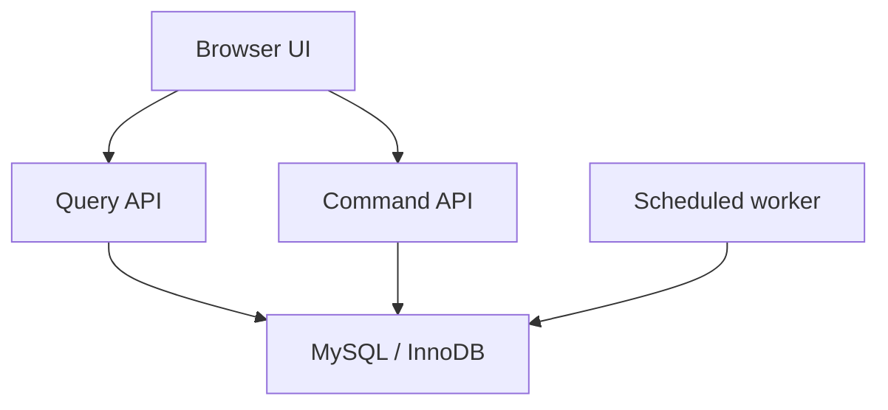
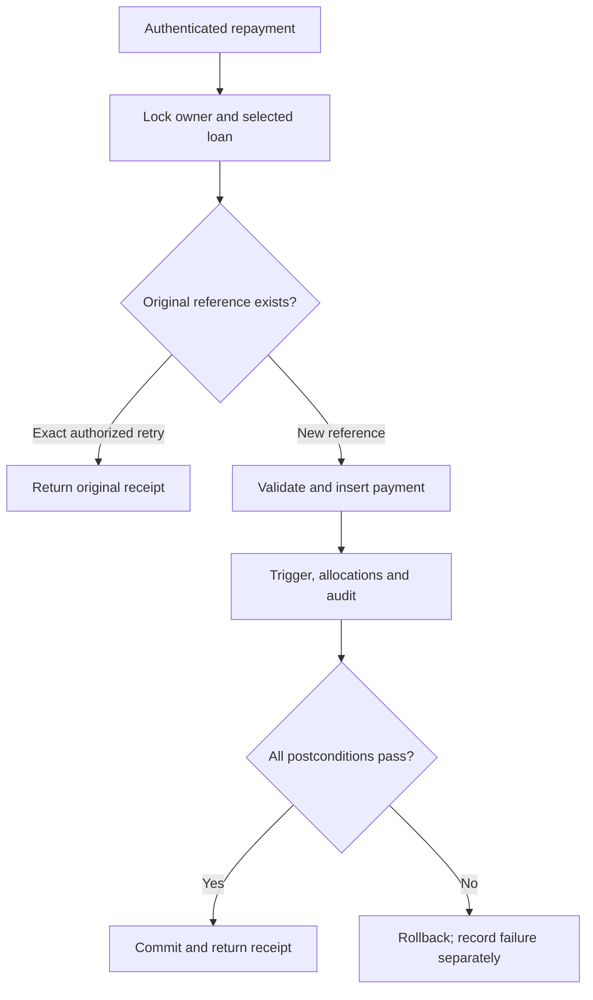

# Micro-Lending Platform — Technical Design Document

Prepared for: CS 437 Micro-Lending Platform project team  
Course: 01:198:437 — Database Implementation  
Date: October 14, 2026  
Version: 1.1  
Repository location: `docs/Technical_Design_Document.md`  
Requirements baseline: `Functional_Requirements_Document.md`, revision 1.1, October 7, 2026  
Baseline SHA-256: `f8dfec6f6f20c04513f7438ec17c4816d1b65253f81c7ee43e4d29271b702b32`

**Contents**

1. [Design Purpose and FRD Alignment](#1-design-purpose-and-frd-alignment)
2. [System Architecture](#2-system-architecture)
3. [Technology Stack and DBMS Selection](#3-technology-stack-and-dbms-selection)
4. [Data Model, Entity Definitions, and Data Dictionary](#4-data-model-entity-definitions-and-data-dictionary)
5. [Relationship Design and Cardinality](#5-relationship-design-and-cardinality)
6. [Relational Schema Summary](#6-relational-schema-summary)
7. [Normalization to Third Normal Form](#7-normalization-to-third-normal-form)
8. [Reference Data and Controlled Domains](#8-reference-data-and-controlled-domains)
9. [Business Rule Enforcement](#9-business-rule-enforcement)
10. [Lifecycle and State-Transition Design](#10-lifecycle-and-state-transition-design)
11. [Transaction Design and Atomicity](#11-transaction-design-and-atomicity)
12. [Stored Procedures, Functions, and Triggers](#12-stored-procedures-functions-and-triggers)
13. [Security Architecture, Roles, and Entitlements](#13-security-architecture-roles-and-entitlements)
14. [Audit and History Design](#14-audit-and-history-design)
15. [Views, Queries, and Reporting Design](#15-views-queries-and-reporting-design)
16. [Index and Performance Design](#16-index-and-performance-design)
17. [Data Integrity, Resiliency, and Recovery](#17-data-integrity-resiliency-and-recovery)
18. [Data Flow](#18-data-flow)
19. [Scalability and Growth Considerations](#19-scalability-and-growth-considerations)
20. [Database Build and Repository Design](#20-database-build-and-repository-design)
21. [Testing Strategy and Test Cases](#21-testing-strategy-and-test-cases)
22. [Final Demonstration Plan](#22-final-demonstration-plan)
23. [Full Requirements Traceability Matrix](#23-full-requirements-traceability-matrix)
24. [Open Design Issues / FRD Clarifications](#24-open-design-issues--frd-clarifications)

## 1. Design Purpose and FRD Alignment

This document specifies the database implementation of the revised Micro-Lending Platform FRD. It defines tables, constraints, trusted operations, access rules, audit records, reports, indexes, test cases, and reproducible demonstration evidence. The professor’s requirements determine the deliverables; FRD 1.1 determines business behavior. References such as FR-13 and AC-29 always refer to that revision.

The baseline permits multiple concurrent requests and outstanding loans per Borrower, multiple contributions by the same Lender to one eligible open request, and lender access to identifiers, schedules, and delinquency for loans they funded. This design preserves those changes. Affordability combines external obligations with the largest remaining/proposed installments of other loans/live requests; current delinquency is checked again before approval and every new contribution. It does not restore the former one-loan or one-contribution restrictions.

All monetary activity is fictional and interest-free. Wallets, real payments, lender payouts, partial activation, monetary reversals, refinancing, write-offs, production disaster recovery, replication/failover, and external credit models remain outside scope. Exactly one loan may arise from each fully funded request; that is a request-to-loan constraint, not a borrower loan-count limit.

The document is an implementation blueprint. Test cases and execution plans below are planned evidence, not claims of implemented or passing software. The final ERD, SQL build scripts, and diagram source/export files are subsequent deliverables. The companion design review records source coverage and the course-template crosswalk. [P01–P04]

## 2. System Architecture

Use one repository, one MySQL application schema, and a small Python application package with two service entrypoints: **Command API** for authenticated changes and **Query API** for reads. They share validation, authentication, encryption, and database-access modules. This implements the course’s extraction/update service expectation without separate databases or distributed transactions. A lightweight scheduled worker from the same package performs assessment, expiration, and delinquency evaluation through a separate technical account. The UI and both APIs share one HTTPS origin; no message broker, service discovery, or saga is required. [P04, P11]



The browser sends a target identifier and intended action, never an authoritative actor or role. A signed, expiring, Secure/HttpOnly/SameSite session cookie identifies a successfully authenticated User. Every protected request reloads current account status and role membership; role claims in a cookie or browser form are not accepted. The service adds the verified actor to parameterized procedure calls. Both service code and routines enforce record ownership or Applied lender participation. MySQL runtime credentials are available only to the services, not human users.

A business transaction uses one checked-out connection from validation/locking through audit and COMMIT. The application owns this transaction envelope because protected inputs are decrypted/encrypted in trusted application memory. Mutation procedures require an active transaction, never independently commit, and perform a complete named action rather than expose arbitrary UPDATE capabilities. Any exception causes an explicit whole-transaction ROLLBACK; the pool discards unusable connections. No transaction spans user think time, manual review, or waiting for lenders. Section 11 defines the exact preparation and finalization protocol.

Query procedures expose explicit result columns. General reporting views are implementation helpers, not substitutes for caller scoping. The Query API never serializes internal encrypted-input preparation results into an HTTP response. The scheduled worker cannot call user funding or repayment operations. Read and write services both derive identity from the trusted session; technical privileges separate their database capabilities.

## 3. Technology Stack and DBMS Selection

| Component | Selection | Project reason / implementation contract |
| --- | --- | --- |
| DBMS | MySQL Community Server 8.4 LTS; InnoDB for every application and build table | Course-required MySQL; FK/UNIQUE/CHECK support, ACID transactions, locking reads, routines, triggers, views, roles, and EXPLAIN. Exact tested 8.4 patch and container digest are recorded in the release environment manifest. |
| Application | Python 3.12, FastAPI, Uvicorn, MySQL Connector/Python | Two small service entrypoints with shared business modules; parameterized SQL and explicit connection/transaction ownership. Dependencies are exact-version locked at implementation release. |
| UI | Basic HTML/CSS and JavaScript served under the API origin | Demonstrates FR-33; amount fields submit decimal strings and show operation references/receipts. No required SPA framework. |
| Security libraries | `argon2-cffi` for password hashes; `cryptography` AESGCM for private fields; signed session middleware | Keys supplied outside source control. Readable data is returned only after authorization. Use supported versions recorded in the lock file. |
| Modeling/docs | GitHub Markdown; draw.io source and SVG exports for subsequent diagrams | Matches course repository requirements; this document is the schema blueprint, not the final ERD. |
| Development/demo | Docker Compose or an equivalent local MySQL 8.4 installation; mysql client and MySQL Workbench | Same tagged artifacts on Linux/macOS/Windows; one documented build entrypoint. |
| Verification | pytest integration harness, two independent DB connections for races, mysql metadata/EXPLAIN output | Tests actual MySQL behavior rather than substituting SQLite. |

Require strict SQL mode, including strict numeric/date handling and `ONLY_FULL_GROUP_BY`; disable application use of multi-statements and `LOCAL INFILE`. Configure TLS with certificate verification for API–MySQL connections and HTTPS for browser traffic. Set `innodb_flush_log_at_trx_commit=1`; retain `sync_binlog=1` when binary logging is enabled. These are durability choices, not a backup or failover system. Runtime accounts receive neither DDL nor general table-write privileges.

MySQL CHECK constraints handle row-local conditions; aggregate funding/repayment limits need transactions. Locking reads are made within transactions, and routines execute with an explicitly provisioned least-privilege definer. MySQL triggers run within the invoking transaction and cannot commit it. DDL has implicit-commit behavior, so the build runner cannot promise one rollback for a partially built schema. These limitations directly shape Sections 9–12 and 20. [M01–M06]

## 4. Data Model, Entity Definitions, and Data Dictionary

The design has **23 application tables and two build-evidence tables**. The additional snapshot, condition, receipt, and audit-detail tables implement requirements already present in FRD 1.1; they are not new lending products.

| Entity | FRD Basis | Purpose | Entity Type |
| --- | --- | --- | --- |
| User | FR-01–FR-04; BR-01, BR-03; SEC-01 | Application identity, account status, and the existing row used to serialize a borrower’s exposure changes. | Strong |
| Role | FR-02; SEC-06, SEC-13 | The four human business roles. | Lookup/reference |
| UserRole | FR-02; BR-01, BR-03; SEC-14 | Retained grant/revocation episodes with at most one active membership per pair. | Associative/history |
| BorrowerProfile | FR-05; BR-01, BR-05; SEC-02, SEC-12 | Current protected income and external monthly obligations. | Dependent 1:1 |
| PolicyVersion | FR-06–FR-09; BR-05–BR-07; AS-03, AS-06, AS-13 | Immutable release policy with a unique effective start. | Lookup/reference |
| PolicyInstallmentOption | BR-05, BR-13; AS-03 | Normalized permitted installment counts for a policy. | Associative/reference |
| LoanRequest | FR-06–FR-16, FR-24; BR-04–BR-13, BR-19 | One draft/submitted funding request; accepted terms remain here after activation. | Strong |
| RequestSnapshot | FR-07, FR-08; BR-06, BR-07; SEC-12 | Frozen private inputs; separates historical inputs from the mutable profile. | Dependent/history 1:1 |
| EligibilityCheck | FR-07–FR-09, FR-12; BR-04, BR-06, BR-07 | Identifies an immutable exposure observation at submission or a later current-eligibility check. | History/supporting |
| ExposureComponent | BR-04, BR-06, BR-07; AC-29 | One other request or loan considered by a retained check. | Weak/history |
| EligibilityCondition | FR-08, FR-09, FR-12; BR-07 | Separate condition outcomes and stable reason codes. | Dependent/history |
| Assessment | FR-08; BR-07, BR-08 | One completed automated assessment per request. | History |
| ReviewDecision | FR-09; BR-08 | One final manual approval/rejection and its current-check context. | History |
| OperationReceipt | FR-30; BR-20; AC-15, AC-16 | Caller-scoped identity of one committed funding/repayment action and its original response. | Technical/history |
| FundingCommitment | FR-12–FR-16; BR-09–BR-12, BR-20 | One initial or additional promise, not one row per lender/request pair. | Associative/event |
| Loan | FR-14–FR-22; BR-12–BR-18 | One activated obligation, with lifecycle and latest observation. | Strong with required 1:1 origin |
| Installment | FR-15, FR-18, FR-19; BR-13–BR-17 | One immutable scheduled obligation identified within its loan. | Weak/dependent |
| Repayment | FR-17–FR-21, FR-30; BR-14–BR-16, BR-20 | One posted payment against exactly one loan. | Event/dependent |
| RepaymentAllocation | FR-18, FR-21; BR-02, BR-15 | Amount of one repayment assigned to one installment of the same loan. | Associative/dependent |
| OversightNote | FR-23; BR-25; SEC-06 | Append-only administrative follow-up or correction. | History |
| AuditEvent | FR-28; Section 9.2; SEC-08, SEC-10, SEC-11 | Append-only attributable event or observed failed/denied attempt. | Audit/history |
| AuditChange | FRD Section 9.2; SEC-11, SEC-12 | Normalized changed-field context for an audit event. | Dependent/audit |
| ControlledValue | FR-29; BR-19, BR-22; AS-13 | Release-controlled code labels and display ordering. | Lookup/reference |
| build_admin.BuildRun | C-05; build-script course material | Separate operational evidence for one tagged build; not a lending entity. | Technical history |
| build_admin.BuildStep | C-05; build-script course material | Per-script execution evidence without repeating build metadata. | Technical dependent |

### 4.1 Conventions

**FRD Explicit** is a stated business fact; **FRD Derived** is needed to enforce a stated rule; **Technical Key** identifies a record/relationship; **Technical Metadata** supports concurrency, security, or reproducibility. These are the classification meanings used in every dictionary below.

All application tables use InnoDB. IDs are `BIGINT UNSIGNED` unless a composite key is specified. Text uses `utf8mb4`; code/login/operation-reference comparisons use `utf8mb4_0900_bin` and exact canonical spelling. String FK columns use identical character sets/collations at both ends. SQL identifiers use the exact dictionary spelling and are backtick-quoted in build scripts. All timestamps are server-controlled UTC `DATETIME(6)`; due dates are UTC calendar `DATE`s. Set every connection time zone to `+00:00`. No money uses floating point. All ordinary FKs have immediate restrictive behavior, including optional and self-references. Omit ON DELETE/ON UPDATE clauses to use InnoDB’s default NO ACTION, equivalent to RESTRICT; no cascading or SET NULL action is used, including on FK columns participating in CHECK expressions. [M10] Absence of an explicit default means callers must supply a validated value. Timestamp defaults are supplied by controlled routines rather than client values.

Encrypted fields use a versioned binary AES-256-GCM envelope containing key version, 12-byte random nonce, ciphertext, and authentication tag; associated data binds table, field, and owner/key. `VARBINARY(128)` accommodates an encrypted decimal string, and `VARBINARY(512)` accommodates the contact field. Contact input is bounded to 254 UTF-8 bytes; decimal plaintext is bounded by DECIMAL(18,2). Envelope size limits and authorized round trips are verified in TC-SEC13-P01. The key is never stored in these tables.

`CHECK` does not replace `NOT NULL`; its predicates must not accidentally accept an unknown value. Cross-row sums, required child counts, encrypted plaintext validation and state transitions belong in locked routines/trusted service checks, not unsupported subqueries inside CHECK. A CHECK never references an AUTO_INCREMENT column; same-target note correction is procedural. Aggregate/intermediate arithmetic uses DECIMAL(38,2) or integer cents with explicit overflow rejection; stored amounts use DECIMAL(18,2). The `Key/Constraint` column identifies every declared FK; matching-request and owner relationships that require procedure validation are explicitly described. [M01]

### 4.2 User

Application identity, account status, and the existing row used to serialize a borrower’s exposure changes. Basis: FR-01–FR-04; BR-01, BR-03; SEC-01.

| Attribute | Classification | MySQL Type | Null? | Key/Constraint | Purpose / FRD Basis |
| --- | --- | --- | --- | --- | --- |
| UserID | Technical Key | `BIGINT UNSIGNED` | No | PK; AUTO_INCREMENT | Stable application identity; also exposed as BorrowerID when this user owns a request. |
| LoginName | FRD Explicit | `VARCHAR(80)` | No | UNIQUE; binary collation | Case-sensitive login; no uniqueness rule on private email. |
| DisplayName | FRD Explicit | `VARCHAR(120)` | No | Nonblank | Account display information, not the marketplace alias. |
| PublicAlias | FRD Derived | `VARCHAR(40)` | No | UNIQUE; nonblank | Random nonidentifying marketplace alias; never generated from email/name. |
| PrivateEmailCipher | FRD Explicit | `VARBINARY(512)` | No | Authenticated-encryption envelope | SEC-12 protected contact value. |
| PasswordHash | Technical Metadata | `VARCHAR(255)` | No | Argon2id encoded hash | Local sample-account sign-in; never a readable password or audit value. |
| AccountStatus | FRD Explicit | `VARCHAR(16)` | No | CHECK; default Active | Current account entitlement state. |
| CreatedAt | FRD Explicit | `DATETIME(6)` | No | Server UTC | Account creation time. |
| RowVersion | Technical Metadata | `BIGINT UNSIGNED` | No | Default 0; increment on update | Reject stale profile/account edit inputs and help validate preparation reads. |

**PK:** UserID. **Alternate/unique keys:** LoginName; PublicAlias. **Validation:** AccountStatus in Active/Restricted/Inactive; trimmed LoginName and DisplayName nonempty.

Administrative procedures audit account creation/status changes. UserID is never changed; no operational DELETE. The User row is locked even when no profile or loan exists, so first submissions have a stable lock target.

### 4.3 Role

The four human business roles. Basis: FR-02; SEC-06, SEC-13.

| Attribute | Classification | MySQL Type | Null? | Key/Constraint | Purpose / FRD Basis |
| --- | --- | --- | --- | --- | --- |
| RoleCode | FRD Explicit | `VARCHAR(16)` | No | PK; CHECK | Canonical business role name. |
| Description | FRD Derived | `VARCHAR(255)` | No | Nonblank | Responsibility described in FRD Section 4. |

**PK:** RoleCode. **Alternate/unique keys:** None. **Validation:** RoleCode in Borrower/Lender/Administrator/Auditor.

System operations is a technical identity, never a Role row. Role definitions are release-managed and immutable at runtime.

### 4.4 UserRole

Retained grant/revocation episodes with at most one active membership per pair. Basis: FR-02; BR-01, BR-03; SEC-14.

| Attribute | Classification | MySQL Type | Null? | Key/Constraint | Purpose / FRD Basis |
| --- | --- | --- | --- | --- | --- |
| UserRoleID | Technical Key | `BIGINT UNSIGNED` | No | PK; AUTO_INCREMENT | Identity of one membership episode. |
| UserID | Technical Key | `BIGINT UNSIGNED` | No | FK User.UserID | Member. |
| RoleCode | Technical Key | `VARCHAR(16)` | No | FK Role.RoleCode | Assigned business role. |
| GrantedAt | FRD Explicit | `DATETIME(6)` | No | Server UTC | Assignment time. |
| GrantedByUserID | FRD Explicit | `BIGINT UNSIGNED` | Yes | FK User.UserID | Administrator; NULL only for documented initial bootstrap. |
| RevokedAt | FRD Explicit | `DATETIME(6)` | Yes | Paired-null CHECK | Revocation time; NULL means active membership. |
| RevokedByUserID | FRD Explicit | `BIGINT UNSIGNED` | Yes | FK User.UserID | Revoking Administrator. |
| ActiveMarker | Technical Metadata | `TINYINT` | Generated nullable | VIRTUAL generated; UNIQUE component | IF(RevokedAt IS NULL,1,NULL), allowing many revoked episodes and one active episode. |

**PK:** UserRoleID. **Alternate/unique keys:** (UserID,RoleCode,ActiveMarker). **Validation:** RevokedAt and RevokedByUserID both NULL or both present; RevokedAt >= GrantedAt.

Forbidden role combinations and removal with outstanding participation are checked while locking the target User; a new grant creates a new episode, never erases an earlier one.

### 4.5 BorrowerProfile

Current protected income and external monthly obligations. Basis: FR-05; BR-01, BR-05; SEC-02, SEC-12.

| Attribute | Classification | MySQL Type | Null? | Key/Constraint | Purpose / FRD Basis |
| --- | --- | --- | --- | --- | --- |
| UserID | Technical Key | `BIGINT UNSIGNED` | No | PK; FK User.UserID | Exactly one current profile per user. |
| MonthlyIncomeCipher | FRD Explicit | `VARBINARY(128)` | No | Encrypted decimal envelope | Self-reported fictional monthly income. |
| ExternalObligationsCipher | FRD Explicit | `VARBINARY(128)` | No | Encrypted decimal envelope | Monthly obligations outside the platform only. |
| UpdatedAt | FRD Explicit | `DATETIME(6)` | No | Server UTC | Latest profile change. |
| RowVersion | Technical Metadata | `BIGINT UNSIGNED` | No | Default 0 | Expected-version check prevents stale preparation/update. |

**PK:** UserID. **Alternate/unique keys:** None. **Validation:** Plaintext income > 0 and external obligations >= 0 validated before encryption; required envelopes nonempty.

No plaintext duplicate columns or searchable hashes of financial values. Profile creation requires Borrower role; current profile edits never alter RequestSnapshot.

### 4.6 PolicyVersion

Immutable release policy with a unique effective start. Basis: FR-06–FR-09; BR-05–BR-07; AS-03, AS-06, AS-13.

| Attribute | Classification | MySQL Type | Null? | Key/Constraint | Purpose / FRD Basis |
| --- | --- | --- | --- | --- | --- |
| PolicyVersionID | Technical Key | `BIGINT UNSIGNED` | No | PK; AUTO_INCREMENT | Referenced policy identity. |
| VersionLabel | FRD Explicit | `VARCHAR(32)` | No | UNIQUE | D1 in the demonstration. |
| EffectiveFrom | FRD Derived | `DATETIME(6)` | No | UNIQUE; release UTC | Inclusive start; effective end is the next version’s start, if any. |
| MinimumPrincipal | FRD Explicit | `DECIMAL(18,2)` | No | CHECK > 0 | D1: 100.00. |
| MaximumPrincipal | FRD Explicit | `DECIMAL(18,2)` | No | CHECK >= minimum | D1: 2000.00. |
| FundingWindowDays | FRD Explicit | `SMALLINT UNSIGNED` | No | CHECK > 0 | D1: 14 exact calendar days from approval. |
| AssessmentRuleCode | FRD Derived | `VARCHAR(32)` | No | CHECK = CombinedExposureV1 | Names the FRD 1.1 formula; no configurable scoring engine. |

**PK:** PolicyVersionID. **Alternate/unique keys:** VersionLabel; EffectiveFrom. **Validation:** MinimumPrincipal > 0; MaximumPrincipal >= MinimumPrincipal; FundingWindowDays > 0.

Submission selects the version with greatest EffectiveFrom not after its captured time. EffectiveFrom is unique; a new controlled-release row supersedes the prior version without editing it. There is no stored EffectiveTo requiring mutation of an already-used policy. Existing requests retain their FK and original terms.

### 4.7 PolicyInstallmentOption

Normalized permitted installment counts for a policy. Basis: BR-05, BR-13; AS-03.

| Attribute | Classification | MySQL Type | Null? | Key/Constraint | Purpose / FRD Basis |
| --- | --- | --- | --- | --- | --- |
| PolicyVersionID | Technical Key | `BIGINT UNSIGNED` | No | PK part; FK PolicyVersion.PolicyVersionID | Owning policy. |
| InstallmentCount | FRD Explicit | `SMALLINT UNSIGNED` | No | PK part; CHECK > 0 | One allowed count per row, not a CSV list. |

**PK:** (PolicyVersionID,InstallmentCount). **Alternate/unique keys:** None. **Validation:** InstallmentCount > 0; D1 seed contains exactly 3 and 6.


### 4.8 LoanRequest

One draft/submitted funding request; accepted terms remain here after activation. Basis: FR-06–FR-16, FR-24; BR-04–BR-13, BR-19.

| Attribute | Classification | MySQL Type | Null? | Key/Constraint | Purpose / FRD Basis |
| --- | --- | --- | --- | --- | --- |
| RequestID | FRD Explicit | `BIGINT UNSIGNED` | No | PK; AUTO_INCREMENT | Stable request identifier. |
| BorrowerID | FRD Explicit | `BIGINT UNSIGNED` | No | FK User.UserID | Owner; assigned from trusted session. |
| Purpose | FRD Explicit | `VARCHAR(1000)` | No | Nonblank | Borrower-supplied request purpose. |
| Principal | FRD Explicit | `DECIMAL(18,2)` | No | CHECK > 0; policy bounds in procedure | Requested principal, frozen after submission. |
| InstallmentCount | FRD Explicit | `SMALLINT UNSIGNED` | No | CHECK > 0; policy-option FK when submitted | Accepted repayment term. |
| PolicyVersionID | Technical Key | `BIGINT UNSIGNED` | Yes | FK PolicyVersion; composite FK with InstallmentCount to PolicyInstallmentOption | NULL until submission fixes the effective policy. |
| RequestState | FRD Explicit | `VARCHAR(20)` | No | CHECK; default Draft | Draft/Submitted/PendingReview/OpenFunding/Funded/Rejected/Cancelled/Expired. |
| CreatedAt | FRD Explicit | `DATETIME(6)` | No | Server UTC | Request creation. |
| SubmittedAt | FRD Explicit | `DATETIME(6)` | Yes | Set once by submission | Snapshot time, not editable client time. |
| FundingDeadlineAt | FRD Explicit | `DATETIME(6)` | Yes | Required for OpenFunding/Funded/Expired | Fixed approval time plus policy window; not extended after blocking. |
| TerminalReason | FRD Explicit | `VARCHAR(1000)` | Yes | Required for Cancelled/Rejected/Expired | Controlled procedure supplies the reason; no financial correction. |
| RowVersion | Technical Metadata | `BIGINT UNSIGNED` | No | Default 0 | Draft edit and stale-action detection. |

**PK:** RequestID. **Alternate/unique keys:** None; deliberately no unique BorrowerID. **Validation:** Principal > 0; InstallmentCount > 0; purpose nonblank; lifecycle whitelist; non-Draft/non-draft-cancelled rows require submitted snapshot; timestamp/state relationships in Section 10.

A Draft still obeys current D1 numeric/input validation; it may require a different effective policy at submission. A cancelled unsubmitted Draft may retain NULL policy/submission. A Submitted request must have exactly one RequestSnapshot and one Submission EligibilityCheck at commit, enforced by its transaction.

### 4.9 RequestSnapshot

Frozen private inputs; separates historical inputs from the mutable profile. Basis: FR-07, FR-08; BR-06, BR-07; SEC-12.

| Attribute | Classification | MySQL Type | Null? | Key/Constraint | Purpose / FRD Basis |
| --- | --- | --- | --- | --- | --- |
| RequestID | Technical Key | `BIGINT UNSIGNED` | No | PK; FK LoanRequest.RequestID | Exactly one snapshot for a submitted request. |
| MonthlyIncomeCipher | FRD Explicit | `VARBINARY(128)` | No | Immutable encrypted decimal | Income retained for this request and later rechecks. |
| ExternalObligationsCipher | FRD Explicit | `VARBINARY(128)` | No | Immutable encrypted decimal | External obligations retained for this request. |

**PK:** RequestID. **Alternate/unique keys:** None. **Validation:** Both envelopes nonempty; only inserted in submission transaction.

Submission time and policy come from LoanRequest, not duplicate columns. Exposure components are separate child rows of EligibilityCheck; no JSON array of loan IDs.

### 4.10 EligibilityCheck

Identifies an immutable exposure observation at submission or a later current-eligibility check. Basis: FR-07–FR-09, FR-12; BR-04, BR-06, BR-07.

| Attribute | Classification | MySQL Type | Null? | Key/Constraint | Purpose / FRD Basis |
| --- | --- | --- | --- | --- | --- |
| CheckID | Technical Key | `BIGINT UNSIGNED` | No | PK; AUTO_INCREMENT | Evidence reference for components and outcomes. |
| RequestID | Technical Key | `BIGINT UNSIGNED` | No | FK LoanRequest.RequestID | Candidate request; never treated as another exposure component. |
| CheckKind | FRD Derived | `VARCHAR(16)` | No | CHECK | Technical checkpoint, not a request lifecycle status. |
| CheckSequence | Technical Metadata | `INT UNSIGNED` | No | UNIQUE component; CHECK | Zero gives one submission snapshot; later sequences allocated under borrower lock. |
| EvaluatedAt | FRD Explicit | `DATETIME(6)` | No | Server UTC | Time of the retained platform facts. |
| ContextID | Technical Metadata | `BINARY(16)` | No | Correlation identifier | Links the attempt and audit even when its business action is rejected. |

**PK:** CheckID. **Alternate/unique keys:** (RequestID,CheckKind,CheckSequence). **Validation:** CheckKind in Submission/Review/Funding; CheckSequence = 0 for Submission, > 0 otherwise.

Submission components are frozen before assessment; assessment subsequently appends its two EligibilityCondition rows. Review/Funding checks include conditions immediately. Failed current checks are persisted in a separate failure transaction after rollback, using captured observations rather than silently recomputing later state.

### 4.11 ExposureComponent

One other request or loan considered by a retained check. Basis: BR-04, BR-06, BR-07; AC-29.

| Attribute | Classification | MySQL Type | Null? | Key/Constraint | Purpose / FRD Basis |
| --- | --- | --- | --- | --- | --- |
| CheckID | Technical Key | `BIGINT UNSIGNED` | No | PK part; FK EligibilityCheck.CheckID | Owning observation. |
| ComponentNumber | Technical Key | `INT UNSIGNED` | No | PK part; CHECK > 0 | Local component identity. |
| SourceRequestID | FRD Explicit | `BIGINT UNSIGNED` | Yes | FK LoanRequest.RequestID; unique within check | Other Submitted/PendingReview/OpenFunding request. |
| SourceLoanID | FRD Explicit | `BIGINT UNSIGNED` | Yes | FK Loan.LoanID; unique within check | Other Active loan. |
| MonthlyBurdenCipher | FRD Derived | `VARBINARY(128)` | No | Encrypted historical decimal | Largest proposed/remaining installment at evaluation time. |
| ObservedCondition | FRD Derived | `VARCHAR(16)` | Yes | Conditional CHECK | Loan condition at that time; never read as current status. |

**PK:** (CheckID,ComponentNumber). **Alternate/unique keys:** (CheckID,SourceRequestID); (CheckID,SourceLoanID), with NULL permitted on the unused branch. **Validation:** Exactly one source ID non-NULL; ComponentNumber > 0; ObservedCondition NULL for request, Current/Delinquent for loan.

Procedure excludes the candidate, validates ownership/state at observation time, and prevents recording both a funded request and its resulting loan. Future source changes do not rewrite this historical fact. Add the Loan FK after Loan exists in build order.

### 4.12 EligibilityCondition

Separate condition outcomes and stable reason codes. Basis: FR-08, FR-09, FR-12; BR-07.

| Attribute | Classification | MySQL Type | Null? | Key/Constraint | Purpose / FRD Basis |
| --- | --- | --- | --- | --- | --- |
| CheckID | Technical Key | `BIGINT UNSIGNED` | No | PK part; FK EligibilityCheck.CheckID | Check being explained. |
| ConditionCode | FRD Derived | `VARCHAR(32)` | No | PK part; CHECK | One row per required condition, with labels from ControlledValue. |
| IsSatisfied | FRD Derived | `TINYINT UNSIGNED` | No | CHECK in (0,1) | False names a failed condition; no copied descriptive text. |

**PK:** (CheckID,ConditionCode). **Alternate/unique keys:** None. **Validation:** ConditionCode in Affordability/NoOutstandingDelinquency; IsSatisfied in 0/1.

Exactly two rows are required for a completed check. A completed Assessment is Pass iff both are true; authorized private drill-down derives the numeric explanation from retained inputs and components.

### 4.13 Assessment

One completed automated assessment per request. Basis: FR-08; BR-07, BR-08.

| Attribute | Classification | MySQL Type | Null? | Key/Constraint | Purpose / FRD Basis |
| --- | --- | --- | --- | --- | --- |
| AssessmentID | FRD Explicit | `BIGINT UNSIGNED` | No | PK; AUTO_INCREMENT | Stable result identifier. |
| RequestID | Technical Key | `BIGINT UNSIGNED` | No | UNIQUE; FK LoanRequest.RequestID | At most one completed result per request. |
| CheckID | Technical Key | `BIGINT UNSIGNED` | No | UNIQUE; FK EligibilityCheck.CheckID | Must be that request’s Submission check. |
| Outcome | FRD Explicit | `VARCHAR(8)` | No | CHECK | Stored assessment decision, supported by condition rows. |
| AssessedAt | FRD Explicit | `DATETIME(6)` | No | Server UTC | Completion time, distinct from frozen input time. |

**PK:** AssessmentID. **Alternate/unique keys:** RequestID; CheckID. **Validation:** Outcome in Pass/Fail.

Procedure validates matching RequestID/CheckID and exactly two conditions. A failure leaves no Assessment; it does not become a business Fail result.

### 4.14 ReviewDecision

One final manual approval/rejection and its current-check context. Basis: FR-09; BR-08.

| Attribute | Classification | MySQL Type | Null? | Key/Constraint | Purpose / FRD Basis |
| --- | --- | --- | --- | --- | --- |
| DecisionID | Technical Key | `BIGINT UNSIGNED` | No | PK; AUTO_INCREMENT | Stable manual decision. |
| RequestID | Technical Key | `BIGINT UNSIGNED` | No | UNIQUE; FK LoanRequest.RequestID | At most one final review. |
| CheckID | Technical Key | `BIGINT UNSIGNED` | No | UNIQUE; FK EligibilityCheck.CheckID | Matching Review check; rejection may proceed even when it fails. |
| AdministratorID | FRD Explicit | `BIGINT UNSIGNED` | No | FK User.UserID | Authenticated reviewer. |
| Decision | FRD Explicit | `VARCHAR(8)` | No | CHECK | Approve or Reject. |
| Reason | FRD Explicit | `VARCHAR(1000)` | No | Nonblank | Review explanation. |
| DecidedAt | FRD Explicit | `DATETIME(6)` | No | Server UTC | Approval time is the funding-window origin. |

**PK:** DecisionID. **Alternate/unique keys:** RequestID; CheckID. **Validation:** Decision in Approve/Reject; Reason nonblank.

Only Approve requires current eligibility Pass. A blocked approval creates no final ReviewDecision and leaves PendingReview available for a later valid attempt.

### 4.15 OperationReceipt

Caller-scoped identity of one committed funding/repayment action and its original response. Basis: FR-30; BR-20; AC-15, AC-16.

| Attribute | Classification | MySQL Type | Null? | Key/Constraint | Purpose / FRD Basis |
| --- | --- | --- | --- | --- | --- |
| OperationID | Technical Key | `BIGINT UNSIGNED` | No | PK; AUTO_INCREMENT | Shared identity used by one financial event. |
| CallerUserID | FRD Explicit | `BIGINT UNSIGNED` | No | FK User.UserID; UNIQUE component | Authenticated Lender or Borrower. |
| OperationReference | FRD Explicit | `VARCHAR(64)` | No | Binary collation; UNIQUE component | Client-generated opaque reference, unique across both action kinds for this caller. |
| ActionCode | FRD Derived | `VARCHAR(20)` | No | CHECK | Determines expected event table. |
| ReceiptSnapshot | Technical Metadata | `MEDIUMBLOB` | Yes until transaction finishes | Immutable serialized response at commit | Original receipt/summary for an exact retry; set once before commit. |

**PK:** OperationID. **Alternate/unique keys:** (CallerUserID,OperationReference). **Validation:** ActionCode in CommitFunding/PostRepayment; Reference length 1–64; response snapshot nonempty at commit.

No separately committed Pending receipt exists. Insert identity, create one event, then fill ReceiptSnapshot in one transaction. Event target/amount are compared through the immutable FundingCommitment or Repayment, not duplicated here. The opaque historical response is justified by exact-result replay; it is not a queryable replacement for normalized records. Runtime cannot edit it after the first fill.

### 4.16 FundingCommitment

One initial or additional promise, not one row per lender/request pair. Basis: FR-12–FR-16; BR-09–BR-12, BR-20.

| Attribute | Classification | MySQL Type | Null? | Key/Constraint | Purpose / FRD Basis |
| --- | --- | --- | --- | --- | --- |
| CommitmentID | FRD Explicit | `BIGINT UNSIGNED` | No | PK; AUTO_INCREMENT | Unique contribution event. |
| RequestID | Technical Key | `BIGINT UNSIGNED` | No | FK LoanRequest.RequestID | Request being funded. |
| OperationID | Technical Key | `BIGINT UNSIGNED` | No | UNIQUE; FK OperationReceipt.OperationID | Lender is derived from its CallerUserID; action must be CommitFunding. |
| CheckID | Technical Key | `BIGINT UNSIGNED` | No | UNIQUE; FK EligibilityCheck.CheckID | Matching passed Funding check. |
| Amount | FRD Explicit | `DECIMAL(18,2)` | No | CHECK > 0 | Immutable contribution amount. |
| CommitmentState | FRD Explicit | `VARCHAR(8)` | No | CHECK; default Pending | Pending/Applied/Released. |
| CreatedAt | FRD Explicit | `DATETIME(6)` | No | Server UTC | Accepted contribution time. |
| AppliedAt | FRD Explicit | `DATETIME(6)` | Yes | Only for Applied | Activation timestamp. |
| ReleasedAt | FRD Explicit | `DATETIME(6)` | Yes | Only for Released | Parent cancellation/expiration time. |

**PK:** CommitmentID. **Alternate/unique keys:** OperationID; CheckID; explicitly NOT (Lender,Request). **Validation:** Amount > 0; state in Pending/Applied/Released; state/timestamp consistency.

LenderID is a view/API alias for OperationReceipt.CallerUserID, avoiding a duplicate dependency. Procedures validate CheckID.RequestID and action/actor. Multiple events for the same lender/request remain valid and individually auditable.

### 4.17 Loan

One activated obligation, with lifecycle and latest observation. Basis: FR-14–FR-22; BR-12–BR-18.

| Attribute | Classification | MySQL Type | Null? | Key/Constraint | Purpose / FRD Basis |
| --- | --- | --- | --- | --- | --- |
| LoanID | FRD Explicit | `BIGINT UNSIGNED` | No | PK; AUTO_INCREMENT | Stable loan identity. |
| RequestID | Technical Key | `BIGINT UNSIGNED` | No | UNIQUE; FK LoanRequest.RequestID | One loan per fully funded request. |
| ActivatedAt | FRD Explicit | `DATETIME(6)` | No | Server UTC | Schedule origin. |
| LoanState | FRD Explicit | `VARCHAR(8)` | No | CHECK; default Active | Active or Repaid, never Delinquent as a lifecycle state. |
| CompletedAt | FRD Explicit | `DATETIME(6)` | Yes | Paired with Repaid | Set exactly once by repayment trigger. |
| ObservedCondition | FRD Explicit | `VARCHAR(16)` | No | CHECK; initial Current | Last detected payment condition. |
| LastEvaluatedAt | FRD Explicit | `DATETIME(6)` | No | Initial activation time | Observation freshness; current reports calculate condition anew. |

**PK:** LoanID. **Alternate/unique keys:** RequestID. **Validation:** State Active/Repaid; completion NULL iff Active; observed condition Current/Delinquent.

Borrower, principal, installment count, and policy come from LoanRequest; no duplicate loan terms or current balance columns. Every committed loan has all required installments.

### 4.18 Installment

One immutable scheduled obligation identified within its loan. Basis: FR-15, FR-18, FR-19; BR-13–BR-17.

| Attribute | Classification | MySQL Type | Null? | Key/Constraint | Purpose / FRD Basis |
| --- | --- | --- | --- | --- | --- |
| LoanID | Technical Key | `BIGINT UNSIGNED` | No | PK part; FK Loan.LoanID | Identifying parent. |
| InstallmentNumber | FRD Explicit | `SMALLINT UNSIGNED` | No | PK part; CHECK > 0 | Ordinal unique only within this loan. |
| DueDate | FRD Explicit | `DATE` | No | UNIQUE within loan | UTC calendar due date. |
| ScheduledPrincipal | FRD Explicit | `DECIMAL(18,2)` | No | CHECK > 0 | Fixed installment obligation. |

**PK:** (LoanID,InstallmentNumber). **Alternate/unique keys:** (LoanID,DueDate). **Validation:** InstallmentNumber > 0; ScheduledPrincipal > 0.

No global InstallmentID. Paid/remaining amounts and overdue condition are derived from allocations. Parent Loan cannot be deleted; schedule rows cannot be altered after activation.

### 4.19 Repayment

One posted payment against exactly one loan. Basis: FR-17–FR-21, FR-30; BR-14–BR-16, BR-20.

| Attribute | Classification | MySQL Type | Null? | Key/Constraint | Purpose / FRD Basis |
| --- | --- | --- | --- | --- | --- |
| LoanID | Technical Key | `BIGINT UNSIGNED` | No | PK part; FK Loan.LoanID | Explicitly selected owned loan. |
| RepaymentNumber | Technical Key | `INT UNSIGNED` | No | PK part; CHECK > 0 | Next local sequence allocated while Loan is locked. |
| OperationID | Technical Key | `BIGINT UNSIGNED` | No | UNIQUE; FK OperationReceipt.OperationID | Caller is the owning Borrower; action PostRepayment. |
| Amount | FRD Explicit | `DECIMAL(18,2)` | No | CHECK > 0 | Immutable posted amount. |
| PostedAt | FRD Explicit | `DATETIME(6)` | No | Server UTC | Users cannot supply or change this time. |

**PK:** (LoanID,RepaymentNumber). **Alternate/unique keys:** OperationID. **Validation:** RepaymentNumber > 0; Amount > 0; no mutable repayment status.

The public FRD RepaymentID is the stable composite identifier (LoanID,RepaymentNumber), rendered e.g. `501/2`. This is an identifier implementation, not a new business concept. Avoiding an additional global RepaymentID keeps allocation LoanID from becoming a redundant dependency. Receipts expose both components and the combined identifier.

### 4.20 RepaymentAllocation

Amount of one repayment assigned to one installment of the same loan. Basis: FR-18, FR-21; BR-02, BR-15.

| Attribute | Classification | MySQL Type | Null? | Key/Constraint | Purpose / FRD Basis |
| --- | --- | --- | --- | --- | --- |
| LoanID | Technical Key | `BIGINT UNSIGNED` | No | PK part; shared component of both FKs | Makes cross-loan linking impossible through the declared keys. |
| RepaymentNumber | Technical Key | `INT UNSIGNED` | No | PK part; composite FK (LoanID,RepaymentNumber) to Repayment | Paying event. |
| InstallmentNumber | Technical Key | `SMALLINT UNSIGNED` | No | PK part; composite FK (LoanID,InstallmentNumber) to Installment | Receiving obligation. |
| AllocatedPrincipal | FRD Explicit | `DECIMAL(18,2)` | No | CHECK > 0 | Depends on the full repayment/installment pair. |

**PK:** (LoanID,RepaymentNumber,InstallmentNumber). **Alternate/unique keys:** None. **Validation:** AllocatedPrincipal > 0; total/cap checks in locked payment transaction.

The two composite FKs enforce same-loan integrity without a trigger or repeated borrower ID. Procedure ensures positive allocations sum to the payment and do not exceed installment remainders.

### 4.21 OversightNote

Append-only administrative follow-up or correction. Basis: FR-23; BR-25; SEC-06.

| Attribute | Classification | MySQL Type | Null? | Key/Constraint | Purpose / FRD Basis |
| --- | --- | --- | --- | --- | --- |
| NoteID | Technical Key | `BIGINT UNSIGNED` | No | PK; AUTO_INCREMENT | Stable note. |
| RequestID | Technical Key | `BIGINT UNSIGNED` | Yes | FK LoanRequest.RequestID; XOR target | Request target. |
| LoanID | Technical Key | `BIGINT UNSIGNED` | Yes | FK Loan.LoanID; XOR target | Loan target. |
| AdministratorID | FRD Explicit | `BIGINT UNSIGNED` | No | FK User.UserID | Author. |
| CreatedAt | FRD Explicit | `DATETIME(6)` | No | Server UTC | Append time. |
| NoteText | FRD Explicit | `TEXT` | No | Nonblank | Internal follow-up; excluded from lender/borrower responses. |
| CorrectsNoteID | FRD Explicit | `BIGINT UNSIGNED` | Yes | FK OversightNote.NoteID | Earlier note on exactly the same target. |

**PK:** NoteID. **Alternate/unique keys:** None. **Validation:** Exactly one RequestID/LoanID non-NULL; NoteText nonblank. The procedure rejects self/cross-target correction; a CHECK does not refer to auto-increment NoteID.

Same-target correction uses procedure validation because a self-FK alone does not ensure matching target. Never UPDATE an existing note.

### 4.22 AuditEvent

Append-only attributable event or observed failed/denied attempt. Basis: FR-28; Section 9.2; SEC-08, SEC-10, SEC-11.

| Attribute | Classification | MySQL Type | Null? | Key/Constraint | Purpose / FRD Basis |
| --- | --- | --- | --- | --- | --- |
| AuditEventID | FRD Explicit | `BIGINT UNSIGNED` | No | PK; AUTO_INCREMENT | Stable event ID; gaps after rollback are allowed. |
| OccurredAt | FRD Explicit | `DATETIME(6)` | No | Server UTC | Detection/event time, not an invented commit timestamp. |
| EventType | FRD Explicit | `VARCHAR(40)` | No | CHECK from Section 14 catalogue | Audited operation. |
| Outcome | FRD Explicit | `VARCHAR(12)` | No | CHECK | Success, Denied, Failed, or observed Interrupted. |
| ActorUserID | FRD Explicit | `BIGINT UNSIGNED` | Yes | FK User.UserID | Human actor; NULL for service or unauthenticated attempts. |
| ActingRoleCode | FRD Explicit | `VARCHAR(16)` | Yes | FK Role.RoleCode | Verified business role; NULL where no human role exists. |
| ServiceActor | FRD Explicit | `VARCHAR(24)` | Yes | CHECK approved service names | Automated actor such as assessment or activation. |
| InitiatingUserID | FRD Explicit | `BIGINT UNSIGNED` | Yes | FK User.UserID | Human initiating an automated action when applicable. |
| TechnicalAccount | Technical Metadata | `VARCHAR(288)` | No | Trusted DB connection identity | USER()/SESSION_USER(), not the definer returned by CURRENT_USER(). |
| SubjectType | FRD Explicit | `VARCHAR(32)` | No | CHECK bounded subject catalogue | Business record type or Attempt. |
| SubjectKey | FRD Explicit | `VARCHAR(128)` | No | Canonical scalar/composite serialization | Affected key or attempted target; intentionally not a polymorphic FK. |
| ContextID | Technical Metadata | `BINARY(16)` | No | One value per attempt/action | Groups business effects and failure observation. |
| OperationID | Technical Key | `BIGINT UNSIGNED` | Yes | FK OperationReceipt.OperationID | Committed funding/payment reference, when one exists. |
| AttemptedOperationReference | FRD Derived | `VARCHAR(64)` | Yes | Safe opaque value | Reference for failed actions that have no committed receipt. |
| ReasonCode | FRD Derived | `VARCHAR(40)` | Yes | Bounded error/reason catalogue | Safe outcome explanation without raw private values. |

**PK:** AuditEventID. **Alternate/unique keys:** None. **Validation:** Outcome Success/Denied/Failed/Interrupted; actor/service context and subject type validated by catalogue.

Success routines validate SubjectType/SubjectKey against the actual affected record. An attempted nonexistent target must remain loggable, so this field is explicitly not represented as an invalid multi-table FK. AuditChange carries individual safe prior/new values. No operational UPDATE/DELETE on either table.

### 4.23 AuditChange

Normalized changed-field context for an audit event. Basis: FRD Section 9.2; SEC-11, SEC-12.

| Attribute | Classification | MySQL Type | Null? | Key/Constraint | Purpose / FRD Basis |
| --- | --- | --- | --- | --- | --- |
| AuditEventID | Technical Key | `BIGINT UNSIGNED` | No | PK part; FK AuditEvent.AuditEventID | Owning event. |
| FieldName | FRD Derived | `VARCHAR(64)` | No | PK part; allowlist | Meaning of the change, e.g. RequestState or Amount. |
| OldValue | FRD Explicit | `VARCHAR(1000)` | Yes | Safe scalar encoding | Old nonprivate value; NULL on creation or for sensitive fields. |
| NewValue | FRD Explicit | `VARCHAR(1000)` | Yes | Safe scalar encoding | New nonprivate value; amounts/IDs remain in source records too. |

**PK:** (AuditEventID,FieldName). **Alternate/unique keys:** None. **Validation:** FieldName from the event-specific allowlist; sensitive values NULL on both sides.

No comma-separated ID lists or unstructured raw request bodies. Profile changes log field names only; historical private values remain in protected snapshots where required.

### 4.24 ControlledValue

Release-controlled code labels and display ordering. Basis: FR-29; BR-19, BR-22; AS-13.

| Attribute | Classification | MySQL Type | Null? | Key/Constraint | Purpose / FRD Basis |
| --- | --- | --- | --- | --- | --- |
| DomainCode | FRD Explicit | `VARCHAR(40)` | No | PK part | One bounded domain from Section 8. |
| ValueCode | FRD Explicit | `VARCHAR(40)` | No | PK part | Canonical code, not arbitrary text. |
| DisplayLabel | FRD Explicit | `VARCHAR(120)` | No | Nonblank | UI/report label. |
| DisplayOrder | FRD Derived | `SMALLINT UNSIGNED` | No | UNIQUE within domain; CHECK > 0 | Stable dropdown/report ordering. |

**PK:** (DomainCode,ValueCode). **Alternate/unique keys:** (DomainCode,DisplayOrder). **Validation:** DomainCode/ValueCode nonblank; DisplayOrder > 0.

A versioned domain manifest generates CHECK whitelists and these seed rows; build validation compares both. Status fields use their own CHECK constraints rather than a misleading FK on ValueCode alone. This avoids constant-domain columns in every transactional table. Role and policy options have their own normalized tables. Runtime cannot change/remove used values.

### 4.25 build_admin.BuildRun

Separate operational evidence for one tagged build; not a lending entity. Basis: C-05; build-script course material.

| Attribute | Classification | MySQL Type | Null? | Key/Constraint | Purpose / FRD Basis |
| --- | --- | --- | --- | --- | --- |
| BuildRunID | Technical Key | `BINARY(16)` | No | PK | Runner-generated UUID. |
| RequestedTag | Technical Metadata | `VARCHAR(100)` | No | Nonblank | Requested immutable release label. |
| ResolvedCommit | Technical Metadata | `CHAR(40)` | Yes | Hex SHA when resolved | NULL for failures before source retrieval; no fabricated commit. |
| TargetSchema | Technical Metadata | `VARCHAR(64)` | No | Identifier allowlist | Intended isolated database. |
| StartedAt | Technical Metadata | `DATETIME(6)` | No | UTC | Build start. |
| FinishedAt | Technical Metadata | `DATETIME(6)` | Yes | Completion time | NULL while running. |
| Outcome | Technical Metadata | `VARCHAR(12)` | No | CHECK | Running/Succeeded/Failed. |
| EnvironmentManifest | Technical Metadata | `TEXT` | No | Redacted machine-readable evidence | Exact server/client/tool versions and container digest; no secrets. |

**PK:** BuildRunID. **Alternate/unique keys:** None. **Validation:** Outcome Running/Succeeded/Failed; nonblank tag/target.

Created outside the target schema so a failed build/reset cannot erase its own evidence. File logs are authoritative fallback if build-log persistence is unavailable.

### 4.26 build_admin.BuildStep

Per-script execution evidence without repeating build metadata. Basis: C-05; build-script course material.

| Attribute | Classification | MySQL Type | Null? | Key/Constraint | Purpose / FRD Basis |
| --- | --- | --- | --- | --- | --- |
| BuildRunID | Technical Key | `BINARY(16)` | No | PK part; FK build_admin.BuildRun.BuildRunID | Owning build. |
| StepNumber | Technical Key | `SMALLINT UNSIGNED` | No | PK part; CHECK > 0 | Manifest order. |
| ScriptPath | Technical Metadata | `VARCHAR(255)` | No | UNIQUE within build | Validated relative path; no shell interpolation. |
| ScriptSHA256 | Technical Metadata | `BINARY(32)` | No | Exact content digest | Identifies executed script bytes. |
| StartedAt | Technical Metadata | `DATETIME(6)` | No | UTC | Step start. |
| FinishedAt | Technical Metadata | `DATETIME(6)` | Yes | Completion time | NULL while running. |
| Outcome | Technical Metadata | `VARCHAR(12)` | No | CHECK | Step result. |
| SafeError | Technical Metadata | `TEXT` | Yes | Redacted diagnostic | Failure context without passwords/tokens or private binds. |

**PK:** (BuildRunID,StepNumber). **Alternate/unique keys:** (BuildRunID,ScriptPath). **Validation:** StepNumber > 0; Outcome Running/Succeeded/Failed.

## 5. Relationship Design and Cardinality

The following matrix describes both directions. “Zero or more” describes optional participation on the parent side; a required FK describes total participation of the child. Cross-row minimums such as a complete schedule are enforced by atomic operations, since an FK alone cannot require a parent to have children.

| Parent / Entity A | Child / Entity B | Cardinality and both directions | Optionality | Implementation | FRD / Business Rule Basis |
| --- | --- | --- | --- | --- | --- |
| User | BorrowerProfile | One User has zero or one profile; each profile has exactly one User. | Profile optional until submission | Shared PK/FK UserID | FR-05, BR-01 |
| User / Role | UserRole | Each User and each Role has zero or many membership episodes; every episode belongs to one User and one Role. Together they resolve User–Role M:N. | Membership may be absent/revoked | Two FKs; active-pair uniqueness | FR-02, BR-01, SEC-14 |
| User | LoanRequest | One Borrower may own zero or many concurrent/historical requests; every request has exactly one owner. | Optional parent participation | LoanRequest.BorrowerID FK | FR-06, BR-04 |
| PolicyVersion | PolicyInstallmentOption | A usable policy has one or more options; each option belongs to exactly one policy. | At least one option checked at seed/release validation | Composite option PK/FK | BR-05, AS-03 |
| PolicyVersion / option | LoanRequest | One policy/option may govern many requests; every submitted request has exactly one permitted option. | Draft may have no policy | Composite FK plus submission checks | BR-05, BR-06 |
| LoanRequest | RequestSnapshot | One request has zero or one snapshot; each snapshot has exactly one request. Every submitted request has one. | Draft optional; submitted mandatory | Shared PK/FK; atomic submission | FR-07, BR-06 |
| LoanRequest | EligibilityCheck | One request has zero or many checks; each check belongs to exactly one request. | Submission has one designated check; current rechecks repeat | FK and unique request/kind/sequence | BR-04, BR-07 |
| EligibilityCheck | ExposureComponent | A check has zero or many components; every component belongs to exactly one check. | Zero is valid for first borrowing | Identifying composite PK | BR-07 |
| LoanRequest or Loan | ExposureComponent | Either source may be referenced by many historical components; each component refers to exactly one source of exactly one kind. | XOR optional FKs | Two FKs, XOR CHECK, source uniqueness | BR-04, BR-06 |
| EligibilityCheck | EligibilityCondition | A completed check has exactly two conditions; each condition belongs to exactly one check. | Initial submission check awaits assessment conditions | Composite PK; transaction verifies count | FR-08, BR-07 |
| LoanRequest / EligibilityCheck | Assessment | One request has zero or one completed assessment; each assessment belongs to one request and its one Submission check. A check supports at most one Assessment. | No result on technical failure | Unique RequestID and CheckID plus FKs | FR-08, BR-08 |
| LoanRequest / EligibilityCheck | ReviewDecision | One request has zero or one final decision; each decision belongs to one request and one matching Review check. | None before final manual action | Unique RequestID/CheckID and FKs | FR-09 |
| User | OperationReceipt | One caller has zero or many committed operation receipts; each receipt has exactly one caller. | No durable receipt for rolled-back action | FK and unique caller/reference | FR-30, BR-20 |
| OperationReceipt | FundingCommitment or Repayment | Each committed receipt has exactly one financial event of the action’s type; each event has one unique receipt. | Exclusive event subtype | UNIQUE OperationID on each child; typed routine validates exclusivity and commit completeness | BR-20, BR-23 |
| User as Lender / LoanRequest | FundingCommitment | A Lender can contribute to many requests and a request can receive contributions from many Lenders; each event has one caller via receipt and one request. Several events for the same pair are valid. | Zero contributions until funded | Event PK, RequestID FK, OperationID FK; no pair uniqueness | FR-12, FR-13, BR-09 |
| LoanRequest | Loan | A request has zero or one Loan; every Loan has exactly one fully funded originating request. | Loan appears only on activation | UNIQUE Loan.RequestID and FK; activation transaction | FR-14, BR-12 |
| User as Borrower | Loan, through LoanRequest | A Borrower can have zero or many outstanding/historical loans; every loan belongs to exactly one Borrower through its request. | No borrower-count limit | Join through immutable request owner; no duplicate BorrowerID in Loan | BR-04 |
| Loan | Installment | Each Loan has its approved number of installments; each installment belongs to exactly one Loan and is numbered only within it. | Complete schedule required at activation commit | **Identifying relationship**; PK(LoanID,InstallmentNumber) and required FK | FR-15, BR-13 |
| Loan | Repayment | Each Loan has zero or many repayments; each repayment belongs to exactly one Loan. | No repayment before activation | Identifying composite repayment PK/FK | FR-17, BR-14 |
| Repayment / Installment | RepaymentAllocation | One repayment covers one or many installments; one installment can receive zero or many repayments. Every allocation belongs to one repayment and one installment on the same loan. | Posted repayment must have positive allocations | Two composite FKs sharing LoanID; full allocation key | FR-18, BR-02, BR-15 |
| LoanRequest or Loan | OversightNote | Each target has zero or many notes; each note targets exactly one request or loan. | XOR targets | Optional FKs plus XOR CHECK | FR-23, BR-25 |
| OversightNote | correcting OversightNote | One note may receive zero or many corrections; a correction references exactly one earlier note on the same target. | CorrectsNoteID optional | Self-FK; locked procedure checks target and earlier existence | BR-25 |
| User | UserRole grant/revocation, ReviewDecision, OversightNote | A User can perform many administrative actions; each such record identifies one responsible Administrator, except the explicitly documented initial role bootstrap. | Revoker absent until revoke | User FKs; current Administrator check | FR-02, FR-09, FR-23 |
| User / Role | AuditEvent | One identity/role can be associated with many events; an event may have a verified human actor/role, initiating user, or service actor. | No human FK required for service/unauthenticated denial | Nullable FKs; event-specific actor checks | FR-28, SEC-10, SEC-11 |
| OperationReceipt | AuditEvent | A committed financial operation may have several related success events; each event refers to zero or one committed operation. | Failed attempts have no invented receipt | Nullable FK; ContextID for attempt correlation | BR-20, BR-23 |
| AuditEvent | AuditChange | An event has zero or many changed fields; every changed-field row belongs to one event. | No values for events needing only source references | Composite PK/FK | FRD 9.2 |
| build_admin.BuildRun | build_admin.BuildStep | A build has zero or many attempted steps; each step belongs to one build. | Early failures may have no steps | Composite child PK/FK | C-05 |

AuditEvent.SubjectKey is deliberately a validated event-context value, not a foreign key claiming to target several tables. Section 14 defines successful-target validation and history reconstruction. ControlledValue supplies read-only labels; static CHECK lists are generated from the same release source, so no invalid one-column FK to its composite key is proposed.

## 6. Relational Schema Summary

This is the complete table blueprint. Section 4 is authoritative for column spelling, type, nullability, and defaults; every column marked No is NOT NULL. All FKs below restrict deletion and key updates. Generated ActiveMarker is the only nullable generated column.

### User

- **PK:** UserID.
- **FKs:** None.
- **UNIQUE:** LoginName; PublicAlias.
- **NOT NULL:** UserID, LoginName, DisplayName, PublicAlias, PrivateEmailCipher, PasswordHash, AccountStatus, CreatedAt, RowVersion.
- **CHECK/domain and procedural postconditions:** AccountStatus in Active/Restricted/Inactive; trimmed LoginName and DisplayName nonempty.
- **Delete/update:** RESTRICT all declared relationships; runtime has no direct DELETE; mutable fields only through the actions in Sections 10–12.

### Role

- **PK:** RoleCode.
- **FKs:** None.
- **UNIQUE:** None.
- **NOT NULL:** RoleCode, Description.
- **CHECK/domain and procedural postconditions:** RoleCode in Borrower/Lender/Administrator/Auditor.
- **Delete/update:** RESTRICT all declared relationships; runtime has no direct DELETE; mutable fields only through the actions in Sections 10–12.

### UserRole

- **PK:** UserRoleID.
- **FKs:** UserID: FK User.UserID; RoleCode: FK Role.RoleCode; GrantedByUserID: FK User.UserID; RevokedByUserID: FK User.UserID.
- **UNIQUE:** (UserID,RoleCode,ActiveMarker).
- **NOT NULL:** UserRoleID, UserID, RoleCode, GrantedAt.
- **CHECK/domain and procedural postconditions:** RevokedAt and RevokedByUserID both NULL or both present; RevokedAt >= GrantedAt.
- **Delete/update:** RESTRICT all declared relationships; runtime has no direct DELETE; mutable fields only through the actions in Sections 10–12.

### BorrowerProfile

- **PK:** UserID.
- **FKs:** UserID: PK; FK User.UserID.
- **UNIQUE:** None.
- **NOT NULL:** UserID, MonthlyIncomeCipher, ExternalObligationsCipher, UpdatedAt, RowVersion.
- **CHECK/domain and procedural postconditions:** Plaintext income > 0 and external obligations >= 0 validated before encryption; required envelopes nonempty.
- **Delete/update:** RESTRICT all declared relationships; runtime has no direct DELETE; mutable fields only through the actions in Sections 10–12.

### PolicyVersion

- **PK:** PolicyVersionID.
- **FKs:** None.
- **UNIQUE:** VersionLabel; EffectiveFrom.
- **NOT NULL:** PolicyVersionID, VersionLabel, EffectiveFrom, MinimumPrincipal, MaximumPrincipal, FundingWindowDays, AssessmentRuleCode.
- **CHECK/domain and procedural postconditions:** MinimumPrincipal > 0; MaximumPrincipal >= MinimumPrincipal; FundingWindowDays > 0.
- **Delete/update:** RESTRICT all declared relationships; runtime has no direct DELETE; mutable fields only through the actions in Sections 10–12.

### PolicyInstallmentOption

- **PK:** (PolicyVersionID,InstallmentCount).
- **FKs:** PolicyVersionID: PK part; FK PolicyVersion.PolicyVersionID.
- **UNIQUE:** None.
- **NOT NULL:** PolicyVersionID, InstallmentCount.
- **CHECK/domain and procedural postconditions:** InstallmentCount > 0; D1 seed contains exactly 3 and 6.
- **Delete/update:** RESTRICT all declared relationships; runtime has no direct DELETE; mutable fields only through the actions in Sections 10–12.

### LoanRequest

- **PK:** RequestID.
- **FKs:** BorrowerID: FK User.UserID; InstallmentCount: CHECK > 0; policy-option FK when submitted; PolicyVersionID: FK PolicyVersion; composite FK with InstallmentCount to PolicyInstallmentOption.
- **UNIQUE:** None; deliberately no unique BorrowerID.
- **NOT NULL:** RequestID, BorrowerID, Purpose, Principal, InstallmentCount, RequestState, CreatedAt, RowVersion.
- **CHECK/domain and procedural postconditions:** Principal > 0; InstallmentCount > 0; purpose nonblank; lifecycle whitelist; non-Draft/non-draft-cancelled rows require submitted snapshot; timestamp/state relationships in Section 10.
- **Delete/update:** RESTRICT all declared relationships; runtime has no direct DELETE; mutable fields only through the actions in Sections 10–12.

### RequestSnapshot

- **PK:** RequestID.
- **FKs:** RequestID: PK; FK LoanRequest.RequestID.
- **UNIQUE:** None.
- **NOT NULL:** RequestID, MonthlyIncomeCipher, ExternalObligationsCipher.
- **CHECK/domain and procedural postconditions:** Both envelopes nonempty; only inserted in submission transaction.
- **Delete/update:** RESTRICT all declared relationships; runtime has no direct DELETE; mutable fields only through the actions in Sections 10–12.

### EligibilityCheck

- **PK:** CheckID.
- **FKs:** RequestID: FK LoanRequest.RequestID.
- **UNIQUE:** (RequestID,CheckKind,CheckSequence).
- **NOT NULL:** CheckID, RequestID, CheckKind, CheckSequence, EvaluatedAt, ContextID.
- **CHECK/domain and procedural postconditions:** CheckKind in Submission/Review/Funding; CheckSequence = 0 for Submission, > 0 otherwise.
- **Delete/update:** RESTRICT all declared relationships; runtime has no direct DELETE; mutable fields only through the actions in Sections 10–12.

### ExposureComponent

- **PK:** (CheckID,ComponentNumber).
- **FKs:** CheckID: PK part; FK EligibilityCheck.CheckID; SourceRequestID: FK LoanRequest.RequestID; unique within check; SourceLoanID: FK Loan.LoanID; unique within check.
- **UNIQUE:** (CheckID,SourceRequestID); (CheckID,SourceLoanID), with NULL permitted on the unused branch.
- **NOT NULL:** CheckID, ComponentNumber, MonthlyBurdenCipher.
- **CHECK/domain and procedural postconditions:** Exactly one source ID non-NULL; ComponentNumber > 0; ObservedCondition NULL for request, Current/Delinquent for loan.
- **Delete/update:** RESTRICT all declared relationships; runtime has no direct DELETE; mutable fields only through the actions in Sections 10–12.

### EligibilityCondition

- **PK:** (CheckID,ConditionCode).
- **FKs:** CheckID: PK part; FK EligibilityCheck.CheckID.
- **UNIQUE:** None.
- **NOT NULL:** CheckID, ConditionCode, IsSatisfied.
- **CHECK/domain and procedural postconditions:** ConditionCode in Affordability/NoOutstandingDelinquency; IsSatisfied in 0/1.
- **Delete/update:** RESTRICT all declared relationships; runtime has no direct DELETE; mutable fields only through the actions in Sections 10–12.

### Assessment

- **PK:** AssessmentID.
- **FKs:** RequestID: UNIQUE; FK LoanRequest.RequestID; CheckID: UNIQUE; FK EligibilityCheck.CheckID.
- **UNIQUE:** RequestID; CheckID.
- **NOT NULL:** AssessmentID, RequestID, CheckID, Outcome, AssessedAt.
- **CHECK/domain and procedural postconditions:** Outcome in Pass/Fail.
- **Delete/update:** RESTRICT all declared relationships; runtime has no direct DELETE; mutable fields only through the actions in Sections 10–12.

### ReviewDecision

- **PK:** DecisionID.
- **FKs:** RequestID: UNIQUE; FK LoanRequest.RequestID; CheckID: UNIQUE; FK EligibilityCheck.CheckID; AdministratorID: FK User.UserID.
- **UNIQUE:** RequestID; CheckID.
- **NOT NULL:** DecisionID, RequestID, CheckID, AdministratorID, Decision, Reason, DecidedAt.
- **CHECK/domain and procedural postconditions:** Decision in Approve/Reject; Reason nonblank.
- **Delete/update:** RESTRICT all declared relationships; runtime has no direct DELETE; mutable fields only through the actions in Sections 10–12.

### OperationReceipt

- **PK:** OperationID.
- **FKs:** CallerUserID: FK User.UserID; UNIQUE component.
- **UNIQUE:** (CallerUserID,OperationReference).
- **NOT NULL:** OperationID, CallerUserID, OperationReference, ActionCode.
- **CHECK/domain and procedural postconditions:** ActionCode in CommitFunding/PostRepayment; Reference length 1–64; response snapshot nonempty at commit.
- **Delete/update:** RESTRICT all declared relationships; runtime has no direct DELETE; mutable fields only through the actions in Sections 10–12.

### FundingCommitment

- **PK:** CommitmentID.
- **FKs:** RequestID: FK LoanRequest.RequestID; OperationID: UNIQUE; FK OperationReceipt.OperationID; CheckID: UNIQUE; FK EligibilityCheck.CheckID.
- **UNIQUE:** OperationID; CheckID; explicitly NOT (Lender,Request).
- **NOT NULL:** CommitmentID, RequestID, OperationID, CheckID, Amount, CommitmentState, CreatedAt.
- **CHECK/domain and procedural postconditions:** Amount > 0; state in Pending/Applied/Released; state/timestamp consistency.
- **Delete/update:** RESTRICT all declared relationships; runtime has no direct DELETE; mutable fields only through the actions in Sections 10–12.

### Loan

- **PK:** LoanID.
- **FKs:** RequestID: UNIQUE; FK LoanRequest.RequestID.
- **UNIQUE:** RequestID.
- **NOT NULL:** LoanID, RequestID, ActivatedAt, LoanState, ObservedCondition, LastEvaluatedAt.
- **CHECK/domain and procedural postconditions:** State Active/Repaid; completion NULL iff Active; observed condition Current/Delinquent.
- **Delete/update:** RESTRICT all declared relationships; runtime has no direct DELETE; mutable fields only through the actions in Sections 10–12.

### Installment

- **PK:** (LoanID,InstallmentNumber).
- **FKs:** LoanID: PK part; FK Loan.LoanID.
- **UNIQUE:** (LoanID,DueDate).
- **NOT NULL:** LoanID, InstallmentNumber, DueDate, ScheduledPrincipal.
- **CHECK/domain and procedural postconditions:** InstallmentNumber > 0; ScheduledPrincipal > 0.
- **Delete/update:** RESTRICT all declared relationships; runtime has no direct DELETE; mutable fields only through the actions in Sections 10–12.

### Repayment

- **PK:** (LoanID,RepaymentNumber).
- **FKs:** LoanID: PK part; FK Loan.LoanID; OperationID: UNIQUE; FK OperationReceipt.OperationID.
- **UNIQUE:** OperationID.
- **NOT NULL:** LoanID, RepaymentNumber, OperationID, Amount, PostedAt.
- **CHECK/domain and procedural postconditions:** RepaymentNumber > 0; Amount > 0; no mutable repayment status.
- **Delete/update:** RESTRICT all declared relationships; runtime has no direct DELETE; mutable fields only through the actions in Sections 10–12.

### RepaymentAllocation

- **PK:** (LoanID,RepaymentNumber,InstallmentNumber).
- **FKs:** RepaymentNumber: PK part; composite FK (LoanID,RepaymentNumber) to Repayment; InstallmentNumber: PK part; composite FK (LoanID,InstallmentNumber) to Installment.
- **UNIQUE:** None.
- **NOT NULL:** LoanID, RepaymentNumber, InstallmentNumber, AllocatedPrincipal.
- **CHECK/domain and procedural postconditions:** AllocatedPrincipal > 0; total/cap checks in locked payment transaction.
- **Delete/update:** RESTRICT all declared relationships; runtime has no direct DELETE; mutable fields only through the actions in Sections 10–12.

### OversightNote

- **PK:** NoteID.
- **FKs:** RequestID: FK LoanRequest.RequestID; XOR target; LoanID: FK Loan.LoanID; XOR target; AdministratorID: FK User.UserID; CorrectsNoteID: FK OversightNote.NoteID.
- **UNIQUE:** None.
- **NOT NULL:** NoteID, AdministratorID, CreatedAt, NoteText.
- **CHECK/domain and procedural postconditions:** Exactly one RequestID/LoanID non-NULL; NoteText nonblank. The procedure rejects self/cross-target correction; a CHECK does not refer to auto-increment NoteID.
- **Delete/update:** RESTRICT all declared relationships; runtime has no direct DELETE; mutable fields only through the actions in Sections 10–12.

### AuditEvent

- **PK:** AuditEventID.
- **FKs:** ActorUserID: FK User.UserID; ActingRoleCode: FK Role.RoleCode; InitiatingUserID: FK User.UserID; OperationID: FK OperationReceipt.OperationID.
- **UNIQUE:** None.
- **NOT NULL:** AuditEventID, OccurredAt, EventType, Outcome, TechnicalAccount, SubjectType, SubjectKey, ContextID.
- **CHECK/domain and procedural postconditions:** Outcome Success/Denied/Failed/Interrupted; actor/service context and subject type validated by catalogue.
- **Delete/update:** RESTRICT all declared relationships; runtime has no direct DELETE; mutable fields only through the actions in Sections 10–12.

### AuditChange

- **PK:** (AuditEventID,FieldName).
- **FKs:** AuditEventID: PK part; FK AuditEvent.AuditEventID.
- **UNIQUE:** None.
- **NOT NULL:** AuditEventID, FieldName.
- **CHECK/domain and procedural postconditions:** FieldName from the event-specific allowlist; sensitive values NULL on both sides.
- **Delete/update:** RESTRICT all declared relationships; runtime has no direct DELETE; mutable fields only through the actions in Sections 10–12.

### ControlledValue

- **PK:** (DomainCode,ValueCode).
- **FKs:** None.
- **UNIQUE:** (DomainCode,DisplayOrder).
- **NOT NULL:** DomainCode, ValueCode, DisplayLabel, DisplayOrder.
- **CHECK/domain and procedural postconditions:** DomainCode/ValueCode nonblank; DisplayOrder > 0.
- **Delete/update:** RESTRICT all declared relationships; runtime has no direct DELETE; mutable fields only through the actions in Sections 10–12.

### build_admin.BuildRun

- **PK:** BuildRunID.
- **FKs:** None.
- **UNIQUE:** None.
- **NOT NULL:** BuildRunID, RequestedTag, TargetSchema, StartedAt, Outcome, EnvironmentManifest.
- **CHECK/domain and procedural postconditions:** Outcome Running/Succeeded/Failed; nonblank tag/target.
- **Delete/update:** RESTRICT all declared relationships; runtime has no direct DELETE; mutable fields only through the actions in Sections 10–12.

### build_admin.BuildStep

- **PK:** (BuildRunID,StepNumber).
- **FKs:** BuildRunID: PK part; FK build_admin.BuildRun.BuildRunID.
- **UNIQUE:** (BuildRunID,ScriptPath).
- **NOT NULL:** BuildRunID, StepNumber, ScriptPath, ScriptSHA256, StartedAt, Outcome.
- **CHECK/domain and procedural postconditions:** StepNumber > 0; Outcome Running/Succeeded/Failed.
- **Delete/update:** RESTRICT all declared relationships; runtime has no direct DELETE; mutable fields only through the actions in Sections 10–12.

The two allocation FKs are precisely `(LoanID,RepaymentNumber) -> Repayment(LoanID,RepaymentNumber)` and `(LoanID,InstallmentNumber) -> Installment(LoanID,InstallmentNumber)`. The policy-option FK is `(PolicyVersionID,InstallmentCount) -> PolicyInstallmentOption(PolicyVersionID,InstallmentCount)`. No FK points to an unindexed/nonunique parent prefix. ExposureComponent has two separate optional FKs plus an XOR CHECK, not a polymorphic source key.

## 7. Normalization to Third Normal Form

Business base relations are in 3NF under the functional dependencies below. Every attribute holds a single value; repeated role memberships, policy options, exposure components, conditions, allocations, and changed audit fields are separate rows. Neither participant IDs nor installment lists are stored as comma-separated strings. [P07]

| Relation / family | Candidate key and significant dependencies | 2NF / 3NF reasoning |
| --- | --- | --- |
| User | UserID, LoginName, and PublicAlias each identify one user and determine account attributes. | Contact/name/status describe that user; roles and profile inputs are not repeated here. |
| Role; UserRole | RoleCode -> role description. UserRoleID -> member, role, episode timestamps/actors. | Description remains in Role; repeated grant episodes do not overwrite history. ActiveMarker is a generated enforcement expression, not an independently editable fact. |
| BorrowerProfile; RequestSnapshot | UserID -> current inputs; RequestID -> historical retained inputs. | The same person’s current and historical income are different time-specific facts. A profile update cannot modify the frozen submission inputs. |
| PolicyVersion; PolicyInstallmentOption | PolicyVersionID, VersionLabel and EffectiveFrom identify policy attributes; (PolicyVersionID,InstallmentCount) identifies an allowed option. | No repeated columns for 3-month/6-month options; labels and limits stay with the policy. |
| LoanRequest | RequestID -> owner, accepted terms, lifecycle, timestamps. | Borrower contact and policy descriptions are not copied; fixed deadline is a contractual event value, not a live expression recalculated from mutable policy. |
| EligibilityCheck; ExposureComponent; EligibilityCondition | CheckID -> candidate/time/checkpoint; full (CheckID,ComponentNumber) -> observed source/burden/condition; full (CheckID,ConditionCode) -> outcome. | Historical component burden describes that check, not the source’s current balance. The full component key is necessary. Reason labels are not copied into every condition. |
| Assessment; ReviewDecision | Their surrogate IDs, unique RequestID, and unique CheckID are candidate keys. | Matching check/request is verified; each determinant is a candidate key. Human display names, rule descriptions, and private inputs remain elsewhere. |
| OperationReceipt; FundingCommitment | OperationID or caller/reference -> receipt identity and frozen response. CommitmentID, OperationID, and CheckID each determine one contribution. | Caller is stored once in OperationReceipt; FundingCommitment exposes it through a join instead of redundantly storing LenderID. Many contributions do not collapse into an editable lender/request total. |
| Loan; Installment | LoanID or RequestID -> activation/lifecycle/observation. (LoanID,InstallmentNumber) or (LoanID,DueDate) -> scheduled principal. | Terms/owner stay in LoanRequest. Installment amounts depend on the whole loan-relative key. No repeated payment totals or borrower data are stored in schedules. |
| Repayment; RepaymentAllocation | (LoanID,RepaymentNumber) or OperationID -> payment amount/time. Full (LoanID,RepaymentNumber,InstallmentNumber) -> allocation amount. | Loan-relative repayment identity allows both composite allocation FKs without a global RepaymentID -> LoanID transitive dependency. The amount does not depend on only the repayment or only the installment. |
| OversightNote; AuditEvent; AuditChange | NoteID -> note facts. AuditEventID -> historical event context. (AuditEventID,FieldName) -> prior/new scalar context. | Notes/corrections are events; actor names and record descriptions are not repeated. Generic attempted-target values are event context, not a second transactional entity model. |
| ControlledValue | (DomainCode,ValueCode) -> label/order; (DomainCode,DisplayOrder) is alternate key. | A code’s label is domain-specific; the full key determines it. |
| BuildRun; BuildStep | BuildRunID -> tag/commit/environment; (BuildRunID,StepNumber) -> path/hash/result. | Build-wide values are not repeated on every step; each step records its own execution. |

Current funding totals, paid installment amounts, outstanding principal, overdue amounts, oldest due dates, and days past due are derived. Reporting views flatten joins for the course’s denormalized reporting requirement without denormalizing stored financial facts. Loan lifecycle and the latest observation are persisted because the FRD requires them; they are reconciled to authoritative payments and dates.

The deliberate retained representations are immutable assessment observations, audit changes, and OperationReceipt.ReceiptSnapshot. The latter is an opaque serialized **historical response**, retained to replay the original committed result under FR-30, not a current-balance cache or a relation queried for financial reporting. Its preservation is justified separately from normalized business facts; it must never become a second authoritative ledger. There is no deliberate denormalization of current financial aggregates.

## 8. Reference Data and Controlled Domains

Canonical spellings below are exact and case-sensitive. New status codes cannot be introduced through a GUI. A versioned domain manifest emits the corresponding CHECK lists and ControlledValue rows; the build verifies equality of these lists. Role and PolicyInstallmentOption use ordinary FKs because they have independent relational meaning. No ENUM is used. [P11]

| Domain | Allowed values / source | Enforcement | Reason |
| --- | --- | --- | --- |
| AccountStatus | Active, Restricted, Inactive | User CHECK; controlled account procedure | BR-03 action availability |
| BusinessRole | Borrower, Lender, Administrator, Auditor | Role PK/FK; procedure checks combinations | Four actual business roles; service is not a fifth assignable role |
| RequestState | Draft, Submitted, PendingReview, OpenFunding, Funded, Rejected, Cancelled, Expired | LoanRequest CHECK and transition routines | Exact FRD lifecycle |
| CommitmentState | Pending, Applied, Released | FundingCommitment CHECK and parent-operation transitions | No Withdrawn/Refunded states |
| LoanState | Active, Repaid | Loan CHECK and completion trigger | Delinquency is separate |
| PaymentCondition | Current, Delinquent | Loan/ExposureComponent conditional CHECK; current derived query | Observation versus current date/amount facts |
| AssessmentOutcome | Pass, Fail | Assessment CHECK and two condition outcomes | No external score/model |
| ReviewDecision | Approve, Reject | ReviewDecision CHECK | Manual step after automatic Pass |
| Policy options | D1: USD, principal 100.00–2000.00, 3 or 6 installments, 14 days, no interest/fees | PolicyVersion/PolicyInstallmentOption plus procedural range checks | Only the business defaults in AS-01–AS-06 |
| CheckKind | Submission, Review, Funding | EligibilityCheck CHECK | Technical evidence checkpoints, not new business statuses |
| ConditionCode | Affordability, NoOutstandingDelinquency | EligibilityCondition CHECK | Names the two BR-07 conditions |
| Financial action | CommitFunding, PostRepayment | OperationReceipt CHECK and event-type validation | One caller/reference namespace across both actions |
| Audit outcome | Success, Denied, Failed, Interrupted | AuditEvent CHECK | Failed/observed interrupted attempts cannot appear successful |
| Audit event / subject | Section 14 catalogue; subject values User, UserRole, BorrowerProfile, LoanRequest, Assessment, ReviewDecision, FundingCommitment, Loan, Repayment, OversightNote, Attempt | Generated CHECK catalogue; validated target formatting | Bounded audit vocabulary with safe attempted-target handling |
| ServiceActor | assessment, activation, expiration, delinquency | CHECK; trusted operation chooses value | Cannot be selected by a browser request |
| Worklist label | DueToday, Upcoming, Overdue | Derived CASE expression, not persisted | Changes with evaluation date |
| Review-queue category | PendingReview, UnpledgedOpenFunding | Derived query branch | RQ-07’s category means queue category; no new borrower-purpose classification |
| Build outcome | Running, Succeeded, Failed | BuildRun/BuildStep CHECK | Operational build evidence only |

Currency is a single release constant, not a Currency table or a per-row free-text attribute. Repayment has no Pending/Failed status: a posted row exists only if the whole operation commits; failures are audit events.

## 9. Business Rule Enforcement

Declarative constraints protect identity, relationships, and row-local domains. Stored routines handle cross-row calculations, state transitions, and attribution inside the transaction protocol. The service handles authentication, plaintext input validation/encryption, and safe HTTP responses. Runtime roles cannot bypass routines with base-table DML.

| Business Rule | Database objects | Enforcement mechanism | Failure behavior |
| --- | --- | --- | --- |
| BR-01 | User, BorrowerProfile, UserRole | PKs; unique login/alias; shared profile PK; generated active-membership unique key | Duplicate rejected; no new success audit |
| BR-02 | Every declared FK; RepaymentAllocation | RESTRICT FKs/NOT NULL; shared LoanID in both allocation FKs | Orphan or wrong-loan reference rejected; whole action rolls back |
| BR-03 | User/UserRole; requests/loans/commitments | sp_set_account_status/sp_set_role lock affected User and inspect all ongoing borrower/lender participation; action-specific status checks | Restriction preserves reading/repayment; prohibited deactivation/removal rejected |
| BR-04 | User, LoanRequest, Loan, snapshot tables | Borrower User lock orders all exposure-changing transactions; no borrower unique constraint | Multiple requests/loans permitted; later snapshots include prior live exposure |
| BR-05 | PolicyVersion, option FK, numeric fields | Amount-string validation before DECIMAL conversion; positive CHECKs; policy bounds and required values in routines | Invalid precision/range/purpose rejected rather than rounded |
| BR-06 | RequestSnapshot, EligibilityCheck/components, LoanRequest | Freeze submitted terms; append current checks; immutability guards | Subsequent edit denied; original snapshot unchanged |
| BR-07 | Snapshot/check/condition tables; balance views | Exact decimal formula, other live requests and Active-loan burdens; current recheck at review/funding | Assessment Fail gives reasons; current-check failure rejects action and retains separate failure evidence |
| BR-08 | Assessment, ReviewDecision, LoanRequest | Unique completed results; sp_assess_request/sp_review_request transitions and role checks | No bypass of Fail; blocked approval leaves no final decision |
| BR-09 | FundingCommitment, OperationReceipt | Actor/account/self-funding/state/deadline/current-eligibility checks; event identity instead of lender/request uniqueness | Invalid action rejected; repeat contribution under a new reference allowed |
| BR-10 | LoanRequest, FundingCommitment, Loan | Request locked; SUM all Pending events; positive amount <= remainder; unique Loan.RequestID | No overfunding or second activation, including same-lender races |
| BR-11 | LoanRequest, FundingCommitment | sp_cancel_request/sp_expire_request update all Pending rows and audit together | No partial release; no loan/refund record created |
| BR-12 | Loan; originating request | UNIQUE RequestID; full funding and complete schedule in sp_commit_funding | Loan cannot exist at partial funding |
| BR-13 | Installment; date/amount helpers | Sum check, count check, positive CHECK, original-day month addition | Invalid/incomplete schedule aborts final contribution and activation |
| BR-14 | Repayment, OperationReceipt | Verified owner/role; selected Active loan lock; current balance; server clock | Wrong owner, overpayment, precision error, or client date denied |
| BR-15 | RepaymentAllocation | Composite FKs; ordered allocation loop; positive CHECK; per-installment cap and sum checks | Cross-loan/partial allocation rejected; entire repayment rolls back |
| BR-16 | Loan, Repayment, allocations, balance views | Independent sums reconcile; trigger completes at exactly zero balance | No negative balance/early completion; disagreement signals integrity error |
| BR-17 | Installment/allocations | DueDate < DATE(T), remaining > 0; grouped SUM/MIN and DATEDIFF | Due-today/paid amounts excluded; no status inferred from entire principal |
| BR-18 | Loan observation; current queries | Per-loan derived condition; observations stamped; all borrower loans checked for new credit | One repayment cannot clear another loan or remove restriction |
| BR-19 | State columns; routines/transition guards | Domain CHECK plus action-specific legal-transition whitelist | Valid-but-illegal state changes denied |
| BR-20 | OperationReceipt and unique event OperationID | Caller/reference UNIQUE; actor lock; immutable event comparison; frozen response | Exact retry replays; changed action/target/amount rejects; new ref means new action |
| BR-21 | Finalized event tables and submitted terms | No direct DML grants; BEFORE UPDATE/DELETE immutability guards; narrowly allowed status fields | Financial history cannot be silently changed |
| BR-22 | All referenced rows, audit, policy | No application DELETE; RESTRICT FKs; used definitions immutable | Referenced/history deletion rejected; Draft is cancelled |
| BR-23 | Every action and AuditEvent | Single connection/transaction; audited procedure; rollback handler; separate failure transaction | No success event or partial business effect survives rollback |
| BR-24 | User/request/loan lock order | Current committed reads after ordered locks; clock captured after waits; deadline validation | Conflicts wait/retry safely; stale state/deadline actions reject |
| BR-25 | OversightNote | XOR FK target; Administrator check; same-target correction validation | Invalid target/correction denied; prior note unchanged |
| BR-26 | Aggregated views; RQ procedures | Aggregate at installment/loan/request grain before joins; participation via EXISTS | Totals count each authorized source once; zero/empty explicitly represented |

The procedures use SQLSTATE `45000` with stable safe reason codes for business rejection; constraint/driver failures are mapped to controlled errors. A client never receives raw SQL text, private target content, or a distinction revealing whether an unauthorized identifier exists. Neither a CHECK nor a UI field can enforce a cross-row funding cap alone.

## 10. Lifecycle and State-Transition Design

| Subject / current state | Action | Required conditions | Next state | Invalid cases / implementation |
| --- | --- | --- | --- | --- |
| Request / New | Create Draft | Active Borrower, valid terms, session owner | Draft | New is conceptual, not stored; sp_save_draft inserts |
| Request / Draft | Edit | Owned, Active account, expected RowVersion | Draft | Submitted terms cannot be edited |
| Request / Draft | Submit | Complete profile, effective policy/option, ordered snapshot capture | Submitted | Repeated submission of same RequestID cannot create a second snapshot; return current result or safe invalid-state response |
| Request / Draft | Cancel | Owner or Administrator, reason | Cancelled | Unsubmitted cancellation needs no assessment snapshot |
| Request / Submitted | Automatic assessment | One frozen Submission check and valid inputs | PendingReview on Pass; Rejected on Fail | Technical failure stays Submitted; no completed Assessment |
| Request / Submitted | Cancel | Owner or Administrator, reason | Cancelled | Racing assessment rechecks state under same lock |
| Request / PendingReview | Approve | Administrator; prior Pass; Active borrower; current BR-07 passes | OpenFunding | Approval before Pass/with current delinquency is blocked; deadline fixed at approval + 14 days for D1 |
| Request / PendingReview | Reject | Administrator, reason, prior Pass | Rejected | A rejection may proceed regardless of current-check outcome |
| Request / PendingReview | Cancel | Owner or Administrator, reason | Cancelled | No racing review may revive it |
| Request / OpenFunding | Initial/additional nonfinal contribution | FR-12 checks, positive amount < remaining | OpenFunding | No special prohibition for already participating Lender |
| Request / OpenFunding | Final contribution | Amount exactly remaining; current eligibility; now < deadline | Funded | Create one Loan, complete schedule, apply every pledge and audit atomically |
| Request / OpenFunding | Cancel | Owner/Admin; now < deadline | Cancelled | All Pending commitments released; after deadline use expiration |
| Request / OpenFunding | Expire | Service; now >= deadline | Expired | All Pending released; no Loan |
| Request / terminal | Any reopening/edit/new funding | None permitted | Unchanged | Funded/Rejected/Cancelled/Expired are terminal |
| Commitment / New | Accept nonfinal contribution | Typed operation and passed Funding check | Pending | New is not stored |
| Commitment / New or Pending | Activate full funding | Parent funding transaction succeeds | Applied | AppliedAt set; immutable amount unchanged |
| Commitment / Pending | Parent cancel/expire | Parent operation succeeds | Released | ReleasedAt set; no individual withdrawal/amendment |
| Loan / New | Activate | Fully funded origin, complete validated schedule | Active | No manual activation endpoint |
| Loan / Active | Repay | Owner, positive <= outstanding, valid allocations | Active or Repaid | Completion trigger sets Repaid exactly when full principal is posted |
| Loan / Repaid | New repayment/reopen | None permitted | Repaid | Authorized exact retry still replays its original receipt |
| Payment condition / Current | Evaluate at T | At least one unpaid installment due before DATE(T) | Delinquent | Due today is not overdue |
| Payment condition / Delinquent | Evaluate after repayment | No overdue remainder on this loan | Current | Other loans and account restriction remain independently evaluated |
| User / New | Administrator create | Unique identity and valid role policy | Active | Bootstrap is controlled seed-only exception |
| User / Active | Restrict | Administrator, reason | Restricted | Existing obligations remain repayable |
| User / Restricted | Reactivate | Administrator, reason | Active | Repayment alone does not perform this transition |
| User / Active or Restricted | Deactivate | No protected ongoing borrower/lender participation | Inactive | Check every outstanding loan and live request/commitment |
| User / Inactive | Reactivate | Administrator, reason | Active | Current roles still determine actions |

Role assignment/revocation is a retained membership episode, not a new User lifecycle. A grant validates incompatible-role combinations; revocation validates BR-03 before setting RevokedAt/RevokedByUserID. Neither business statuses nor timestamps are accepted as arbitrary PATCH fields.

Request CHECKs require SubmittedAt and PolicyVersionID for Submitted/PendingReview/OpenFunding/Funded/Rejected/Expired, and FundingDeadlineAt for OpenFunding/Funded/Expired. Cancelled may originate from a Draft and is validated procedurally against its prior state. Commitment CHECKs require both terminal timestamps NULL for Pending, only AppliedAt for Applied, and only ReleasedAt for Released. Loan completion CHECK requires CompletedAt exactly when LoanState is Repaid. Cross-table facts such as exactly one snapshot, approval, or complete schedule are asserted before action completion.

## 11. Transaction Design and Atomicity

### 11.1 Common transaction and concurrency contract

Use `READ COMMITTED` for commands. Connections use autocommit disabled; the service explicitly starts one transaction on one connection before its first database lookup, calls the named preparation/action routines, commits only after all postconditions and success audit writes pass, and explicitly rolls back on **every** exception, including lock timeout. Procedures do not issue COMMIT/ROLLBACK. A dropped connection is discarded, never returned to the pool. All tables affected by a business action use InnoDB. [M02–M04]

Acquire User rows first, in ascending UserID, for the acting human and every affected Borrower; then LoanRequest, then Loan, then Installment rows in key order. The administrative target is also in the initial sorted User set. Immutable parent lookups may discover these IDs before locking; re-read and validate after locks. Never acquire another User lock later. A worker action locks the affected Borrower. Each batch processes one request/loan per transaction, rather than retaining locks across the batch.

The Borrower’s User row is the common lock for submission, assessment, approval, funding/activation, repayment, cancellation, expiration, profile changes, restriction, and observation. Consequently, even a Borrower with no existing request has a lockable parent. A new submitted request reserves its proposed burden as soon as submission commits. Another submission sees it even before assessment. When activation commits, the OpenFunding burden becomes an Active-loan burden once. Every writer obeys this protocol; runtime accounts have no direct DML route around it. `SELECT ... FOR UPDATE` is issued for each required parent; an outer locking query is not assumed to lock tables in a nested subquery.

Capture business time **after** lock acquisition, using `fn_business_now()`. A commitment at `T >= FundingDeadlineAt` fails even if the expiration worker has not run. Financial references are serialized by the acting User lock and independently protected by `UNIQUE(CallerUserID,OperationReference)`. Draft/profile edits also require expected RowVersion; a mismatch returns `STALE_VERSION` without overwriting another edit.

For MySQL deadlock 1213 or lock timeout 1205, roll back the entire action and retry at most two times after the first attempt, with short jitter and the same reference/context. Re-authorize and reread on each attempt. A lost COMMIT response is an unknown outcome: reconnect and resolve the caller/reference, replay if committed, otherwise retry safely. Never issue a fresh reference merely because a response was lost.

### 11.2 Protected-input protocol

Encrypted income/obligations cannot be aggregated directly by SQL. The trusted service and database therefore cooperate inside the **same open transaction**:

1. `sp_prepare_action(actor, action, target)` validates current role/status and target scope, locks the ordered parents, resolves exact retries, and returns only to the service the needed ciphertext and authoritative exposure facts. For submission it reads current BorrowerProfile; for review/funding it reads the immutable RequestSnapshot. It also returns locked RowVersions and the evaluation time. These internal results are never an HTTP response.
2. The service decrypts income/external obligations in memory. For each exposure component returned by SQL, it encrypts the retained burden using the new check identity and field-bound associated data. No external call or user interaction occurs while locks are held.
3. The named final routine recomputes the source set and exact decimal platform burdens, validates that the supplied component identities/values match those locked facts, and evaluates affordability using transient income/external-obligation parameters. It stores only encrypted private inputs/component amounts and nonprivate condition results, performs the action, and writes audit context. The service verifies its generated encrypted payloads correspond to the plaintext parameters; the database does not possess the encryption key and cannot independently authenticate that correspondence.
4. COMMIT makes the whole result durable; an exception rolls everything back. A successful operation receipt is filled once before COMMIT. There is no committed half-filled receipt or partially frozen snapshot.

This is an explicit trusted-application boundary: compromise of a runtime credential or encryption process is not solved by accepting an alleged human ID in a SQL parameter. Credentials are isolated from clients, routines expose only named actions, and service tests verify identity binding. The service asserts Connector/Python `connection.in_transaction` after starting the transaction; procedures reject `@@autocommit <> 0` so preparation cannot silently release its locks between calls. The contract also rejects unexpected versions, missing/extra components, and unfinished postconditions. [M09] Prepared-statement bind logging, database general-query logging of sensitive calls, debug exception dumps, and plaintext SQL interpolation are disabled/redacted.

### 11.3 Atomic action catalogue

| Transaction | FRD / UC | Tables affected | Validation and ordered atomic operations | Rollback conditions / audit |
| --- | --- | --- | --- | --- |
| TX-01 Account / entitlement maintenance | FR-01–FR-04; SEC-14 | User, UserRole, AuditEvent, AuditChange | BEGIN → lock actor/target → Administrator check → validate unique identity or role combination / all protected participation → write account or membership episode → audit → COMMIT | Duplicate/incompatible membership, ongoing obligations, stale authority, or audit failure leaves account/memberships unchanged. Creation includes a protected password hash; initial admin bootstrap is build-only. |
| TX-02 Profile / Draft maintenance | FR-05, FR-06 | BorrowerProfile or LoanRequest; audit | BEGIN → lock owner → authorize Borrower (Active/Restricted for profile; Active for Draft) → validate input/expected version → encrypt private inputs or write Draft terms → increment RowVersion → audit → COMMIT | Invalid amount/purpose, missing owner, stale version, or submitted-term edit leaves original row intact. |
| TX-03 Submission | FR-07; UC-01 | LoanRequest, RequestSnapshot, EligibilityCheck, ExposureComponent, audit | BEGIN → lock Borrower/request → validate owned Draft/profile/policy → capture I/E and all other live-request/Active-loan components → insert Submission check sequence 0 → freeze snapshot, terms/policy/time → set Submitted → audit → COMMIT | Missing input or snapshot/audit failure creates no reservation or snapshot. Other concurrent requests are permitted. Submission does not fail merely because the later assessment will return Fail. |
| TX-04 Assessment | FR-08; UC-01 | EligibilityCondition, Assessment, LoanRequest, audit | BEGIN → lock Borrower/request → require Submitted + retained check → decrypt retained facts → insert both conditions and one result → set PendingReview for Pass, Rejected for Fail → audit → COMMIT | Technical failure leaves Submitted, no conditions/result/success event; retry creates one Assessment. A business Fail is a committed assessment, not a technical rollback. |
| TX-05 Review | FR-09; UC-01 | EligibilityCheck/components/conditions, ReviewDecision, LoanRequest, audit | BEGIN → ordered locks → Administrator + PendingReview + prior Pass → current check using retained I/E → Reject with reason, or require current Pass to Approve → set Rejected or OpenFunding + deadline → audit → COMMIT | Failed approval recheck leaves prior state and original assessment unchanged; capture a separate failed check after rollback. Rejection is allowed even when current affordability fails. |
| TX-06 Funding and conditional activation | FR-12–FR-15; UC-01 | OperationReceipt, check tables, FundingCommitment, optionally Loan/Installment, request and earlier commitments, audit | BEGIN → lock caller/Borrower/request → authorize → exact-retry lookup → state/deadline/current eligibility/cap validation → new receipt + Pending commitment → if total < principal, retain Pending; if equal, create Loan and complete schedule, apply every Pending event, set Funded → validate totals → audit + frozen receipt → COMMIT | Any error, including incomplete schedule/audit, rolls back this contribution and activation. Earlier committed contributions remain Pending. UNIQUE Loan.RequestID prevents second activation. |
| TX-07 Cancel / expire | FR-10, FR-16; UC-01 | LoanRequest, all Pending FundingCommitment, audit | BEGIN → lock owner/request → owner/Admin cancel with reason, or worker deadline check → terminal state and all releases → per-event/parent audit → COMMIT | Any release/audit failure rolls back all changes; no loan, refund, wallet, or payment record. A racing terminal operation rereads state and cannot revive it. |
| TX-08 Repayment | FR-17–FR-21; UC-02 | OperationReceipt, Repayment, RepaymentAllocation, Loan, audit | BEGIN → lock owner/request/loan/installments → authorize → replay check → positive amount <= outstanding → insert receipt and next loan-relative RepaymentNumber → completion trigger if final → allocate oldest unpaid first → verify allocation sum and balances → evaluate condition → audit + frozen receipt → COMMIT | Any allocation, trigger, postcondition, or audit error removes all new rows and restores Loan state/observation. No amount reaches another loan. |
| TX-09 Delinquency evaluation | FR-22; UC-03 | Loan observation; audit on condition change | BEGIN → lock Borrower/request/loan → use one T → calculate overdue facts → update LastEvaluatedAt and ObservedCondition → audit only a Current/Delinquent change → COMMIT | Failure leaves previous observation and audit intact. Daily worker, Administrator action, and repayment call the same helper. No restriction is imposed or lifted automatically. |
| TX-10 Follow-up / correction | FR-23; UC-03 | OversightNote, audit | BEGIN → authorize Admin and target → validate optional earlier note belongs to same target → append new note → audit → COMMIT | Invalid target or audit error creates no note; original note and all money/schedules unchanged. |
| TX-11 Failure evidence | FR-28; SEC-11 | AuditEvent/AuditChange; failed current EligibilityCheck/components/conditions when available | After the failed business transaction ends, BEGIN a separate short transaction → validate trusted captured context → append Denied/Failed/Interrupted evidence → COMMIT | Never inserts a success receipt, review decision, funding, or repayment. Missing/deleted attempted targets use safe Attempt context. Reacquire the Borrower lock, allocate a fresh CheckID/sequence, and re-encrypt captured components with that new identity; preserve the original EvaluatedAt/ContextID and do not recompute the failed observation. Failure to log is reported operationally; it cannot convert failure to success. |

### 11.4 Algorithms and postconditions

**Exposure:** candidate largest installment is the rounded final installment, which absorbs any remainder. Sum, once per other Submitted/PendingReview/OpenFunding request, its largest proposed installment; sum, once per other Active loan, `MAX(remaining installment principal)`. Include Active loans with no overdue amounts; exclude Draft/terminal requests and the candidate. Evaluate all outstanding borrower loans for current delinquency using dates/allocations, not cached ObservedCondition. Pass iff `candidate + platform burden + retained external obligations <= retained income` and no outstanding delinquent loan. Store the component identities and both conditions; never replace the original snapshot with a later check.

**Schedule:** for principal P and count n, use integer cents: `base = floor(P_cents/n)`. Installments 1..n-1 receive base; installment n receives `P_cents - base*(n-1)`. Due date i is `DATE_ADD(DATE(ActivatedAt), INTERVAL i MONTH)`, always from the original activation date. Verify n rows, positive amounts, sum P, distinct ordered dates. For 100/3, amounts are 33.33, 33.33, 33.34; Jan 31 yields Feb’s last day, Mar 31, Apr 30.

**Allocation:** derive remaining per installment from scheduled principal minus committed allocation SUM, order DueDate/InstallmentNumber, and allocate `min(payment remainder, installment remainder)` until zero. Future installments are eligible for early payment. Assert allocation sum equals repayment Amount, every installment total <= scheduled principal, and loan repayment total equals allocation total. The amount is bounded by the selected loan’s outstanding principal; no cross-loan spill is allowed.

**Replay:** after current identity/record authorization, find caller/reference before testing mutable request/loan eligibility. Compare ActionCode, event target, and exact decimal amount with the immutable event. An identical authorized retry returns ReceiptSnapshot, labeled as the original result with its original timestamp, even after funding closes or the loan is Repaid; it does not re-evaluate eligibility or emit another success audit. Conflicting contents produce `REFERENCE_CONFLICT`. A different reference creates a distinct contribution/payment if otherwise valid.

Reports use a short `REPEATABLE READ` read-only consistent-snapshot transaction, capture T after opening that snapshot, and exclude events with effective timestamps after T. T labels evaluation against that committed snapshot, not a historical time-travel API. A concurrent commit not visible to the snapshot appears on refresh. No report combines totals from different autocommit reads. This prevents contributions, repayments, and child totals from referring to different committed states.

## 12. Stored Procedures, Functions, and Triggers

All public command procedures accept the verified actor/acting role, ContextID, and action-specific inputs. Financial procedures additionally accept OperationReference; status/owner/service identity are not client-writable inputs. Amounts enter as strings and are validated before conversion. Internal helper execution is granted only to the routine definer, except the explicitly trusted preparation call. Procedures SIGNAL safe codes and leave whole-transaction rollback to the service. They return explicit columns, never `SELECT *`.

| Object | Type | FRD basis / inputs | Behavior and database-level purpose |
| --- | --- | --- | --- |
| sp_prepare_action; sp_prepare_worker_action | Procedures | Action, actor, target; FR-07, FR-09, FR-12 | Human and worker entrypoints respectively; ordered locks, current authorization, internal snapshot inputs/source facts and check identity. The worker wrapper allows only assessment/expiration/evaluation; the human wrapper cannot select a service actor. Both call the same internal preparation logic and prevent stale preflight checks outside the transaction. |
| sp_create_user | Procedure | Identity, encrypted contact, hash, permitted initial roles; FR-01 | Creates sample account/memberships and audit atomically. |
| sp_set_role; sp_set_account_status | Procedures | Target, change, reason; FR-02, FR-03 | Membership history, role compatibility, protected-participation scan, status/role audit. |
| sp_save_profile; sp_save_draft | Procedures | Owner, values, expected version; FR-05, FR-06 | Authorized mutable fields only; private ciphertext or Draft terms and audit. |
| sp_submit_request | Procedure | Request + protected snapshot payload; FR-07 | Submission reservation/snapshot/state/audit under Borrower lock. |
| sp_assess_request | Procedure | Request + verified retained plaintext inputs; FR-08 | Worker-only completion of two conditions, Assessment and transition. |
| sp_review_request | Procedure | Request, Approve/Reject, reason, current check payload; FR-09 | Current eligibility evidence, one decision, deadline and state. |
| sp_commit_funding | Procedure | Request, amount, reference, check payload; FR-12–FR-15 | One contribution and, when full, entire activation. No separate public activate endpoint. |
| sp_cancel_request; sp_expire_request | Procedures | Request/reason; Request; FR-10, FR-16 | Atomic releases and terminal state; expire callable only by worker. |
| sp_post_repayment | Procedure | Loan, amount, reference; FR-17–FR-21 | Immutable payment, ordered allocations, observation, audited receipt; trigger owns completion update. |
| sp_evaluate_loan | Procedure | Loan; FR-22 | Worker or authorized Administrator entrypoint for one loan observation. |
| sp_append_note | Procedure | Request or Loan, text, optional prior note; FR-23 | Same-target append-only correction and audit. |
| sp_record_failure | Procedure | Trusted action/attempt context, safe reason and optional captured check; FR-28 | Separate post-rollback evidence; no business-state DML. |
| sp_require_entitlement | Internal procedure | Actor, action, target; FR-04, FR-27 | Current role/status and ownership/participation validation; shared by command/report routines. |
| sp_capture_eligibility | Internal procedure | Candidate/check kind/retained inputs; BR-07 | Source-grain exposure sums and condition results; verifies prepared payload. |
| sp_apply_loan_observation | Internal procedure | Locked loan, T, actor context; FR-22 | Shared date-based calculation/update and condition-change audit. |
| sp_append_audit | Internal procedure | Typed event and safe changes; FR-28 | Validates successful subject, actor and event vocabulary; inserts event/changes only. |
| sp_get_session_identity; sp_get_authorized_detail | Query procedures | Verified UserID; type/id; FR-04, FR-19 | Current identity/roles and role-specific account/profile/decision/schedule detail. Sensitive paths return ciphertext to the trusted service only. |
| sp_rq01_fundable through sp_rq08_history | Query procedures | Verified actor and typed filters; RQ-01–RQ-08 | Exact report contracts in Section 15; neither dynamic SQL fragments nor arbitrary column lists. |
| fn_business_now | Function | No client inputs; BR-24 | Returns UTC_TIMESTAMP(6). Isolated fixture builds replace its body with a fixed test clock; runtime cannot replace or set it. |
| fn_installment_due_date | Function | Original date, ordinal; BR-13 | Deterministic original-day month arithmetic; no DB access. |
| fn_largest_installment | Function | Principal, count; BR-07, BR-13 | Deterministic integer-cent schedule remainder calculation. |
| trg_repayment_complete_loan | AFTER INSERT trigger on Repayment | FR-20, AC-27 | Meaningful UPDATE of related Loan when total posted principal equals originating principal, in the invoking transaction. |
| Immutable/transition guard family | BEFORE UPDATE/DELETE triggers, listed below | FR-29, FR-32; BR-21, BR-22 | Prevents changes outside finalized-content/transition whitelist; complements privileges, not PK/FK/CHECK duplication. |

**Completion trigger contract.** Read originating principal and current posted repayment sum into local decimal variables in separate SELECT statements. Reject totals above principal defensively. If equal, `UPDATE Loan SET LoanState='Repaid', CompletedAt=NEW.PostedAt WHERE LoanID=NEW.LoanID AND LoanState='Active'`. The insert procedure has already locked the loan and validated remaining capacity. The trigger must not update Repayment, issue COMMIT, allocate money, or derive a human actor from CURRENT_USER(). Following allocation/audit failure rolls back its Loan UPDATE as well. The repayment procedure emits the single LoanCompleted audit after successful postconditions; it does not also update completion. An isolated test compares the loan before/after the triggering INSERT and after forced rollback. [M03–M05]

**Guard specification:** generate `trg_<table>_guard_update` and `trg_<table>_guard_delete` for immutable RequestSnapshot, Assessment, ReviewDecision, ExposureComponent, EligibilityCondition, Installment, Repayment, RepaymentAllocation, OversightNote, AuditEvent and AuditChange. UPDATE/DELETE always SIGNAL on these tables. EligibilityCheck is append-only after creation. OperationReceipt permits one NULL-to-final ReceiptSnapshot fill with all identity columns unchanged; subsequent changes/deletion fail. FundingCommitment permits only Pending→Applied/Released with matching timestamps; amount, request, operation, check and creation time are immutable. LoanRequest permits Draft term edits and Section 10 transitions; owner/identity never change and submitted terms never change. Loan permits only observation updates and Active→Repaid with completion time; request/activation never change. UserRole permits only one active-episode revocation; PolicyVersion/PolicyInstallmentOption/ControlledValue are release-owned and immutable to runtime. Remaining hard-delete protection is primarily no DELETE grants plus FK RESTRICT, not one trigger per ordinary mutable table.

Guard triggers cannot prove cross-table authorization or that a privileged DBA has not tampered with history; scoped routines, grants, audit tests and controlled builds supply those boundaries. Positive money, valid codes, required parents, and uniqueness stay declarative.

## 13. Security Architecture, Roles, and Entitlements

### 13.1 Business permissions

| Role | View | Create / execute | Update | Cancel / delete | Administration / scope |
| --- | --- | --- | --- | --- | --- |
| Borrower | Own profile, requests, assessments/decisions, all own loans/schedules/repayments | Own profile, Draft, submit, repay | Own profile and Draft when Active | Cancel eligible own request; no delete | Owner joins through LoanRequest.BorrowerID; no lender identities or notes/audit feed |
| Lender | Limited RQ-01; own receipts; Applied-participation loan/schedule/payment/delinquency | Own initial/additional funding when Active | None to commitments | None | Participation is per LoanID via its originating request; no access to that borrower’s other loans |
| Administrator | Review inputs; operational records, notes, audit, role history | Create sample users, review, restrict/reactivate, evaluate, append notes | Controlled status/role actions only | Cancel eligible request; no delete | Cannot act as a Borrower/Lender, edit posted money, or bypass failed assessment |
| Auditor | Redacted project summaries, decisions, notes, role history, audit | None | None | None | No contact, income, obligations or raw assessment inputs; no administrative action |
| System operations | Only inputs needed for assigned automated action | Assess, expire, evaluate; activation internal to funding | Named derived lifecycle/observation changes | Expire only | Separate technical identity, never a browser-selectable business role |

Restricted accounts retain authorized reads, own profile maintenance, eligible cancellation, and repayment; new Draft creation/edit/submission and funding fail. Inactive accounts cannot sign in or perform protected actions. Profile maintenance for Restricted accounts is the explicit FRD exception to general new-credit restrictions; `sp_save_profile` permits Active/Restricted, while `sp_save_draft` requires Active. Existing sessions reload entitlements on every action. Role revocation/status change and commands share User locks, so a change committed before the next action cannot be bypassed by a stale session.

The Lender loan predicate is `EXISTS` an Applied FundingCommitment for `Loan.RequestID` joined to OperationReceipt with `CallerUserID = authenticated lender`. It is repeated on detail endpoints as well as list reports. Pending holders receive only own receipts and limited progress; Released holders receive own receipts/terminal summary. BorrowerID in an allowed result is not a permission token for other records. Monetary detail for lenders includes dates and amounts, not other lenders’ identity/individual commitments or Borrower private fields. Default-deny response schemas are separate per role.

### 13.2 Technical accounts and grants

| MySQL role | Sample account | Allowed objects/actions | Explicitly absent privileges |
| --- | --- | --- | --- |
| r_command | api_command | EXECUTE enumerated human command/preparation/session/detail/failure procedures | No base-table SELECT/INSERT/UPDATE/DELETE, DDL, GRANT OPTION, worker identity |
| r_query | api_query | EXECUTE session/detail and eight report procedures | No command or worker procedures; no arbitrary base/view access |
| r_worker | job_worker | EXECUTE sp_prepare_worker_action, assessment/expiration/evaluation/failure routes and bounded job-candidate procedure | No human commitment/repayment/review/account actions |
| r_evaluator | demo_evaluator | Initially no business data access; temporary direct SELECT on v_demo_loan_totals | No private view/table or DML privileges; grant revoked after evidence |

`sp_worker_candidates` returns only IDs for Submitted, due OpenFunding, and Active loans awaiting the UTC daily pass; it is the additional bounded worker query. Three required roles/users are r_command/api_command, r_query/api_query, r_worker/job_worker; protected object demonstrations include sp_commit_funding, sp_rq05_delinquency and sp_assess_request. The evaluator’s narrow direct grant on `v_demo_loan_totals` demonstrates the course’s direct-entitlement/revocation example without exposing private inputs. The view exposes LoanID, principal and outstanding only, using fictional demo data. No MySQL `DENY` statement is proposed; omission/revocation of grants supplies denial. [P11, P12]

Use a locked `routine_owner` account as the explicit SQL SECURITY DEFINER for controlled routines/views and triggers. Its grants are enumerated per touched table: SELECT/INSERT and only required UPDATE columns; no financial/audit DELETE, no GRANT OPTION, no application DDL. It needs UPDATE privileges on rows used for locking reads. Runtime roles receive EXECUTE on their allowed public entrypoints only; the definer can invoke internal helpers. A separate build account creates objects and assigns definers/roles, then is removed from application configuration. An isolated test controller may KILL only designated fixture sessions; that privilege is never given to an application role. [M02, M05]

### 13.3 Encryption, authentication and errors

Use Argon2id hashes with per-password salts for credentials; no reversible password storage. Encrypt private email, current/retained income and external obligations, and retained exposure-burden values with AES-256-GCM in the service. Each VARBINARY value is an envelope containing format/key version, fresh 12-byte nonce, ciphertext and authentication tag. Associated data binds table, stable record key and field name to prevent swapping ciphertext between records. User.PrivateEmailCipher uses the immutable unique LoginName as its record key, so it can be encrypted before UserID exists; profile/snapshot fields use their known parent IDs. The preparation transaction inserts the check header to allocate CheckID before encrypting its component payloads. No invalid placeholder ciphertext is committed. Keys are injected through protected environment/secret files, never SQL seeds, audit rows, error logs, Git, or browser output. Ciphertext integrity failures reject the whole action. [M08]

TLS protects DB connections and HTTPS protects browser traffic; certificate verification is required. Use bound SQL parameters, fixed routine names, allowlisted sort/filter options, CSRF tokens for mutations, and short-lived signed sessions. A session carries identity, not authoritative current roles. Sign-in failure does not reveal whether a login exists. Authorized Borrower/Admin detail paths decrypt allowed fields server-side; Auditor/Lender serialization never receives those plaintext fields. Do not cache private detail or authorization decisions across actions.

Error responses contain a stable public code and ContextID, with a useful own-record explanation when authorized. Unauthorized/nonexistent foreign targets share an indistinguishable response. Detailed SQL errors and private values are excluded. Denials/failures retain safe internal audit context under SEC-11; browser actor/owner/service values are rejected or ignored, never trusted.

## 14. Audit and History Design

AuditEvent is the FRD’s audit record, with AuditChange as its normalized field-level child; no separate competing AuditLog table is introduced. Section 4 specifies every attribute: identity/time, event/outcome, human/role/service/initiator, technical account, typed subject/key, ContextID, optional OperationID/attempted reference, safe reason, and prior/new field values. The service supplies the verified human; USER() records the connected technical account. CURRENT_USER() inside a definer routine is not the Borrower or Administrator.

| EventType values | Source / actor | Retained context | Method / transaction reference |
| --- | --- | --- | --- |
| UserCreated, AccountStatusChanged, RoleGranted, RoleRevoked | User/UserRole; Administrator | Target, old/new status or membership, mandatory status-change reason | sp_append_audit in TX-01; ContextID |
| ProfileCreated, ProfileUpdated | BorrowerProfile; owner | Changed field names, version; sensitive old/new values NULL | TX-02; no raw income/contact/password |
| DraftCreated, DraftUpdated, RequestSubmitted | LoanRequest; owner | Changed public terms; state; snapshot/check/policy identity | TX-02/TX-03; snapshot fields remain encrypted |
| AssessmentCompleted, ReviewRecorded | Assessment/ReviewDecision; assessment service or Admin | Outcome, condition codes, check ID, safe reason and state/deadline | TX-04/TX-05 |
| CommitmentAccepted | FundingCommitment; Lender | Request, amount, resulting funding total, check and OperationID | TX-06; one acceptance per new contribution |
| LoanActivated, CommitmentApplied | Loan and each applied FundingCommitment; activation service with initiating Lender | Origin request, loan, installment count/total, each commitment old/new state | Same TX-06/ContextID/OperationID; all prior pledges traceable |
| RequestCancelled, RequestExpired, CommitmentReleased | Request/each released contribution; owner/Admin or expiration service | Old/new state, reason/deadline and affected contribution | TX-07; one parent and per-released-event context |
| RepaymentPosted, LoanCompleted | Repayment/Loan; owner and user-initiated progression | RepaymentID, amount, before/after outstanding, allocation source references, completion time | TX-08; one financial success plus completion event when applicable |
| DelinquencyChanged | Loan; delinquency service and optional initiating Admin/Borrower | Old/new condition, T, oldest overdue due date and overdue amount | TX-08/TX-09 only when condition changes; observation timestamp still updates otherwise |
| OversightNoteAppended | OversightNote; Administrator | Target and optional corrected note; note text stays in authorized note table | TX-10 |
| AuthorizationDenied, OperationReferenceConflict, OperationFailed, OperationInterrupted | Attempt or validated subject; actor if known | Attempted action/target/reference, safe reason, no private target values | TX-11 after rollback; never Success |

These EventType values form the complete initial CHECK/catalog list. ReasonCode is nullable for ordinary success; the initial failure-code list is UNAUTHENTICATED, FORBIDDEN, INVALID_INPUT, DUPLICATE_IDENTITY, DUPLICATE_MEMBERSHIP, ROLE_CONFLICT, ONGOING_PARTICIPATION, STALE_VERSION, INVALID_STATE, PROFILE_REQUIRED, OUTSIDE_POLICY, SELF_FUNDING, DEADLINE_REACHED, CAPACITY_EXCEEDED, AFFORDABILITY_FAILED, DELINQUENCY_PRESENT, REFERENCE_CONFLICT, BALANCE_EXCEEDED, INTEGRITY_FAILURE, CRYPTO_FAILURE, DB_FAILURE and INTERRUPTED. Store this list in the same release domain manifest and enforce it with CHECK. Administrator narrative reasons are safe AuditChange context or their ReviewDecision/OversightNote source, not arbitrary ReasonCode values. Successful financial events reference immutable events/allocations rather than copying each allocation into audit JSON. Multiple meaningful events may share one ContextID and OperationID; replay creates none of them again. A committed financial action has one acceptance/posting event plus any distinct lifecycle transitions.

Audit rows are append-only: no operational account, including business Administrator, can UPDATE/DELETE them; immutable guards also reject those operations. Normal write paths call the internal audit helper within the business transaction. The helper verifies successful subject existence and formats composite Repayment keys as `LoanID/RepaymentNumber`. Denied attempts may name nonexistent targets, so SubjectKey intentionally is not a polymorphic FK. ContextID joins failure/retry diagnostics without inventing a successful financial operation.

RQ-08 starts from RequestID or LoanID, resolves the originating pair, and constructs a distinct typed target set for request, assessments, decisions, commitments, loan, repayments and notes. Join AuditEvent on `(SubjectType,SubjectKey)` and include related ContextIDs for linked changes, then deduplicate by AuditEventID. Order by OccurredAt/AuditEventID; AuditChange is a nested detail result, not repeated event rows. Redact private change context for Auditor; lenders/borrowers receive own receipts rather than this feed.

A killed connection cannot reliably log its own death. After reconnecting, the trusted harness/service inspects the operation reference: if committed, return the original success; if no effect exists, append a separately observed Interrupted event. Rollback proof comes from unchanged business rows and absence of success audit, not from assuming the presence of a failure log. Administrative notes correct explanations by addition, never by changing old financial or audit records.

## 15. Views, Queries, and Reporting Design

The report designs apply the course query patterns to the actual eight FRD questions. [P14]

### 15.1 Shared financial projections

| Object | Grain / columns | Definition and access |
| --- | --- | --- |
| v_installment_balance | One (LoanID,InstallmentNumber); DueDate, ScheduledPrincipal, AllocatedPrincipal, RemainingPrincipal | LEFT JOIN Installment to allocation SUM grouped by its exact key; COALESCE absent amount to 0. Paid installments remain present. Internal definer view. |
| v_loan_balance | One LoanID; RequestID, BorrowerID, principal, TotalRepaid, OutstandingPrincipal, NextUnpaidDueDate | Join Loan to LoanRequest; join repayment SUM and installment MIN as separately grouped children. Never join raw repayment and allocation rows before SUM. Internal view. |
| v_request_funding | One RequestID; PendingTotal, AppliedTotal, ReleasedTotal | Conditional SUM of individual commitments, LEFT JOIN from request for zero totals. Remaining capacity is principal minus PendingTotal only for OpenFunding. Internal view. |
| v_demo_loan_totals | One LoanID; Principal, OutstandingPrincipal | Restricted projection of v_loan_balance for temporary evaluator SELECT; no borrower/contact/input/actor fields. |

Views deliberately contain no implicit CURRENT_USER-based human filtering. They are not directly granted to API accounts; report procedures add actor/row/field scope. Time-dependent overdue values are calculated with the report’s explicit T, not an unrecorded NOW() inside several views. Predicates on ownership/participation apply before result totals and pagination.

### 15.2 Exact report contracts

| RQ / routine | Question / tables | Join, filter, aggregation, order | Output / permission |
| --- | --- | --- | --- |
| RQ-01 / sp_rq01_fundable | What can this Lender fund now? LoanRequest, User, ReviewDecision, funding view, snapshots and current exposure facts internally | OpenFunding; other Active Borrower; deadline > T; positive remaining; principal range/count filters; current BR-07. Do not exclude prior contributors. Order deadline,RequestID. | One row/request: RequestID, PublicAlias, Purpose, Principal, PendingTotal, remaining, InstallmentCount, estimated largest installment, approval time, deadline. Active/Restricted Lender can read within account policy; action still requires Active. No private fields or BorrowerID in this public listing. |
| RQ-02 / sp_rq02_borrower | What do I owe? Own requests, Assessment, ReviewDecision, funding/loan views, schedule/repayment/allocation detail | Owner predicate; identifier/state/creation interval; newest CreatedAt,RequestID first. Separate result sets for request headers, distinct loans, full schedules, repayments and allocations. | Own terms/state/reasons/deadline/funding; BorrowerID/LoanID, activation/completion, all schedule and paid/remaining values, receipts, balance/next date/overdue/days. Distinct-loan outstanding/overdue totals. No lender identities/notes. |
| RQ-03 / sp_rq03_lender | What did I contribute and how are funded loans progressing? OperationReceipt, FundingCommitment, request/loan/balance/detail | CallerUserID scope; commitment time/state filters, optional associated BorrowerID/LoanID; newest CreatedAt,CommitmentID. Separate per-request contribution SUM and state totals. Select related loans through EXISTS Applied contribution; no raw commitment join in loan aggregation. | One detail row/own CommitmentID with request/optional loan, own amount/state/state date; own per-request and Pending/Applied/Released totals. Separate one-row-per-loan summary with IDs/principal/repaid/outstanding/overdue/oldest date/days and complete schedule/payment drill-down. Loan-level repayments are not lender payouts. |
| RQ-04 / sp_rq04_worklist | Which installments remain unpaid in the period? Installment balance + Loan/request | RemainingPrincipal > 0; optional BorrowerID/LoanID and inclusive due-date bounds; owner or Applied participation or oversight scope. CASE DueDate < DATE(T), =, >. Order DueDate,LoanID,InstallmentNumber. | One unpaid installment: BorrowerID, LoanID, number, due date, scheduled/allocated/remaining and Overdue/DueToday/Upcoming label. Full paid-inclusive schedule remains in RQ-02/RQ-03. |
| RQ-05 / sp_rq05_delinquency | Which Active loans are late? Loan balance + installment balance | Active; aggregate only unpaid amounts with DueDate < DATE(T); SUM/MIN/COUNT; HAVING SUM > 0. Optional borrower/loan/minimum days. Lender participation EXISTS or Administrator/Auditor scope. Order DaysPastDue DESC,LoanID. | One delinquent loan: IDs, outstanding/overdue, overdue installment count, oldest overdue date, days, LastEvaluatedAt; allowed schedule/payment drill-down. Distinct visible-loan count and overdue total; no unrelated loans/notes/private inputs. Borrower uses RQ-02/RQ-04 instead. |
| RQ-06 / sp_rq06_monthly | What principal was repaid per month? Repayment | Selected UTC month interval; calendar CTE LEFT JOIN grouped payments; count payments, COUNT DISTINCT LoanID, SUM/AVG; running SUM window ordered month. Aggregate payments before joining anything else. | Month, count, distinct loans, total, nullable average, running total and grand total. Empty month count/total 0; average NULL displayed “not applicable.” Administrator/Auditor only. |
| RQ-07 / sp_rq07_review_queue | Which requests await review or have no pledges? LoanRequest, Assessment, ReviewDecision, FundingCommitment, OversightNote | PendingReview UNION ALL OpenFunding with deadline > T and NOT EXISTS Pending commitment. Optional category/submission interval. State-entry is Assessment.AssessedAt for PendingReview, ReviewDecision.DecidedAt for open. Latest note MAX separately. Order state-entry,RequestID. | ID, BorrowerID, category, principal, submission/approval, elapsed time, outcome, deadline, latest note time. Admin private drill-down; Auditor redacted summary. No invented “stalled for N days” cutoff. |
| RQ-08 / sp_rq08_history | What happened across request/loan? AuditEvent/AuditChange + typed target set | Section 14 UNION target traversal, deduplicate event IDs; event-time/type/outcome filters; order OccurredAt,AuditEventID. | One event header with actor/role, action/outcome, subject, operation reference, safe old/new values and linked decision/financial context; separate changed-field detail. Administrator/Auditor only. |

RQ-01 requires private retained inputs to evaluate eligibility. Its trusted service orchestration obtains candidate facts/ciphertext through the internal path in the same read snapshot, decrypts and evaluates the specified formula, then emits only the whitelisted marketplace columns. The public procedure is an internal service contract; private candidate data is held separately from public row serialization. Eligibility filtering occurs **before** page-size selection and total counts. A deadline/RequestID cursor scans further candidates when some fail eligibility; it must not return a short page simply because the first SQL batch contained ineligible rows. A later commitment always rechecks under write locks; a listing is not a funding reservation.

Date inputs are ISO dates or UTC instants as appropriate. Inclusive date intervals are implemented as `>= start` and `< next_day(end)` for timestamp fields; do not wrap an indexed timestamp column in DATE() in a range predicate. Exact identifier and code inputs are typed/allowlisted. Current reports use Section 11’s snapshot; event reports display retained effective timestamps. Pagination uses the documented tie-breaking key and the same scope; no new business maximum on loans or requests is introduced.

### 15.3 Representative query shapes

The following are query specifications, not schema-build SQL. The service binds `:actor`, `:evaluation_time`, and filters; an untrusted client does not choose the actor. The lender-specific overdue projection illustrates aggregation and a participation subquery without multiplication:

```sql
WITH overdue AS (
  SELECT LoanID, SUM(RemainingPrincipal) AS OverduePrincipal,
         MIN(DueDate) AS OldestOverdueDueDate,
         COUNT(*) AS OverdueInstallmentCount
  FROM v_installment_balance
  WHERE RemainingPrincipal > 0 AND DueDate < DATE(:evaluation_time)
  GROUP BY LoanID
)
SELECT b.BorrowerID, b.LoanID, b.OutstandingPrincipal,
       o.OverduePrincipal, o.OverdueInstallmentCount,
       o.OldestOverdueDueDate,
       DATEDIFF(DATE(:evaluation_time), o.OldestOverdueDueDate) AS DaysPastDue,
       l.LastEvaluatedAt
FROM Loan AS l
JOIN v_loan_balance AS b ON b.LoanID = l.LoanID
JOIN overdue AS o ON o.LoanID = l.LoanID
WHERE l.LoanState = 'Active'
  AND EXISTS (
    SELECT 1 FROM FundingCommitment AS f
    JOIN OperationReceipt AS r ON r.OperationID = f.OperationID
    WHERE f.RequestID = l.RequestID AND f.CommitmentState = 'Applied'
      AND r.CallerUserID = :actor
  )
ORDER BY DaysPastDue DESC, b.LoanID;
```

An Administrator/Auditor procedure substitutes its explicit oversight authorization for the participation predicate; it does not let a client request a bypass flag. Summary totals wrap this authorized loan result, not the unfiltered CTE. The optional ID/minimum-days filters must be applied before its totals/pagination.

RQ-06’s calendar CTE generates one first-of-month value from selected start through end, in bounded execution batches if a requested interval exceeds MySQL’s recursion limit. Payment grouping uses the indexed PostedAt half-open range, `DATE_FORMAT(PostedAt,'%Y-%m-01')`, COUNT, COUNT DISTINCT LoanID, SUM and AVG. LEFT JOIN by month; `SUM(COALESCE(month_total,0)) OVER (ORDER BY month_start ROWS UNBOUNDED PRECEDING)` yields the running total. Distinct-loan counts are per-month; a grand distinct-loan count, if displayed, is independently calculated rather than summing monthly distinct counts. No allocation join is needed.

The required UPDATE is demonstrated through profile/Draft/status routines and the repayment completion trigger. Exception reporting is RQ-05; NOT EXISTS is RQ-07; explicit joins/grouping/windows are RQ-02/RQ-06. These are existing FRD queries, not extra reports added to satisfy a SQL checklist.

## 16. Index and Performance Design

PK/UNIQUE indexes in Section 6 are mandatory integrity structures. InnoDB requires supporting FK indexes; explicitly name/reuse them instead of retaining both an automatic and an equivalent manual index. A child FK support index may be widened only when its leftmost columns still satisfy that FK. The following workload indexes are in addition to nonredundant key/FK structures. Column names use the data dictionary exactly. [P08–P10]

| Index | Table / ordered columns | Query / expected benefit | Write / storage tradeoff |
| --- | --- | --- | --- |
| ix_request_owner_state | LoanRequest(BorrowerID,RequestState,RequestID) | Borrower exposure scan and BR-03 live participation; owner equality then state set | Extra entries on submission/state changes; no global unique owner restriction |
| ix_request_owner_created | LoanRequest(BorrowerID,CreatedAt,RequestID) | RQ-02 owner/date range, newest order | Overlaps owner prefix but serves date order without state predicate; retain only if measured workload benefits |
| ix_request_funding_deadline | LoanRequest(RequestState,FundingDeadlineAt,RequestID) | RQ-01 and expiration state equality/deadline range/order | State/deadline write cost; principal/count filters are residual rather than adding every filter permutation |
| ix_request_review | LoanRequest(RequestState,SubmittedAt,RequestID) | RQ-07 candidate/submission interval | Does not eliminate sorting by Assessment.AssessedAt; evaluate selectivity before retaining |
| ix_commitment_request_state | FundingCommitment(RequestID,CommitmentState,CommitmentID) | Funding-cap SUM, release/apply scan, participation EXISTS | Terminal transition changes index entries; not a unique lender/request key |
| uq_operation_caller_reference | OperationReceipt(CallerUserID,OperationReference) UNIQUE | Exact retry and first-stage own-contribution lookup | Required integrity cost; already defined in schema, not a second index |
| ix_commitment_created | FundingCommitment(CreatedAt,CommitmentID) | Candidate for broad Admin time queries only | **Not initially created**: RQ-03 begins from caller/operation keys and sorts a small subset; measure before adding |
| ix_installment_due | Installment(DueDate,LoanID,InstallmentNumber) | RQ-04 date interval, RQ-05 due-before scan | One entry/installment at activation; no payment updates to this index |
| ix_allocation_installment | RepaymentAllocation(LoanID,InstallmentNumber,RepaymentNumber) | Allocation SUM for each installment and second composite FK | PK already covers repayment-first traversal; this reversed suffix serves a different FK/access path |
| ix_repayment_posted | Repayment(PostedAt,LoanID,RepaymentNumber) | RQ-06 time range and grouping input | Insert/storage cost per payment; leave Amount off initially, measure covering-index tradeoff |
| ix_loan_state | Loan(LoanState,LoanID) | Worker Active candidate scan / RQ-05 | Low cardinality may yield a scan on small data; retain only if measured, no claim of universal benefit |
| ix_note_request_time | OversightNote(RequestID,CreatedAt,NoteID) | RQ-07 latest request note and request history | Extra entry per append; prefix supports request FK |
| ix_note_loan_time | OversightNote(LoanID,CreatedAt,NoteID) | Loan follow-up history | Separate nullable target path; prefix supports loan FK |
| ix_audit_subject_time | AuditEvent(SubjectType,SubjectKey,OccurredAt,AuditEventID) | RQ-08 typed target lookup + time/order | Audit write/storage cost; SubjectKey bounded to 128 chars, no unbounded text index |
| ix_audit_context | AuditEvent(ContextID,AuditEventID) | Correlated transition/failure reconstruction | One narrow binary prefix per event |
| ix_audit_time | AuditEvent(OccurredAt,AuditEventID) | Authorized audit interval scans | Candidate retained only if interval reports justify cost beyond subject lookup |

Do not index encrypted income/contact values, free-text purpose/notes, calculated days past due, or every status alone. Ciphertext cannot support the required numeric comparison; text search is not an FRD feature; days past due changes daily. Do not add redundant standalone RequestID/LoanID indexes already covered by a PK/UNIQUE/composite left prefix. The index manifest marks optional candidates so the release records an evidence-based keep/remove decision rather than silently creating all candidates.

Measure RQ-01 deadline selection, RQ-05 overdue/participation, and RQ-06 monthly grouping with EXPLAIN and EXPLAIN ANALYZE on safe read-only fixtures. Capture exact tag/commit, MySQL version/configuration, table/index sizes, row counts/distribution, parameters, plans, rows examined, returned cardinality, and repeated wall times. Compare with/without one justified optional index in separate identical fixture schemas; also measure insert batch time and index bytes. A scan on a tiny or low-selectivity table may be correct. Do not use FORCE INDEX merely to manufacture a result. [M07]

Use scale fixtures derived from a recorded seed (for example, 100, 1,000 and 10,000 loans for experiments, explicitly **test sizes**, not traffic predictions). Measure actual storage growth and derive `data/index bytes per loan`, including its typical installments, commitments, repayments, allocations and audit events. Record concurrency separately; do not extrapolate a single query timing into unsupported throughput guarantees.

The InnoDB buffer pool is the initial cache. Record configured size, buffer-pool reads/read requests and working-set size; warm by repeating an identical read. Only call a run cold if an isolated test restart/controlled cache procedure establishes that condition; record OS-cache limitations. Cache only immutable policy/domain labels in the application if measurements justify it, keyed by release/policy version. Never cache mutable funding capacity, balances, delinquency, ownership/roles, or RQ-01 eligibility as authoritative. Redis is not required. For redo tuning, measure write volume/checkpoint pressure before proposing `innodb_redo_log_capacity`; preserve durable commit settings and report recovery/disk tradeoffs rather than inventing optimal sizes. [P10]

## 17. Data Integrity, Resiliency, and Recovery

| Risk | Concrete protection / recovery behavior |
| --- | --- |
| Duplicate submission | Request lock, state check, one RequestSnapshot PK and unique Submission check; no duplicate reservation. A new distinct request is allowed. |
| Invalid reference / domain | Required FKs, NOT NULL, positive/domain/XOR CHECKs and policy-option FK; routine validates target type/current role. |
| Conflicting edits / transitions | Expected RowVersion for editable rows; ordered locks and transition guards for stateful actions. |
| Duplicate funding/payment | Caller/reference UNIQUE and immutable event comparison; exact retry returns frozen original result; a new reference permits a new contribution. |
| Funding/repayment race | Borrower/caller/request/loan locks and current aggregate checks; unique originating request-to-loan conversion. |
| Partial activation / allocation | One InnoDB transaction includes financial event, all children, parent states, receipt and success audit. Rollback restores the before-state. |
| Cancellation / expiration | Controlled terminal transition releases all Pending events; no hard deletion, loan, refund or wallet mutation. |
| Incorrect finalized facts | Reject edit/delete. Before activation cancel and create a new request; after activation append explanatory note. No reversal/reschedule feature is introduced. |
| Lost response / deadlock | Resolve committed receipt or bounded same-reference whole-action retry; never assume failure implies no commit. |
| Worker interruption | Submitted/Active/OpenFunding candidates remain discoverable; rerun each idempotent guarded action. Expiration validity is enforced by funding even if worker is late. |
| Stale delinquency observation | Reports/eligibility derive current facts at T; stored observation has LastEvaluatedAt. Worker checks at least once per UTC day; repayment/evaluation refresh immediately. |
| History or parent deletion | No operational DELETE, RESTRICT FKs, append-only/immutability guards and release-owned reference definitions. |

Daily evaluation is a scheduled UTC job that selects Active loans, runs one TX-09 per loan, and records safe operational completion/failure diagnostics. On restart it selects loans with LastEvaluatedAt before today’s UTC date; an Administrator can trigger the same guarded operation. A skipped/failed daily run is visible in diagnostics and must be retried; “scheduled” alone is not evidence that all loans were evaluated. Repaid loans cannot acquire new overdue amounts; a final repayment sets the observation Current.

COMMIT/ROLLBACK, crash-safe InnoDB behavior, retry handling and the killed-connection demonstration are in scope. They are not a disaster-recovery deployment. No replica, master/replica failover set, point-in-time recovery service, automated restore orchestration, or availability SLA is claimed. A local export before a destructive instructor-approved rebuild is an operational precaution, not a new production DR feature. Never restore an old snapshot over live history as an application “rollback.”

## 18. Data Flow

| Use case | End-to-end flow and transaction boundaries |
| --- | --- |
| UC-01 Request to funded loan | Borrower UI → verified session/current role → validate profile/Draft → TX-03 freezes snapshot and exposure → receipt. Worker → TX-04 assessment → PendingReview/Rejected. Administrator UI → authorization/current recheck → TX-05 decision/deadline → result. Lender query → scoped eligible listing; each contribution → TX-06 reference/eligibility/cap checks → contribution or complete activation → committed receipt. Every action has its own audit/commit; manual waiting holds no locks. |
| UC-02 Repayment | Borrower selects one LoanID → authenticated owner/current status → TX-08 replay/amount/balance check → Repayment → trigger completion if final → oldest-first allocations → condition and audit → COMMIT → receipt + refreshed own summary. Other loans remain unchanged. |
| UC-03 Delinquency and follow-up | Daily worker or Administrator evaluates a loan → TX-09 computes due-date/remaining facts and stores latest observation → audit only if changed. Authorized query → scoped RQ-05 → Administrator may append TX-10 note and separately use TX-01 restriction. Borrower repayment → TX-08 recomputes that loan; all borrower loans still participate in new-credit checks. Lenders can read funded-loan details but cannot note/restrict. |



Conflicting reference contents exit with a denial before E. The diagram describes process flow, not the final ERD. Protected snapshot values move only between the authorized service’s memory and encrypted DB fields; they are absent from lender report output and general audit change values.

## 19. Scalability and Growth Considerations

Owner/participant predicates and deterministic pagination keep ordinary reads bounded as accounts and requests grow. The Borrower lock serializes decisions that share one borrower’s exposure; different borrowers can proceed concurrently unless they share a funding actor. This intentional contention protects correctness. Lock timing and deadlock counts should be measured before redesigning it; weakening the lock to increase concurrency would risk overcommitting income.

More repayment rows increase allocation aggregation and audit joins. Composite keys, per-installment allocation access, per-loan repayment grouping and period-range indexes support those paths. Query-specific preaggregation prevents result multiplication; no stored outstanding-balance cache is introduced. The scale test records the crossover where a scan beats an index. Historical report windows can be processed in bounded batches while preserving one evaluation contract and stable ordering.

Audit/history are retained for the semester release; no deletion or automatic retention cutoff is specified by the FRD. Growth is measured separately from business rows. A later archival design would need authorized, queryable preservation and tested request-to-loan reconstruction before removing anything from the active database; partitioning or a warehouse is not part of this release. Secrets and privacy scope must survive any future export.

The two service entrypoints can run as separate processes with bounded pools against the same database. Increasing pool size without measuring lock queues is not a scalability strategy. Do not introduce distributed caches, replicas, sharding, queues or microservice databases merely to anticipate unspecified traffic. Course growth/cache/tuning discussion is satisfied through measured workload and storage estimates, supported index changes and documented limits.

## 20. Database Build and Repository Design

### 20.1 Repository blueprint

| Path | Responsibility |
| --- | --- |
| docs/Functional_Requirements_Document.md | Authoritative FRD, separately versioned; not rewritten by this TDD |
| docs/Technical_Design_Document.md | This implementation blueprint |
| docs/diagrams/ | Subsequent ERD, architecture/data-flow `.drawio`, `.svg` and explanatory Markdown artifacts |
| database/manifest.json | Ordered relative script paths, SHA-256 checksums and release schema version |
| database/00_database/ | New target schema and build_admin bootstrap prerequisites |
| database/01_schema/ | Lookup/core/history/transaction tables and named constraints in FK order |
| database/02_programmability/ | Views, functions, internal/public procedures and trigger guards |
| database/03_security/ | Least-privilege definer, technical roles/users/grants, defaults; secret values supplied externally |
| database/04_seed/ | Immutable domains, roles, D1 and deterministic fictional accounts/scenarios |
| database/05_validation/ | Metadata, relationship, domain, financial reconciliation and entitlement validation queries |
| app/command_api/, app/query_api/, app/worker/, app/shared/ | Small service entrypoints and shared trusted modules |
| tests/integration/, tests/concurrency/, tests/fixtures/ | MySQL tests, coordinated races, isolated fixed-time/failure fixtures |
| scripts/build.py, scripts/demo.py | Validated tag-based runner and deterministic demonstration entrypoints |
| evidence/ | Sanitized manifests/logs, query plans, test/demo output and screenshots; no secrets/private real data |
| README.md, dependency lock file, .env.example | Exact build/demo commands, locked dependencies and configuration variable names only |

These are prescribed implementation artifacts, not files created by this document-generation task. No executable schema-build script or final ERD is included here.

### 20.2 Build sequence and failure contract

1. Validate required configuration and CLI inputs without printing secrets. Accept a release tag; resolve it to a full commit, verify the expected repository, and use an isolated checkout at that commit. Record requested tag, resolved commit, dependency lock hashes, MySQL version, SQL mode, time zone and configuration. A moved tag is detectable by the stored commit/hash; do not silently use a different working tree.
2. Validate the target schema name with a strict allowlist, connectivity, required builder privilege, every ordered manifest path/checksum, and uniqueness of step numbers. Reject path traversal, missing files and nonzero script results. Do not build arbitrary user-provided SQL paths.
3. Require a fresh target schema by default. If it exists, stop safely. Destructive fixture reset is a separate explicit operator option limited to a designated test-schema prefix; never infer consent from a failed build. Preserve build logs outside the target so cleanup cannot erase failure evidence.
4. Create reference parents (Role, PolicyVersion, ControlledValue), User, UserRole/Profile, policy options, request/snapshot/check/component/condition tables, assessment/review, operation receipt/commitment, Loan/Installment/Repayment/Allocation, notes/audit, then deferred cross-FKs where the order requires them. ExposureComponent.SourceLoanID is a deferred FK because Loan depends on LoanRequest. AuditEvent’s OperationID FK waits for OperationReceipt. All deferred FKs are required before seed or acceptance.
5. Create shared views/functions, internal helpers, public routines and triggers in dependency order; provision the locked definer with required privileges before exercising objects. Create API/worker roles and scoped EXECUTE grants. Seed roles/domains/D1 and then fictional business scenarios through controlled fixture paths. The first Administrator is a build-provisioned prerequisite with NULL GrantedByUserID and BuildRun evidence; it is not falsely attributed to a nonexistent administrator. Thereafter sample accounts and memberships are created through audited administrative actions. Seed login credentials are generated/injected, never committed as plaintext reusable passwords.
6. Run schema/domain/FK/grant validation, all release integration gates, reconciliation queries and smoke UI/API checks. Verify `information_schema` definitions, including composite FKs, CHECK enforcement, triggers, view definers and absence of unintended grants. A seed that bypasses normal actions must be clearly fixture-only and still satisfy every postcondition.
7. Mark BuildRun/BuildStep outcomes and retain sanitized output with timestamps, path/hash and safe errors. Stop on first failed step; do not continue into a partly valid demo. Exit nonzero. A validation failure is a failed build even when SQL files executed without errors.

BuildRun/BuildStep live in a separate `build_admin` schema so an application-target rebuild does not erase build history. An early configuration/connectivity error may prevent DB logging; the runner still writes a sanitized local log and imports the result when possible. The environment manifest is a technical artifact, not a table of duplicated financial facts.

MySQL DDL can implicitly commit. The runner therefore promises **fail-fast, identifiable partial build**, not whole-build rollback. Recovery is to inspect the failing step and rebuild a fresh designated target from the same corrected release, or explicitly reset an authorized disposable fixture. It never retries failed DDL blindly against an unknown schema. The final release tag, commit, ordered manifest and clean-build output make the professor’s demonstration reproducible. [P05, P13, M06]

## 21. Testing Strategy and Test Cases

These are executable-test specifications for the subsequent MySQL implementation. No test result is represented as already passing. Run against an isolated schema built from the same tag as the application; use exact decimal assertions, deterministic fictional identities and explicit UTC fixtures. Capture safe SQLSTATE/reason codes, not raw secret-bearing statements.

Positive, negative, boundary, exception and concurrency cases are separated below where their expected behavior differs. Multi-condition rows run each listed invalid input as an independent case with a fresh or restored fixture; a failure in one must not conceal later checks. Every AC-01–AC-30 is mapped.

| Test ID | Requirement | Type | Setup / input | Operation | Expected result | Evidence | Acceptance / demo |
| --- | --- | --- | --- | --- | --- | --- | --- |
| TC-FR01-P01 | FR-01–FR-04; SEC-01, SEC-06, SEC-14 | Positive | Administrator and new fictional identities; no existing memberships. | Create accounts, grant/revoke permitted roles; sign in then revoke a role. | Unique users and retained membership episodes; next protected request reflects revocation. | Account/membership rows, session response, chronological audit. | AC-01; DEMO-02 |
| TC-FR02-N01 | FR-01, FR-02, FR-04; BR-01; SEC-01, SEC-06 | Negative | Existing login/active membership; ordinary user and unauthenticated client. | Duplicate login/membership; incompatible Administrator+Lender or Admin+Auditor; ordinary role change; unauthenticated read. | Every invalid action denied; no duplicate rows or changed authority. Revoked historical episodes do not block a later valid grant. | Safe errors, before/after membership counts, denial audit. | AC-01; DEMO-02 |
| TC-FR03-P01 | FR-03; BR-03; SEC-14 | Positive/Negative | Borrower with two Active loans, no other protected participation after their eventual settlement. | Restrict; attempt submit/fund/edit Draft; update profile, read/cancel eligible request and repay; settle only one loan and try deactivation/revocation; settle both and deactivate. | New-credit actions denied; retained permissions work. Deactivation/Borrower-role removal blocked until all protected participation ends; subsequent inactive sign-in/access fails. | Two-loan state, account/role audit, allowed/denied API pairs. | AC-02; DEMO-02 |
| TC-FR03-N02 | BR-03; FR-02, FR-03 | Negative | Lender with Pending commitment or Applied participation in an outstanding loan; borrower with live request. | Deactivate/remove corresponding role, then repeat after release/settlement and no other participation. | Protected participation blocks removal; valid later removal succeeds. | All-participation scan and membership history. | AC-02; DEMO-02 |
| TC-FR07-P01 | FR-05–FR-07; BR-04–BR-06 | Positive | Complete borrower profile, owned Draft, sufficient income for several requests. | Edit Draft; submit; update current profile; submit another request. | Immutable terms/input/exposure snapshot preserved; second live request permitted; each submission has one snapshot/check and success audit. | Decrypted authorized snapshot comparison, request states/counts. | AC-03; DEMO-03 |
| TC-BR05-B01 | BR-02, BR-05, BR-06; FR-06, FR-07 | Boundary/Negative | Fresh Drafts and current D1; valid income. | Try 99.99/100/2000/2000.01, terms 3/6/4, blank purpose, absent profile/parent, negative external obligations, and amount string 100.001. | 100 and 2000 with 3/6 pass; invalid cases fail before snapshot/state writes; fractional cents never silently round. | Input/output table and unchanged invalid Drafts. | AC-03; DEMO-03 |
| TC-FR08-B01 | FR-08; BR-07, BR-08 | Boundary | 600/3 proposed; retained available amount 200 versus 199.99; separate delinquent-loan fixture. | Run automatic assessment. | 200 passes to PendingReview; 199.99 fails to Rejected; delinquency fails even if affordability passes. Both condition rows and correct reasons/policy/time retained. | Snapshot component list and assessment/state rows. | AC-04; DEMO-03 |
| TC-FR08-E01 | FR-08; BR-23 | Exception | Submitted request with frozen inputs. | Inject error after inserting conditions before Assessment/state/audit completion; retry. | Failure leaves Submitted and no completed conditions/result/success event; retry completes exactly one result. | Before/after rows, rolled-back context, separate failure audit. | AC-04; DEMO-07 |
| TC-FR09-P01 | FR-09; BR-08, BR-19 | Positive/Negative | Passing PendingReview requests; Submitted and automatically Rejected controls. | Approve one; reject another with reason; ordinary user approve; approve before Pass; override Fail. | Valid approval sets deadline exactly approval+14 days; rejection keeps reason; three invalid paths denied. | Decision/check rows, exact timestamps and errors. | AC-05; DEMO-03 |
| TC-RQ01-P01 | FR-11, FR-24, FR-25; RQ-01–RQ-03; SEC-02–SEC-04 | Positive/Negative | Mixed Draft/review/open/expired/restricted/delinquent/funded cases; repeat-contributor Lender. | Run filters and attempt direct foreign detail requests. | Exact expected eligible IDs including previously contributed open request; owner detail correct; no private fields/other lenders; no eligibility-filter pagination omissions. | Golden ID lists, response field sets, paginated/unpaginated equality. | AC-06; DEMO-04 |
| TC-FR14-P01 | FR-12–FR-15; BR-09, BR-10, BR-12, BR-13 | Positive | Eligible 600/3 request. | Lender A commits 350 then 100 with new references; Lender B commits 150. | First two remain Pending/no Loan; final creates exactly one Loan/three 200 installments; all three Applied; A total 450, principal 600. | Receipts, states, loan/schedule, audit and SUM checks. | AC-07; DEMO-04 |
| TC-BR13-B01 | FR-15; BR-13 | Boundary | 100/3; fixture activation 2027-01-31; separate leap-year 2028-01-31 case. | Activate and inspect schedules. | 33.33/33.33/33.34; due Feb28/Mar31/Apr30 in 2027 and Feb29/Mar31/Apr30 in 2028; sum equals 100. | Exact amount/date comparison and count. | AC-07; DEMO-04 |
| TC-FR12-N01 | FR-12, FR-13, FR-29; BR-09, BR-10 | Negative/Boundary | 250 remaining; dual Borrower/Lender owner; non-open and full controls. | Try 250.01, 0, negative, self-funding, non-open; then prior lender adds 100 new-ref and tries 150.01. | Invalid attempts leave rows/totals unchanged; additional 100 accepted, remainder 150; no new funding after full. | Before/after funding/counts and error codes. | AC-08; DEMO-04 |
| TC-FR16-B01 | FR-10, FR-16; BR-11, BR-24 | Boundary | Partially funded requests at before/exact/after deadline. | Cancel before deadline; expire at deadline; attempt funding at exact deadline before job runs. | Every Pending event Released on cancel/expire; no Loan; at-deadline funding fails independently of worker. | Fixed clock, states, release rows and no-loan query. | AC-09; DEMO-04 |
| TC-FR14-E01 | FR-14, FR-28; BR-23 | Exception | 600 request with earlier 350 Pending; final 250. | Fail after Loan INSERT but before schedule/audit completes, then retry same reference. | New 250 event/receipt/check, loan, installments, apply-state changes and success audit all absent after rollback; prior 350 Pending. Retry activates once. | Row/amount/state snapshots and transaction failure output. | AC-10; DEMO-07 |
| TC-FR18-P01 | FR-17–FR-21; BR-14–BR-16 | Positive | Active 600 loan with 3x200 installments. | Post 250 to selected LoanID. | One repayment; allocations 200/50; remainders 0/150/200; repaid250/outstanding350; original schedule unchanged. | Payment/allocation rows, sums and before/after schedule. | AC-11; DEMO-05 |
| TC-FR17-N01 | FR-17, FR-29; BR-14, BR-15; SEC-05 | Negative | Owned Active loan, other borrower loan, Repaid control. | Try 0/negative/fractional-cent/over-balance, client posting date, wrong owner and new payment on Repaid. | Each denied; no new receipt/payment/allocation or balance/state effect. | Error matrix and unchanged totals/counts. | AC-12; DEMO-05 |
| TC-BR15-N01 | BR-02, BR-15; FR-18, FR-21 | Negative | Two loans with distinct loan-relative repayment keys; controlled privileged fixture session. | Insert allocation naming repayment key absent on selected LoanID; inject over-allocation through test-only routine fault. | Composite FK rejects nonexistent same-loan repayment; postcondition rejects over-allocation. API cannot mix another loan's composite RepaymentID with selected loan. Whole action rolls back. | FK error, routine error and zero surviving faulty allocations. | AC-12; DEMO-08 |
| TC-FR20-P01 | FR-19, FR-20; BR-16, BR-21 | Positive | After 250 on 600 loan. | Post150, then200; retry final reference. | Total600/outstanding0; every installment settled; one completion time; exact retry adds no effect. | Trigger-caused Loan UPDATE, totals, receipt and completion audit. | AC-13, AC-27; DEMO-05 |
| TC-FR21-E01 | FR-21, FR-28; BR-23 | Exception | Owned loan and known prior committed rows; fixture barrier after initial repayment/allocation write. | Independent controller KILLs that connection before COMMIT; reconnect and inspect, then retry reference. | No new repayment/allocations/receipt/completion/observation/success audit survive; prior rows intact. Separately log Interrupted when observed. Retry succeeds once. | Session ID/KILL evidence, synchronized barrier, independent before/after reconciliation. | AC-14; DEMO-07 |
| TC-FR30-P01 | FR-13, FR-30; BR-20 | Positive/Negative | Committed funding/payment references, including funded request and Repaid loan. | Retry exact contents; reuse ref with different amount/target/action; use same amount/new ref on open request. | Exact original receipt bytes and one effect; conflicting reuse denied; distinct new ref accepted if capacity/eligibility permit. Reference belongs to caller, not globally unique. | Receipt comparison, operation/event counts and conflict audit. | AC-15; DEMO-06 |
| TC-FR30-E01 | FR-30, FR-31; BR-20, BR-24 | Exception | Financial action with instrumented response path. | Lose response immediately after COMMIT; client retries same reference. | Previously committed receipt resolved, not a second payment/contribution. Unknown outcome never reported as definite rollback. | Commit marker, dropped response, replay IDs/counts. | AC-15; DEMO-06 |
| TC-FR31-E01 | FR-31; BR-10, BR-24 | Concurrency | 250 remaining; two eligible lenders. Repeat fixture with same already-participating lender and distinct refs. | Barrier-start two new250 commitments; then simultaneous identical retries in separate fixture. | One final contribution/Loan per race; loser safely rejects. Same-reference race gives one effect and same receipt. | Two-connection outcomes and funding/schedule/audit totals. | AC-16; DEMO-06 |
| TC-FR31-E02 | FR-31; BR-14, BR-24 | Concurrency | 350 outstanding; two new payment refs; separate final-funding/cancel fixture. | Race two300 repayments; race final funding against cancellation. | One300 payment and50 remaining; exactly one terminal request outcome with matching all-applied loan or all-released no-loan effects. | Barrier traces, final states/amounts, no mixed terminal effects. | AC-16; DEMO-06 |
| TC-FR22-B01 | FR-19, FR-22; BR-17, BR-18 | Boundary | 600 loan;200 due Jan15/Feb15/Mar15; fixed UTC clock. | Evaluate Jan15 andJan16; repay250 Jan16; evaluate Feb16; repeat same observation. | Due date not overdue; Jan16 overdue200/days1; repayment clears condition with350 outstanding; Feb16 overdue150/days1. Repeated unchanged evaluation updates time only. | T, derived rows, stored observation and transition audit count. | AC-17; DEMO-05 |
| TC-FR23-P01 | FR-23; BR-25; SEC-06 | Positive/Negative | Request/loan and existing Admin note. | Append correction linked to same target; try ordinary author, UPDATE old note, correction to another target. | Two retained notes; balances unchanged; unauthorized/immutable/wrong-target changes fail. | Note chain, errors, balance comparison. | AC-18; DEMO-05 |
| TC-SEC09-N01 | FR-27; SEC-01–SEC-10, SEC-14 | Negative/Positive | Two borrowers; lender funded only one loan of a multi-loan borrower; Auditor. | Tamper IDs/actor/role; foreign read/payment; nonparticipant schedule/RQ05; service impersonation; Auditor approval; then corresponding allowed requests. | Every unauthorized action denied without target disclosure; allowed own/Applied detail includes IDs/schedules/dates/overdue but no private inputs/other loan/notes; lenders cannot restrict. | Direct API request/response field comparisons and unchanged records. | AC-19; DEMO-02 |
| TC-FR28-P01 | FR-28; SEC-07, SEC-08, SEC-11; RQ-08 | Positive/Negative | Full financing cycle, denial, failed attempt and follow-up note. | Query history by RequestID and LoanID, compare Admin/Auditor; attempt audit UPDATE/DELETE as each role. | Same related event set in stable order; correct actor/role/service/context; failures distinct; no private values to Auditor; all audit mutations denied. | Chronological headers/change details, grant/guard errors, field allowlist. | AC-20; DEMO-09 |
| TC-RQ05-P01 | FR-19, FR-25, FR-26; BR-17, BR-26; SEC-04; RQ-03–RQ-05 | Positive | Future/due-today/paid/partial-overdue installments; borrower with two loans; lender has several Applied events on one only. | Run full schedule, worklist, delinquency and summaries for lender and oversight users. | Paid rows in schedule only; one row/unpaid installment; one row/visible delinquent loan; correct dates/days/counts/totals; no duplicated balances or unrelated loan. | Hand-calculated golden rows and sums, response field audit. | AC-21; DEMO-09 |
| TC-RQ06-P01 | FR-26; BR-26; RQ-06, RQ-07 | Positive/Boundary | 250 Jan/150 Feb/200 Mar, no April; mixed review/open/funded/cancelled and pledged/unpledged requests. | Run Jan-Apr monthly and review-queue filters. | Totals250/150/200/0; running250/400/600/600; empty averageNULL; grand600. Queue exactly PendingReview + nonexpired unpledged OpenFunding. | Grouped payment source and expected queue ID/time/order list. | AC-22; DEMO-09 |
| TC-DB-N01 | FR-29, FR-32; BR-01, BR-02, BR-19, BR-21, BR-22 | Negative | Isolated fixture with real constraints/guards; narrowly privileged test account. | Duplicate PK; nonexistent FK; NULL required relationship; invalid code/negative amount; invalid XOR; repeated policy option. | PK/FK/NOT NULL/CHECK/UNIQUE errors separately evidenced; no survivors. Valid alternatives succeed. | Named constraint/SQLSTATE output and row counts. | AC-23; DEMO-08 |
| TC-DB-N02 | FR-29, FR-32; BR-19, BR-21, BR-22 | Negative | Submitted/funded/repaid/history records and used policy. | Invalid request OpenFunding→Repaid; valid-code illegal Draft→Funded; cancel Funded; reopen Repaid; edit payment/schedule/snapshot/receipt; delete referenced user/transaction/policy. | Domain, transition, immutability or privilege/FK protections reject each; finalized content unchanged. | Guard/procedure/grant errors and row hashes/financial sums. | AC-13, AC-23; DEMO-08 |
| TC-SEC13-P01 | SEC-12, SEC-13; C-07 | Positive/Negative | Three runtime role/user pairs, locked definer, evaluator; fictional encrypted inputs. | Show grants and allowed/denied calls on three objects; temporary evaluator SELECT then REVOKE; inspect TLS and ciphertext/authorized plaintext; scan fixture repo/logs for test secrets. | Least privilege enforced; no direct DML/private reads; evaluator loses access; stored fields unreadable without key; authorized response accurate; no test secret leaks. | SHOW GRANTS, identity/object matrix, TLS session evidence, redacted encryption and secret-scan output. | AC-24; DEMO-02 |
| TC-SEC12-N01 | SEC-12; FR-27 | Negative | Valid encrypted snapshot; isolated tampered nonce/tag/AAD/cross-record envelope. | Run authorized action requiring decryption; inspect errors and logs. | Authentication failure aborts whole action; no private values/errors or success state; original fixture restored separately. | Ciphertext failure code, unchanged business rows, log field check. | AC-24; DEMO-02 |
| TC-FR33-P01 | FR-33; C-08 | Positive/Negative | Fresh seeded accounts and UI; successful workflow fixture. | Submit, review, initial/additional fund, repay and retrieve reports; submit an invalid action. | Only committed results displayed; useful safe rejection; session role/record rules match direct API tests. | UI recording/screenshots plus corresponding database IDs. | AC-25; DEMO-10 |
| TC-BUILD-P01 | C-01–C-05 | Positive | Clean designated target; selected release tag/commit and locked dependencies. | Build/seed/validate from manifest. | All expected objects/constraints/grants/domains and reconciled fixture rows; successful BuildRun/steps and exact release evidence. | Manifest/checksums, logs, metadata and financial validation output. | AC-26; DEMO-01 |
| TC-BUILD-E01 | C-05 | Exception/Negative | Separate isolated runs for missing config/tag/script, bad connection, existing target, invalid SQL and failed validation. | Invoke build runner once per failure condition. | Safe nonzero stop with named failed step/reason; existing target unchanged; no later step; useful redacted fallback log if DB unavailable. DDL partial build identified honestly. | Exit codes, step sequence, preserved existing-target checksum and sanitized logs. | AC-26; DEMO-01 |
| TC-TRIGGER-E01 | FR-20, FR-21, FR-28; C-06 | Exception | Final repayment would reduce balance to zero. | Observe trigger UPDATE within transaction, inject later allocation/audit failure and roll back. | Loan state/completion revert, no payment/allocations/success audit; later valid final payment completes once. | Same-connection before/after trigger and independent post-rollback query. | AC-27; DEMO-07 |
| TC-PERF-P01 | C-09, C-10; RQ-01, RQ-05, RQ-06 | Measurement | Deterministic documented larger fixtures; one optional index variation per isolated comparison. | EXPLAIN/ANALYZE three reports; repeated timings; measure index bytes, insert cost, buffer/redo counters and workload footprint. | Plans/result cardinalities correct; measured tradeoffs recorded without invented target/benchmark; justify retain/remove and any tuning proposal. | Version/seed/parameters/rowcounts, plans, timings/cache conditions/storage/write evidence. | AC-28; DEMO-11 |
| TC-BR04-P01 | FR-07–FR-09, FR-17–FR-21, FR-24; BR-04, BR-06, BR-07, BR-15; RQ-02 | Positive | Income1000/external100; two600/3 requests for same borrower. | Submit/approve/fund both; repay only one. | Two Active loans each200 installments; loan-specific balance change; borrower distinct totals correct; funded request replaced by loan exposure once. | Snapshots/components, two loan rows and independent summaries. | AC-29; DEMO-03 |
| TC-BR04-E01 | FR-07, FR-08, FR-31; BR-04, BR-06, BR-07, BR-24 | Concurrency/Boundary | Income1000/external100/existing platform burden300; two1200/3 Drafts. Separate identical fixture with two900/3. | Barrier-start submissions; run assessments after both submit. | 1200 case: ordered snapshots give one400 burden Pass, other Fail because300+400+400+100>1000. 900 case: both300 burdens fit. No arbitrary count limit. | Lock order, retained snapshots and both assessment conditions. | AC-29; DEMO-06 |
| TC-BR07-E01 | FR-03, FR-09, FR-12, FR-19, FR-22; BR-03, BR-07, BR-18; SEC-04; RQ-05 | Boundary/Negative | Two overdue loans; previously passing review/open requests; deliberately stale Current observations; optional Admin restriction. | Attempt assessment/approval/new/additional/final funding; clear overdue on one then both; retry permitted operations. | Current dates block all new credit; original assessments and earlier commitments unchanged. One loan clear is insufficient. All clear may permit action if other checks/deadline pass; restriction persists until Admin removes it. Lender sees only own funded loan changes. | Time-controlled current checks/failure evidence, unchanged snapshot/pledges, scoped reports and status history. | AC-30; DEMO-05 |
| TC-FR06-E01 | FR-05, FR-06; BR-24 | Concurrency | Two sessions read the same owned Draft/profile RowVersion. | Submit different edits with that expected version. | One commits and increments version; the stale edit fails without overwriting it or adding a success audit. A fresh read permits a later intended edit. | Version, saved values, safe conflict response and audit. | AC-03; DEMO-03 |
| TC-FR22-E01 | FR-22; BR-18, BR-23 | Exception | Several Active loans last evaluated yesterday; UTC daily job interrupted after one commits. | Restart job, inject failure on one remaining loan, retry that loan. | Each loan receives a current-day observation; committed work is preserved; failed observation remains unchanged until retry; only actual condition changes create transition audits. | Job candidate IDs/times, per-loan outcomes and audit counts. | AC-17; DEMO-05 |

### Failure and reconciliation harness

Failure injection exists only in a separate test build/schema, with gates/barriers compiled into fixture routines or harness calls; runtime clients receive no fail-after-step or test-time parameter. The release validation rejects fixture clock/fault bodies in a normal build. Use coordinated barriers/events rather than timing guesses for KILL and race tests. Record the exact connection IDs and ensure the controller never kills an unrelated session.

Before and after each failed financial action compare: receipt/event/child counts, affected request/commitment/loan states and timestamps, scheduled sum, repayment sum, allocation sum, outstanding/overdue values, and success-audit IDs for its ContextID. Compare logical contents, not AUTO_INCREMENT next values: rolled-back IDs may leave gaps. Previously committed events must remain identical. Failure audit is a separate permitted difference.

Validation queries assert: one loan per Funded request and none for incomplete/Cancelled/Expired requests; Applied sum and installment sum equal principal; repayment sum equals allocation sum; no installment exceeds scheduled principal; no negative outstanding; Repaid iff outstanding is zero; one financial event per completed OperationReceipt and correct action type; one initial snapshot/check per submitted request; exactly two condition rows per completed check; no dangling FK or forbidden role combination. Reports are compared to independent hand-calculated fixture results so the test does not simply repeat the implementation query.

The no-direct-DML rule is tested as runtime users. Constraint/trigger tests that must reach a constraint use an explicitly isolated, short-lived fixture account with only the required table privileges, then revoke it. This does not create an application bypass. Reconciliation and concurrency gates must pass before performance measurements or final demo acceptance.

## 22. Final Demonstration Plan

Run the demonstration from an identified release tag and its recorded commit using fictional fixtures. Store sanitized evidence under `evidence/<tag>/<demo-id>/`; each folder records input fixture, actor/technical account, operation/reference, expected result, actual output and evaluation time. Stop on a failed correctness gate rather than continuing with unexplained data. The complete evidence bundle can contain longer concurrency/performance runs than the live walkthrough.

| Evidence ID | What is shown | Designed objects / tests | Required visible proof |
| --- | --- | --- | --- |
| DEMO-01 | Fresh tagged build, ordered load/validation and safe failures | Section 20; TC-BUILD-P01, TC-BUILD-E01 | Tag→commit, manifest/checksums, build/step logs, metadata/seed validation; existing target protection; failed build exits safely. |
| DEMO-02 | Authentication, business entitlements, technical grants and encryption | Section 13; TC-FR01-P01, TC-FR02-N01, TC-FR03-P01, TC-FR03-N02, TC-SEC09-N01, TC-SEC13-P01, TC-SEC12-N01 | Three roles/users/objects; allowed/denied direct calls; revoked authority takes effect; Restricted can repay; lender cannot read unrelated loan; ciphertext vs authorized value; TLS; evaluator grant/revoke. |
| DEMO-03 | Profile/Draft, snapshot, assessment, review and multiple loans | TX-02–TX-05; TC-FR07-P01, TC-FR06-E01, TC-BR05-B01, TC-FR08-B01, TC-FR09-P01, TC-BR04-P01 | Frozen snapshot after profile edit; Pass/Fail reasons; approval/deadline; two loans for same borrower and independent balances. |
| DEMO-04 | Initial/additional funding, full activation, schedule and release | TX-06/TX-07; TC-RQ01-P01, TC-FR14-P01, TC-BR13-B01, TC-FR12-N01, TC-FR16-B01 | 350+100 from same lender, then150; three Applied events/one600 loan; rounding/month-end; over-cap/self/late denials; cancel/expire all-release/no-loan. |
| DEMO-05 | Partial/final repayments, trigger UPDATE, delinquency and follow-up | TX-08–TX-10; TC-FR18-P01, TC-FR17-N01, TC-FR20-P01, TC-FR22-B01, TC-FR22-E01, TC-FR23-P01, TC-BR07-E01 | Allocation200/50, balance350; final trigger Repaid; UTC due-day boundary; scoped overdue; clearing one loan insufficient; appended notes; restriction persists until Admin action. |
| DEMO-06 | Exact retries and coordinated concurrency | TC-FR30-P01, TC-FR30-E01, TC-FR31-E01, TC-FR31-E02, TC-BR04-E01 | Original receipt with one effect after lost response; conflict rejection; final-funding/payment/cancel races; serial borrower snapshots for concurrent new requests. |
| DEMO-07 | Controlled failure and killed connection rollback | TC-FR08-E01, TC-FR14-E01, TC-FR21-E01, TC-TRIGGER-E01 | Failure at named boundary; KILL of identified fixture connection; no partial financial/schedule/completion/success-audit effect; prior commitments/payments unchanged; safe later retry. |
| DEMO-08 | Declarative integrity and finalized-history protection | TC-BR15-N01, TC-DB-N01, TC-DB-N02 | Independent PK/FK/UNIQUE/NOT NULL/CHECK errors; same-loan allocation constraint; legal-domain/illegal-transition rejection; no history deletion or monetary amendment. |
| DEMO-09 | Joins, subqueries, aggregates, exceptions and audit reconstruction | RQ-02–RQ-08; TC-RQ05-P01, TC-RQ06-P01, TC-FR28-P01 | Hand-calculated distinct-grain report comparison; monthly empty month/running totals; NOT EXISTS queue; complete request→loan→repayment event history; redaction. |
| DEMO-10 | Integrated basic web workflow and safe errors | FR-33; TC-FR33-P01 | Browser actions tied to committed DB IDs; identical permissions to direct API; no premature success display. |
| DEMO-11 | Query plans, index tradeoffs and workload measurements | Section 16; TC-PERF-P01 | Recorded fixture volumes/parameters; EXPLAIN/ANALYZE; before/after index storage/write/read measurements; honest cache conditions; justified tuning discussion. |

Keep the ordinary release and fixed-time/failure fixtures in separate schema names and explicitly label them in screenshots/logs. Submit the later ERD and executable SQL alongside this TDD when implemented; their absence from this document-authoring delivery is intentional and is not evidence that the complete course project is finished.

## 23. Full Requirements Traceability Matrix

Every FR-01–FR-33, BR-01–BR-26, SEC-01–SEC-14, RQ-01–RQ-08 and UC-01–UC-03 has an individual row. Section 21 maps all 30 acceptance criteria to concrete tests; Section 22 defines every demo evidence identifier. “Check tables” means EligibilityCheck, ExposureComponent and EligibilityCondition; “audit” means AuditEvent/AuditChange. These abbreviations describe existing dictionary objects, not additional tables.

| FRD requirement | Schema objects | Constraint / rule | Procedure / trigger / view | Entitlement | Test case(s) | Demo evidence |
| --- | --- | --- | --- | --- | --- | --- |
| FR-01 | User, UserRole, AuditEvent | Unique login/alias; BR-01 | sp_create_user | Administrator | TC-FR01-P01; TC-FR02-N01 | DEMO-02 |
| FR-02 | Role, UserRole, User | Active membership UNIQUE; retained episodes; BR-03 | sp_set_role | Administrator | TC-FR01-P01; TC-FR02-N01; TC-FR03-N02 | DEMO-02 |
| FR-03 | User, LoanRequest, FundingCommitment, Loan | All protected participation; reason; BR-03 | sp_set_account_status | Administrator | TC-FR03-P01; TC-FR03-N02; TC-BR07-E01 | DEMO-02; DEMO-05 |
| FR-04 | User, UserRole | Current identity/roles each action | sp_get_session_identity; sp_require_entitlement | Validated session | TC-FR01-P01; TC-FR02-N01; TC-SEC09-N01 | DEMO-02 |
| FR-05 | BorrowerProfile | Shared PK; external-only obligations; encryption | sp_save_profile | Own Borrower profile | TC-FR07-P01; TC-BR05-B01; TC-SEC13-P01 | DEMO-03 |
| FR-06 | LoanRequest, PolicyVersion, PolicyInstallmentOption | Owned Draft; positive/bounded exact decimals; RowVersion | sp_save_draft | Active Borrower | TC-FR07-P01; TC-BR05-B01; TC-FR06-E01 | DEMO-03 |
| FR-07 | LoanRequest, RequestSnapshot, EligibilityCheck, ExposureComponent | Frozen snapshot; Borrower lock; no count cap | sp_prepare_action; sp_submit_request | Owned Active Borrower | TC-FR07-P01; TC-BR04-P01; TC-BR04-E01 | DEMO-03; DEMO-06 |
| FR-08 | Assessment, EligibilityCondition, LoanRequest | Unique result/check; retained formula; Pass/Fail | sp_assess_request | Assessment worker | TC-FR08-B01; TC-FR08-E01 | DEMO-03; DEMO-07 |
| FR-09 | ReviewDecision, check tables, LoanRequest | Prior Pass; current check; fixed deadline; one decision | sp_review_request | Administrator | TC-FR09-P01; TC-BR07-E01 | DEMO-03; DEMO-05 |
| FR-10 | LoanRequest, FundingCommitment | Legal cancellation + all releases atomically | sp_cancel_request | Owner or Administrator | TC-FR16-B01; TC-FR31-E02 | DEMO-04; DEMO-06 |
| FR-11 | LoanRequest, snapshot/check inputs, funding view | Current eligible, limited projection, deterministic filters | sp_rq01_fundable | Lender | TC-RQ01-P01 | DEMO-04 |
| FR-12 | FundingCommitment, OperationReceipt, check tables | Positive <= remaining; no self-fund; current eligibility/deadline | sp_commit_funding | Active Lender, other Active Borrower | TC-FR14-P01; TC-FR12-N01; TC-BR07-E01 | DEMO-04; DEMO-05 |
| FR-13 | FundingCommitment, OperationReceipt | Distinct events; no lender/request UNIQUE; caller/ref UNIQUE | sp_commit_funding | Own Lender event | TC-FR14-P01; TC-FR30-P01; TC-FR31-E01 | DEMO-04; DEMO-06 |
| FR-14 | Loan, Installment, FundingCommitment, LoanRequest, audit | Unique Loan.RequestID; full sum; atomic activation | sp_commit_funding | Internal activation under Lender action | TC-FR14-P01; TC-FR14-E01; TC-FR31-E01 | DEMO-04; DEMO-07 |
| FR-15 | Installment, Loan, LoanRequest | Weak PK; immutable schedule; sum/count/date checks | fn_installment_due_date; fn_largest_installment; sp_commit_funding | Internal activation | TC-BR13-B01; TC-DB-N02 | DEMO-04; DEMO-08 |
| FR-16 | LoanRequest, FundingCommitment | Deadline >=; all Pending released; no Loan | sp_expire_request | Expiration worker | TC-FR16-B01 | DEMO-04 |
| FR-17 | Repayment, OperationReceipt, Loan | Owner, Active loan; positive <= outstanding; server time | sp_post_repayment | Owning Borrower, including Restricted | TC-FR18-P01; TC-FR17-N01; TC-FR03-P01 | DEMO-05 |
| FR-18 | RepaymentAllocation, Repayment, Installment | Two same-loan composite FKs; oldest unpaid first | sp_post_repayment | Internal allocation under Borrower action | TC-FR18-P01; TC-BR15-N01; TC-BR04-P01 | DEMO-05; DEMO-08 |
| FR-19 | Balance views, Loan, Installment, Repayment | Committed snapshot T; per-grain aggregation; scope | sp_get_authorized_detail; sp_rq02_borrower; sp_rq03_lender; sp_rq04_worklist; sp_rq05_delinquency | Owner / Applied Lender / oversight | TC-FR18-P01; TC-FR22-B01; TC-RQ05-P01 | DEMO-05; DEMO-09 |
| FR-20 | Loan, Repayment | Repaid iff zero; one completion time | trg_repayment_complete_loan | Internal progression | TC-FR20-P01; TC-TRIGGER-E01 | DEMO-05; DEMO-07 |
| FR-21 | Repayment, allocations, Loan, receipt, audit | TX-08 atomicity / whole-action rollback | sp_post_repayment; completion trigger | Owning Borrower action | TC-FR21-E01; TC-TRIGGER-E01 | DEMO-07 |
| FR-22 | Loan, installment balance, AuditEvent | Current date-based observation; audit changes only | sp_evaluate_loan; sp_apply_loan_observation | Worker / Administrator; repayment internal | TC-FR22-B01; TC-FR22-E01; TC-BR07-E01 | DEMO-05 |
| FR-23 | OversightNote | XOR target; append-only same-target correction | sp_append_note | Administrator | TC-FR23-P01 | DEMO-05 |
| FR-24 | LoanRequest, Loan and owned detail views | Owner filters; all distinct loans; creation/date/state | sp_rq02_borrower | Owning Borrower | TC-RQ01-P01; TC-BR04-P01 | DEMO-03; DEMO-09 |
| FR-25 | FundingCommitment, OperationReceipt, Loan/detail | Own events plus distinct Applied loan summaries | sp_rq03_lender; sp_rq04_worklist; sp_rq05_delinquency | Participating Lender | TC-RQ01-P01; TC-RQ05-P01; TC-SEC09-N01 | DEMO-09 |
| FR-26 | Report projections, Repayment, notes, audit | Exact RQ-04–RQ-08 outputs/grains and scopes | sp_rq04_worklist; sp_rq05_delinquency; sp_rq06_monthly; sp_rq07_review_queue; sp_rq08_history | Per report Section 15 | TC-RQ05-P01; TC-RQ06-P01; TC-FR28-P01 | DEMO-09 |
| FR-27 | User, UserRole, all protected objects | Server identity + record checks + restricted grants | sp_require_entitlement; all public routines | Default deny, Section 13 | TC-SEC09-N01; TC-SEC13-P01 | DEMO-02 |
| FR-28 | AuditEvent, AuditChange | Atomic success; separate failure; append-only | sp_append_audit; sp_record_failure; sp_rq08_history; guards | Controlled writers; Admin/Auditor read | TC-FR28-P01; TC-FR14-E01; TC-FR21-E01 | DEMO-07; DEMO-09 |
| FR-29 | ControlledValue and all lifecycle columns | CHECK domains + transition whitelist | Named state routines; guard triggers | No arbitrary status endpoint | TC-FR12-N01; TC-FR17-N01; TC-DB-N01; TC-DB-N02 | DEMO-08 |
| FR-30 | OperationReceipt, FundingCommitment, Repayment | Caller/ref UNIQUE; event/action comparison; frozen result | sp_commit_funding; sp_post_repayment | Currently authorized original caller | TC-FR30-P01; TC-FR30-E01 | DEMO-06 |
| FR-31 | User lock parent, requests, loans, payments, receipts | Ordered locking; cap/exposure/one-origin invariants | Section 11 command routines | Authorized competing actions | TC-FR31-E01; TC-FR31-E02; TC-BR04-E01 | DEMO-06 |
| FR-32 | Referenced/finalized tables, policy, audit | FK RESTRICT behavior; immutable guards; no DELETE | Guard family; controlled correction paths | All operational roles constrained | TC-DB-N01; TC-DB-N02; TC-FR23-P01 | DEMO-08 |
| FR-33 | All core business data via trusted API | UI confirms only committed effects and safe errors | Command/Query APIs; same public routines | Current session scope | TC-FR33-P01 | DEMO-10 |
| BR-01 | User, BorrowerProfile, UserRole | PKs; unique login/alias; shared profile PK; generated active-membership unique key | sp_create_user; sp_set_role | Action-specific scope in Sections 9/13 | TC-FR02-N01; TC-DB-N01 | DEMO-02; DEMO-08 |
| BR-02 | Every declared FK; RepaymentAllocation | RESTRICT FKs/NOT NULL; shared LoanID in both allocation FKs | FK constraints; sp_post_repayment | Action-specific scope in Sections 9/13 | TC-DB-N01; TC-BR15-N01 | DEMO-08 |
| BR-03 | User/UserRole; requests/loans/commitments | sp_set_account_status/sp_set_role lock affected User and inspect all ongoing borrower/lender participation; action-specific status checks | sp_set_role; sp_set_account_status | Action-specific scope in Sections 9/13 | TC-FR03-P01; TC-FR03-N02 | DEMO-02 |
| BR-04 | User, LoanRequest, Loan, snapshot tables | Borrower User lock orders all exposure-changing transactions; no borrower unique constraint | sp_submit_request; sp_capture_eligibility | Action-specific scope in Sections 9/13 | TC-BR04-P01; TC-BR04-E01 | DEMO-03; DEMO-06 |
| BR-05 | PolicyVersion, option FK, numeric fields | Amount-string validation before DECIMAL conversion; positive CHECKs; policy bounds and required values in routines | sp_save_draft; sp_submit_request; financial routines | Action-specific scope in Sections 9/13 | TC-BR05-B01 | DEMO-03 |
| BR-06 | RequestSnapshot, EligibilityCheck/components, LoanRequest | Freeze submitted terms; append current checks; immutability guards | sp_submit_request; immutable guards | Action-specific scope in Sections 9/13 | TC-FR07-P01 | DEMO-03 |
| BR-07 | Snapshot/check/condition tables; balance views | Exact decimal formula, other live requests and Active-loan burdens; current recheck at review/funding | sp_capture_eligibility; sp_assess_request; sp_review_request; sp_commit_funding | Action-specific scope in Sections 9/13 | TC-FR08-B01; TC-BR04-E01; TC-BR07-E01 | DEMO-03; DEMO-05; DEMO-06 |
| BR-08 | Assessment, ReviewDecision, LoanRequest | Unique completed results; sp_assess_request/sp_review_request transitions and role checks | sp_assess_request; sp_review_request | Action-specific scope in Sections 9/13 | TC-FR08-E01; TC-FR09-P01 | DEMO-03; DEMO-07 |
| BR-09 | FundingCommitment, OperationReceipt | Actor/account/self-funding/state/deadline/current-eligibility checks; event identity instead of lender/request uniqueness | sp_commit_funding | Action-specific scope in Sections 9/13 | TC-FR12-N01; TC-FR14-P01 | DEMO-04 |
| BR-10 | LoanRequest, FundingCommitment, Loan | Request locked; SUM all Pending events; positive amount <= remainder; unique Loan.RequestID | sp_commit_funding | Action-specific scope in Sections 9/13 | TC-FR31-E01; TC-FR12-N01 | DEMO-04; DEMO-06 |
| BR-11 | LoanRequest, FundingCommitment | sp_cancel_request/sp_expire_request update all Pending rows and audit together | sp_cancel_request; sp_expire_request | Action-specific scope in Sections 9/13 | TC-FR16-B01; TC-FR31-E02 | DEMO-04; DEMO-06 |
| BR-12 | Loan; originating request | UNIQUE RequestID; full funding and complete schedule in sp_commit_funding | sp_commit_funding | Action-specific scope in Sections 9/13 | TC-FR14-P01; TC-FR14-E01 | DEMO-04; DEMO-07 |
| BR-13 | Installment; date/amount helpers | Sum check, count check, positive CHECK, original-day month addition | fn_installment_due_date; sp_commit_funding | Action-specific scope in Sections 9/13 | TC-BR13-B01 | DEMO-04 |
| BR-14 | Repayment, OperationReceipt | Verified owner/role; selected Active loan lock; current balance; server clock | sp_post_repayment | Action-specific scope in Sections 9/13 | TC-FR17-N01; TC-FR31-E02 | DEMO-05; DEMO-06 |
| BR-15 | RepaymentAllocation | Composite FKs; ordered allocation loop; positive CHECK; per-installment cap and sum checks | sp_post_repayment | Action-specific scope in Sections 9/13 | TC-FR18-P01; TC-BR15-N01 | DEMO-05; DEMO-08 |
| BR-16 | Loan, Repayment, allocations, balance views | Independent sums reconcile; trigger completes at exactly zero balance | trg_repayment_complete_loan; balance views | Action-specific scope in Sections 9/13 | TC-FR20-P01 | DEMO-05 |
| BR-17 | Installment/allocations | DueDate < DATE(T), remaining > 0; grouped SUM/MIN and DATEDIFF | sp_rq04_worklist; sp_rq05_delinquency | Action-specific scope in Sections 9/13 | TC-FR22-B01; TC-RQ05-P01 | DEMO-05; DEMO-09 |
| BR-18 | Loan observation; current queries | Per-loan derived condition; observations stamped; all borrower loans checked for new credit | sp_apply_loan_observation; sp_capture_eligibility | Action-specific scope in Sections 9/13 | TC-FR22-B01; TC-BR07-E01 | DEMO-05 |
| BR-19 | State columns; routines/transition guards | Domain CHECK plus action-specific legal-transition whitelist | Named state routines; guards | Action-specific scope in Sections 9/13 | TC-DB-N02 | DEMO-08 |
| BR-20 | OperationReceipt and unique event OperationID | Caller/reference UNIQUE; actor lock; immutable event comparison; frozen response | Financial routines; OperationReceipt unique key | Action-specific scope in Sections 9/13 | TC-FR30-P01; TC-FR30-E01 | DEMO-06 |
| BR-21 | Finalized event tables and submitted terms | No direct DML grants; BEFORE UPDATE/DELETE immutability guards; narrowly allowed status fields | Immutable guards; restricted grants | Action-specific scope in Sections 9/13 | TC-DB-N02 | DEMO-08 |
| BR-22 | All referenced rows, audit, policy | No application DELETE; RESTRICT FKs; used definitions immutable | FKs, guards, restricted grants | Action-specific scope in Sections 9/13 | TC-DB-N01; TC-DB-N02 | DEMO-08 |
| BR-23 | Every action and AuditEvent | Single connection/transaction; audited procedure; rollback handler; separate failure transaction | Audit helpers and transaction wrapper | Action-specific scope in Sections 9/13 | TC-FR14-E01; TC-FR21-E01; TC-TRIGGER-E01 | DEMO-07 |
| BR-24 | User/request/loan lock order | Current committed reads after ordered locks; clock captured after waits; deadline validation | Ordered-lock command routines; fn_business_now | Action-specific scope in Sections 9/13 | TC-FR31-E01; TC-FR31-E02; TC-BR04-E01 | DEMO-06 |
| BR-25 | OversightNote | XOR FK target; Administrator check; same-target correction validation | sp_append_note | Action-specific scope in Sections 9/13 | TC-FR23-P01 | DEMO-05 |
| BR-26 | Aggregated views; RQ procedures | Aggregate at installment/loan/request grain before joins; participation via EXISTS | Balance views; report routines | Action-specific scope in Sections 9/13 | TC-RQ05-P01; TC-RQ06-P01 | DEMO-09 |
| SEC-01 | User, UserRole | Verified session; no client identity authority | sp_get_session_identity; sp_require_entitlement | All signed-in roles | TC-FR02-N01; TC-SEC09-N01 | DEMO-02 |
| SEC-02 | BorrowerProfile, LoanRequest, RequestSnapshot, Loan | Owner scope; Draft/profile-only edits | sp_get_authorized_detail; sp_rq02_borrower; save routines | Borrower own | TC-FR07-P01; TC-SEC09-N01 | DEMO-02; DEMO-03 |
| SEC-03 | LoanRequest, limited request projection | Explicit marketplace field allowlist | sp_rq01_fundable | Lender public scope | TC-RQ01-P01 | DEMO-04 |
| SEC-04 | FundingCommitment, OperationReceipt, Loan/detail | Applied EXISTS per loan; Pending/Released limited | sp_rq03_lender; sp_rq04_worklist; sp_rq05_delinquency | Own Lender participation | TC-RQ05-P01; TC-SEC09-N01 | DEMO-02; DEMO-09 |
| SEC-05 | OperationReceipt, LoanRequest, Loan | Actor=caller/owner; no Admin impersonation | sp_commit_funding; sp_post_repayment | Lender/Borrower respectively | TC-FR17-N01; TC-SEC09-N01 | DEMO-02; DEMO-05 |
| SEC-06 | UserRole, User, ReviewDecision, OversightNote | Current Administrator required | Account/role/review/note routines | Administrator | TC-FR02-N01; TC-FR09-P01; TC-FR23-P01 | DEMO-02; DEMO-03; DEMO-05 |
| SEC-07 | Loan/detail, decisions, role history, audit | Read-only redacted projection | Authorized detail and oversight reports | Auditor | TC-FR28-P01; TC-SEC09-N01 | DEMO-02; DEMO-09 |
| SEC-08 | Financial history, AuditEvent/AuditChange | No DML grants; immutability guards | Guard family | Every operational role | TC-DB-N02; TC-FR28-P01 | DEMO-08; DEMO-09 |
| SEC-09 | UserRole, all protected target paths | Role+record recheck at every boundary | sp_require_entitlement | Default deny | TC-SEC09-N01 | DEMO-02 |
| SEC-10 | AuditEvent, automated subjects | Technical-account action allowlist; service actor derived | Worker routes; activation internal | Worker / trusted internal action | TC-SEC09-N01; TC-SEC13-P01 | DEMO-02 |
| SEC-11 | AuditEvent/AuditChange | Separate failure; safe error; private fields absent | sp_record_failure; sp_rq08_history | Authorized audit readers only | TC-FR28-P01; TC-FR21-E01 | DEMO-07; DEMO-09 |
| SEC-12 | Encrypted User/Profile/Snapshot/ExposureComponent fields | AES-GCM envelopes, TLS, protected keys/logs | Trusted encryption module; authorized detail | Borrower own / Administrator review | TC-SEC13-P01; TC-SEC12-N01 | DEMO-02 |
| SEC-13 | Three roles/accounts and protected procedures | Least-privilege EXECUTE; evaluator direct grant/revoke | Section 13 grants; v_demo_loan_totals | Technical identity separation | TC-SEC13-P01 | DEMO-02 |
| SEC-14 | User, UserRole | Reload next action; shared locks on changes | sp_get_session_identity; sp_require_entitlement | Current entitlements only | TC-FR01-P01; TC-FR03-P01 | DEMO-02 |
| RQ-01 | What can this Lender fund now? LoanRequest, User, ReviewDecision, funding view, snapshots and current exposure facts internally | OpenFunding; other Active Borrower; deadline > T; positive remaining; principal range/count filters; current BR-07. Do not exclude prior contributors. Order deadline,RequestID. | sp_rq01_fundable | Exact field/row permissions in Section 15.2 | TC-RQ01-P01 | DEMO-04 |
| RQ-02 | What do I owe? Own requests, Assessment, ReviewDecision, funding/loan views, schedule/repayment/allocation detail | Owner predicate; identifier/state/creation interval; newest CreatedAt,RequestID first. Separate result sets for request headers, distinct loans, full schedules, repayments and allocations. | sp_rq02_borrower | Exact field/row permissions in Section 15.2 | TC-RQ01-P01; TC-BR04-P01 | DEMO-03; DEMO-04 |
| RQ-03 | What did I contribute and how are funded loans progressing? OperationReceipt, FundingCommitment, request/loan/balance/detail | CallerUserID scope; commitment time/state filters, optional associated BorrowerID/LoanID; newest CreatedAt,CommitmentID. Separate per-request contribution SUM and state totals. Select related loans through EXISTS Applied contribution; no raw commitment join in loan aggregation. | sp_rq03_lender | Exact field/row permissions in Section 15.2 | TC-RQ01-P01; TC-RQ05-P01 | DEMO-04; DEMO-09 |
| RQ-04 | Which installments remain unpaid in the period? Installment balance + Loan/request | RemainingPrincipal > 0; optional BorrowerID/LoanID and inclusive due-date bounds; owner or Applied participation or oversight scope. CASE DueDate < DATE(T), =, >. Order DueDate,LoanID,InstallmentNumber. | sp_rq04_worklist | Exact field/row permissions in Section 15.2 | TC-RQ05-P01 | DEMO-09 |
| RQ-05 | Which Active loans are late? Loan balance + installment balance | Active; aggregate only unpaid amounts with DueDate < DATE(T); SUM/MIN/COUNT; HAVING SUM > 0. Optional borrower/loan/minimum days. Lender participation EXISTS or Administrator/Auditor scope. Order DaysPastDue DESC,LoanID. | sp_rq05_delinquency | Exact field/row permissions in Section 15.2 | TC-RQ05-P01; TC-BR07-E01 | DEMO-05; DEMO-09 |
| RQ-06 | What principal was repaid per month? Repayment | Selected UTC month interval; calendar CTE LEFT JOIN grouped payments; count payments, COUNT DISTINCT LoanID, SUM/AVG; running SUM window ordered month. Aggregate payments before joining anything else. | sp_rq06_monthly | Exact field/row permissions in Section 15.2 | TC-RQ06-P01 | DEMO-09 |
| RQ-07 | Which requests await review or have no pledges? LoanRequest, Assessment, ReviewDecision, FundingCommitment, OversightNote | PendingReview UNION ALL OpenFunding with deadline > T and NOT EXISTS Pending commitment. Optional category/submission interval. State-entry is Assessment.AssessedAt for PendingReview, ReviewDecision.DecidedAt for open. Latest note MAX separately. Order state-entry,RequestID. | sp_rq07_review_queue | Exact field/row permissions in Section 15.2 | TC-RQ06-P01 | DEMO-09 |
| RQ-08 | What happened across request/loan? AuditEvent/AuditChange + typed target set | Section 14 UNION target traversal, deduplicate event IDs; event-time/type/outcome filters; order OccurredAt,AuditEventID. | sp_rq08_history | Exact field/row permissions in Section 15.2 | TC-FR28-P01 | DEMO-09 |
| UC-01 | Request/snapshot/checks/assessment/review/commitments/loan/schedule/audit | TX-03–TX-07; complete or unchanged action boundaries | Submission, assessment, review, funding, cancel/expire routines | Borrower→worker→Administrator→Lender | TC-FR14-P01; TC-FR14-E01; TC-BR04-P01 | DEMO-03; DEMO-04; DEMO-07 |
| UC-02 | Loan, Installment, Repayment, RepaymentAllocation, receipt/audit | TX-08; same-loan oldest-first; atomic completion | sp_post_repayment; trg_repayment_complete_loan | Owning Borrower | TC-FR18-P01; TC-FR20-P01; TC-FR21-E01 | DEMO-05; DEMO-07 |
| UC-03 | Loan observation, balances, OversightNote, User/audit | TX-09/TX-10/TX-01; current condition vs admin restriction | sp_evaluate_loan; sp_append_note; sp_set_account_status | Worker/Admin actions; participating Lender reads | TC-FR22-B01; TC-FR23-P01; TC-BR07-E01 | DEMO-02; DEMO-05 |

### Assumptions and course constraints retained

| Baseline IDs | Design treatment / verification |
| --- | --- |
| AS-01, AS-02 | Fictional, USD, principal-only; Sections 1/8/11; no real payment/payout objects. |
| AS-03–AS-06 | D1 bounds/options, exact combined exposure, manual approval and 14-day deadline; Sections 8–12; TC-BR05-B01, TC-FR08-B01, TC-FR09-P01. |
| AS-07, AS-08 | Repeated contribution events and multiple borrower requests/loans; Sections 4–5/11; TC-FR14-P01, TC-BR04-P01, TC-BR04-E01. |
| AS-09, AS-10 | Oldest-first partial/early repayment and UTC next-day overdue; Sections 11/15; TC-FR18-P01, TC-FR22-B01. |
| AS-11, AS-12 | Participation-scoped lender oversight; separate oversight roles; restriction preserves repayment; Section 13; TC-SEC09-N01, TC-FR03-P01. |
| AS-13, AS-14 | Controlled-release definitions and retained history; no monetary reversals; Sections 8/17/20; TC-DB-N02. |
| C-01, C-02 | MySQL, 23 application entities, keys/relationships/weak Installment and 3NF; Sections 3–7. |
| C-03, C-04 | Markdown TDD and specified later diagram/build artifacts; Section 20; final ERD/SQL intentionally outside this authoring task. |
| C-05 | Tag/commit/manifest build and failure controls; Section 20; TC-BUILD-P01, TC-BUILD-E01. |
| C-06 | SQL variety, trigger UPDATE, auditing and killed-connection rollback; Sections 12/15/21; DEMO-05/07/08/09. |
| C-07, C-08 | Business/technical permissions and UI/extraction/update services; Sections 2/13; TC-SEC13-P01, TC-FR33-P01. |
| C-09, C-10 | Reproducible plans/measurements, storage/workload/cache/redo reasoning; Sections 16/19; TC-PERF-P01. |

## 24. Open Design Issues / FRD Clarifications

The design identifies **no unresolved material contradiction** between FRD 1.1 and the supplied professor requirements. The revised multiple-loan, repeat-contribution and participant-visible delinquency policies are implemented throughout this blueprint; the old FRD review companion is not a business-policy source.

| Interpretation resolved | Source | Why it matters | Selected implementation |
| --- | --- | --- | --- |
| Public RepaymentID representation | FR-17–FR-21; FRD does not prescribe a physical datatype | Same-loan allocation FKs and 3NF need compatible keys | Expose a canonical loan-relative composite ID such as `501/2`; store (LoanID,RepaymentNumber). This changes no repayment behavior. |
| Current reports and evaluation time | FR-19; FRD Section 10 | Concurrent commits cannot be combined from unrelated reads | One committed snapshot and stated T per report; refresh for later commits. Historical periods filter retained event times; no time-travel feature implied. |
| Generic worked-example exclusions | TDD template versus semester/project requirements | A sample cannot remove required UI, roles, triggers or rollback | Retain basic UI/services, technical grants, meaningful trigger UPDATE and killed-connection test. |
| ER notation versus current task boundary | Group-project slides and ER guidance; user instruction | Must show weak/identifying semantics without creating an unauthorized final deliverable | Subsequent conceptual ERD uses the course’s Chen weak/identifying notation; relational mapping includes full keys/types and bidirectional optionality. Source/export files follow Section 20. |

Exact dependency versions, tested MySQL 8.4 patch/digest, generated release tag, measured query plans and passing test output are implementation evidence to record in the build—not fabricated results or unsettled lending rules. The current FRD’s D1 defaults remain the baseline; changing them later requires a separately approved FRD revision and updated fixtures. Individual team names and the actual course section were not supplied in the baseline metadata; the document uses the project-team label without inventing them.

## References

Source priority: professor project/deliverable requirements → FRD 1.1 for business behavior → course references → GitHub sample → explicit implementation decisions. All 17 supplied course PDFs were inspected; the sample was read in full. Page references in the companion review refer to PDF page numbering. Source titles identify supplied files; web references use canonical public URLs.

| Ref | Source | Design use |
| --- | --- | --- |
| F01 | Updated `Functional_Requirements_Document.md`, revision 1.1, October 14, 2026; SHA-256 in header | Authoritative 33 FR, 26 BR, 14 SEC, 8 RQ, 3 UC, 30 AC, 14 assumptions and 10 constraints. |
| P01 | `Project_Deliverables_and_Demo_Requirements(1).pdf` | TDD detail, traceability, security/audit/resiliency, query plans and reproducible demo. |
| P02 | `database_group_project_requirements (1)(1).pdf` | Meaningful entities, 3NF, relationships/weak entity, constraints, trigger UPDATE and killed rollback. |
| P03 | `technical_design_document_template.pdf` | Environment, schema, dictionaries, normalization, objects, tests and traceability structure. |
| P04 | `group project for a 12 week co.pdf` | Basic UI, extraction/update services and architecture, encryption, Markdown and editable/exported diagrams. |
| P05 | `student-er-diagram-reference(1).pdf` | Cardinality/optionality in both directions, identifying and associative relationships. |
| P06 | `ER Diagram student resources.pdf` | Conceptual model versus relational mapping; subsequent diagram preparation. |
| P07 | `Database_Normalization.pdf` | Dependencies, 1NF/2NF/3NF, normalized storage and reporting projections. |
| P08 | `database_indexing_btree(1).pdf` | Composite B-tree paths, equality/range/order and write costs. |
| P09 | `database_indices_and_performance_tuning.pdf` | Selectivity, plans, realistic data and before/after measurement. |
| P10 | `buffer-pool-caching-edited-5.pdf` | Working-set/storage/write-volume estimates, cache measurement and redo reasoning. |
| P11 | `Database_security.pdf` | Business versus technical roles, protected objects, encryption, least privilege and suggested direct-grant checklist. |
| P12 | `customer_authorization_workflow(1).pdf` | Trusted session, record authorization, legal transitions and transaction history. |
| P13 | `Database_Build_Script(1).pdf` | Tag/commit build, ordered manifest, fresh target, validation, safe logs and failure. |
| P14 | `complex_sql_queries.pdf` | Joins, subqueries, grouped aggregates, windows and reporting grain. |
| P15 | `15-Project-Ideas-for-a-12-Week-Group-System-Build(1).pdf` | Micro-lending domain boundary; no external underwriting or wallet requirement inferred. |
| P16 | `student_functional_requirements_guide(1).pdf` | FRD-to-TDD continuity, requirements/security/report/test traceability. |
| P17 | `functional_requirements_document_template (1)(1).pdf` | WHAT/HOW separation; generic examples subordinate to actual project requirements. |
| G01 | [Sample Technical Design Document](https://github.com/sanikadeshmukh3/Digital-Document-Signing-Portal/blob/main/docs/Technical_Design_Document_No_Outline.md), inspected October 14, 2026 | Entity basis/classification/dictionary and traceability techniques; no document-signing entities or policies copied. Retrieved content SHA-256: `7a6762dba65e41f16c2ec7d232c42d2cb6e39547926b9e577672783810e3ebac`. |
| M01 | [MySQL 8.4 CHECK constraints](https://dev.mysql.com/doc/refman/8.4/en/create-table-check-constraints.html) | Row-local enforcement, NULL semantics and expression restrictions. |
| M02 | [MySQL 8.4 locking reads](https://dev.mysql.com/doc/refman/8.4/en/innodb-locking-reads.html) | Transaction-bound locks, privileges and explicit parent locking. |
| M03 | [MySQL 8.4 stored-program restrictions](https://dev.mysql.com/doc/refman/8.4/en/stored-program-restrictions.html) | Trigger/routine limitations and transaction ownership. |
| M04 | [MySQL 8.4 trigger syntax](https://dev.mysql.com/doc/refman/8.4/en/trigger-syntax.html) | Related-table trigger update within invoking transaction. |
| M05 | [MySQL 8.4 stored-object security](https://dev.mysql.com/doc/refman/8.4/en/stored-objects-security.html) | Explicit definer privileges and runtime EXECUTE boundary. |
| M06 | [MySQL 8.4 implicit commits](https://dev.mysql.com/doc/refman/8.4/en/implicit-commit.html) | Honest DDL build failure/recovery contract. |
| M07 | [MySQL 8.4 EXPLAIN](https://dev.mysql.com/doc/refman/8.4/en/explain.html) | Measured query-plan evidence. |
| M08 | [cryptography authenticated encryption / AESGCM](https://cryptography.io/en/latest/hazmat/primitives/aead/) | Nonce, authentication tag and associated-data design. |
| M09 | [MySQL Connector/Python transaction state](https://dev.mysql.com/doc/connector-python/en/connector-python-api-mysqlconnection-in-transaction.html) | Trusted service verifies active connection transaction. |
| M10 | [MySQL 8.4 foreign keys](https://dev.mysql.com/doc/refman/8.4/en/create-table-foreign-keys.html) | Compatible parent keys/types/indexes and immediate restrictive default behavior. |
