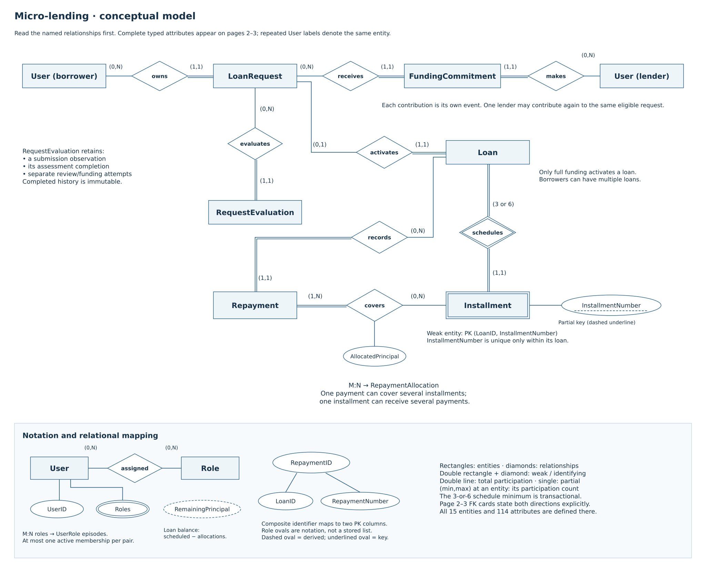

# Micro-Lending ERD — compact study and implementation guide

**Baseline:** FRD 1.2 · TDD 1.2 · October 19, 2026.  
**Application model:** 15 entities, 114 attributes, 27 foreign-key constraints.  
**Deliverable:** one editable draw.io file, three pages, three corresponding SVGs.

Start with page 1 to explain the business, then use pages 2–3 to answer key/column
questions. The full [TDD dictionary](Technical_Design_Document.md#4-complete-application-data-dictionary)
supplies column meanings and constraints. [FRD](Functional_Requirements_Document.md)
defines the behavior; the [reusable prompt](ERD_Work_Prompt.md) records the revision brief.

## Diagram navigation

Open [Micro_Lending_ERD.drawio](diagrams/Micro_Lending_ERD.drawio) in diagrams.net;
switch pages using the bottom tabs. Each table's rows are grouped with that table.

| Page | Readable export | Purpose |
| --- | --- | --- |
| 1 | [Conceptual model](diagrams/01-conceptual.svg) | The lending story; Chen relationships, participation, weak entity, and attribute mapping. |
| 2 | [Accounts, requests and funding](diagrams/02-accounts-funding.svg) | Complete typed detail for 8 tables, including frozen inputs, evaluations and retries. |
| 3 | [Loans, repayments and oversight](diagrams/03-repayments-oversight.svg) | Complete typed detail for 7 tables; derived reporting structures clearly distinguished. |



SVGs are vector exports: zoom to read the full relational dictionary. Dashed FK
reference cards on pages 2–3 point to the named table's full definition, possibly
on another page. They are not extra tables. Each card lists the referenced columns
and both directional counts, and its F## label matches the matrix below. This avoids
long overlapping connectors through other tables. The conceptual page shows the
business topology; it deliberately selects key concepts rather than repeating all columns.

The detailed pages now use two columns with content-sized spacing and larger FK cards.
They remain inspection views: use the conceptual page for a laptop walkthrough and zoom
for individual column detail. A complete 114-attribute dictionary cannot honestly be
presented as readable paragraph-sized text in one laptop overview.

## Review-gap revision

No entities, attributes or foreign keys were added. TDD 1.2 now defines the missing
implementation contracts; the original lending behavior and fixed D1 scope are unchanged.

| Reported gap | Concrete correction | Remaining evidence |
| --- | --- | --- |
| Status explanation / cancellation actors / permissive actor validation | TDD §8.1 and catalogue 1.1: StatusReason in existing AuditChange, Borrower or Administrator cancellation, explicit Bootstrap/service alternatives and transaction bindings; targeted negative cases | Execute the same allow/deny cases against SQL audit routines and API reads |
| Missing audit catalogue / stale §14 reference | TDD §8.1 + finite audit-catalogue.json, typed subjects, actor/reason sets, field allowlists/redaction | SQL CHECKs, append guards and access tests |
| Encrypted inputs vs DB eligibility | TDD §7.1: same-transaction prepare/decrypt/calculate/finish; RQ-01 internal coordinator | Wrong-AAD/key, stale preparation, scoped-output and concurrency tests |
| Isolation/retries/failed numbering/completion | TDD §§6.1–6.3: read strategy, bounded whole-action retry, fresh failed-attempt numbering, sole completion trigger | Actual deadlock, lost-response, final-payment and rollback tests |
| Six users and partial fixture rows | Seven users/dual roles; complete seed specification and SQL materializer; lifecycle and denial audit examples | Load against actual schema; expected-versus-observed AC results |
| Delivery/source drift | Canonical model section references; supplied handouts in repo; API/session contracts, editable application flow and wireframes, direct version targets | Instructor architecture approval, names/section, resolved tested dependency lock, real UI |

The two application-design views in [TDD §2.1](Technical_Design_Document.md#21-architecture-decision-and-editable-views)
are separate from the **three-page ERD**. No audit/review report document is added.

## Approved scope and assumptions

This revision replaces the 11-view package from commit
[`2ddda14`](https://github.com/anuvikdas/CS-437-Database-Systems-Implementation/tree/2ddda14cf76ae8864017a7acbd92a3345fd863b1).
The earlier artifacts remain in Git history, not as competing current diagrams.

- D1 is the single fixed demonstration policy: fictional interest-free USD, $100–$2,000,
  3 or 6 monthly installments, and a 14-day funding window. Requests retain the D1
  label. Coexisting policy versions and policy-editor capabilities are outside scope.
- Every submission/review/funding evaluation calculates all applicable obligations
  and retains the total burden, delinquency condition, time, and condition results.
  The old per-obligation component history is intentionally omitted. The historical
  total can explain the numerical decision, but not every contributing record as of then.
- Current profile inputs and immutable submitted inputs remain distinct. New approval/
  funding checks never overwrite earlier observations or completed assessments.
- Borrowers may have multiple loans/live requests. Lenders may contribute repeatedly
  to the same eligible request. A new reference is a new action; an exact retry returns
  the original authorized result without a second effect.
- One request activates only at its full principal. Partial funding creates no loan.
  A participating lender sees only the loans they funded, including their schedules
  and delinquency; borrower identity does not grant access to that borrower's other loans.

These are the two approved business reductions (fixed D1 and summarized exposure).
Other changes consolidate representation. No private input, audit trail, retry protection,
repayment allocation, or required role/transaction behavior is silently removed.

## Professor requirement checklist

P1 = [supplied project requirements](course/Course_Project_Requirements.pdf), pp.6–7 and 12.  
P2 = [supplied deliverables and demo requirements](course/Deliverables_and_Demo.pdf), p.1 and design/demo expectations.  
P3 = [supplied semester plan](course/Semester_Plan.pdf), p.1.  
P4 = [supplied ERD resources](course/ERD_Resources.pdf), conceptual-versus-relational mapping.

| Requirement | Where this model demonstrates it | Source |
| --- | --- | --- |
| Minimum 8–10 meaningful entities | 15 application entities below; build tables/reference cards/views excluded | P1 p.6 |
| 1:1 | LoanRequest 0..1 Loan; every Loan has exactly one request. User 0..1 BorrowerProfile is another valid example | P1 p.6; page 1/2/3 |
| 1:N | User → LoanRequest; Loan → Installment | P1 p.6; page 1 |
| M:N and associative mapping | User–Role through UserRole; Repayment–Installment through RepaymentAllocation | P1 p.6; pages 1–3 |
| Required/optional participation in both directions | Chen min/max and single/double lines; every FK card/matrix has both counts | P1 pp.6–7; P2 p.1 |
| Weak entity and identifying relationship | Installment double rectangle; schedules double diamond; partial key InstallmentNumber; PK includes LoanID | P1 p.6; page 1/3 |
| Key/derived/multivalued/composite attributes | UserID underlined; remaining balance dashed oval; Roles double oval mapped to UserRole; RepaymentID composite mapped to two key columns | P1 p.7; page 1 |
| All attributes, data types, PKs/FKs, UNIQUE and nullability | 114 full column rows once across pages 2–3; TDD §4 gives exact conditional checks | P1 p.6; P2 p.1; P4 |
| Lookup and associative entities | Role lookup; UserRole, FundingCommitment events and RepaymentAllocation classified below | P2 p.1 |
| 3NF | Key dependencies, distinct historical snapshots, no repeated role/component lists; TDD §5 | P1 p.12 |
| Transactions, entitlements, audit, reporting | Financial entities and TDD §§6–8; audit tables and derived-report inset on page 3 | P2; P3 p.1 |
| Editable source, SVGs, explanatory Markdown in docs/ | One three-page source, three exports and this explanation, committed together | P3 p.1 |
| Agreement with FRD/TDD/schema | FRD 1.2/TDD 1.2 updated together; dictionary/source/export checks pass. SQL implementation consistency remains unverified | P2 p.1 |

The professor does not prescribe 11 views, 23 tables, 139 attributes, or 39 FKs.
Diagram count is a presentation choice. Attribute/FK counts follow required facts and
integrity, not a target to minimize by deleting valid relationships.

## Notation and enforcement

On page 1, rectangles are entities and diamonds name relationships. A double rectangle
and double diamond identify a weak entity and its identifying relationship. Double
relationship lines mean total participation. A `(min,max)` label beside an entity counts
that entity's participation. `3 or 6` means the approved term, not any value in a range.
Key ovals are underlined, partial keys have a dashed underline, derived attributes use
dashed ovals, and multivalued attributes use double ovals. The role oval is explanatory
notation: the relational schema stores one role membership per row, not a list column.

On pages 2–3, PK marks the primary key; U# refers to the UNIQUE group beneath the table;
F## identifies a FK; G marks a virtual generated column. NULL=Yes is permitted by the
column declaration but may be required in particular states, as specified in TDD §4.
Composite FK cards list all referenced columns. A relationship can be mandatory for a
valid committed business state even when its parent-side minimum needs a transaction.

| Rule | Schema can enforce | Transaction/procedure/authorization must enforce |
| --- | --- | --- |
| Required parent, nonduplicate identity | PK, FK, NOT NULL, UNIQUE | Parent's role, current status and ownership |
| One loan per request | UNIQUE Loan.RequestID | Exact full funding, one complete schedule and atomic activation |
| Multiple loans / repeat contributions | No borrower uniqueness and no lender/request pair uniqueness | Current combined exposure, deadline and funding capacity |
| One active role / one final review | Nullable generated markers plus UNIQUE pairs | Authorized grant/revoke/review, legal role combinations and finalization |
| Retained evaluations | Required summary fields, kinds and conditional field checks | Capture current facts under locks; fill Submission completion once; never edit completed history |
| Exact retry | UNIQUE(caller,reference), unique event OperationID | Match original action/target/amount, authorize, return frozen response; exactly one event per receipt |
| Repayment allocation | Composite same-loan FKs, positive amounts | Oldest-first order, no installment overpayment, sum equals repayment, complete at zero |
| Delinquency and lender scope | Existing relationship paths support joins | Current date/remaining computation; Applied-participation EXISTS; explicit field allowlist |
| Append-only history | FKs preserve parents; field domains | Restricted grants/guard triggers, same-target note correction, atomic success audit and separate failure evidence |

## Entity and key inventory

| Entity | Purpose / classification | PK | Other UNIQUE | Source |
| --- | --- | --- | --- | --- |
| `User` | Application identity, account status, and the existing row used to serialize a borrower’s exposure changes. **Strong.** | UserID | LoginName; PublicAlias | FR-01–FR-04; BR-01, BR-03; SEC-01; TDD §4.1 |
| `Role` | The four human business roles. **Lookup/reference.** | RoleCode | None | FR-02; SEC-06, SEC-13; TDD §4.2 |
| `UserRole` | Retained grant/revocation episodes with at most one active membership per pair. **Associative/history.** | UserRoleID | (UserID,RoleCode,ActiveMarker) | FR-02; BR-01, BR-03; SEC-14; TDD §4.3 |
| `BorrowerProfile` | Current protected income and external monthly obligations. **Dependent 1:1.** | UserID | None | FR-05; BR-01, BR-05; SEC-02, SEC-12; TDD §4.4 |
| `LoanRequest` | A funding request with immutable submitted terms and private input snapshot. **Strong.** | RequestID | None; deliberately no unique BorrowerID | FR-06–FR-16, FR-24; BR-04–BR-13, BR-19; TDD §4.5 |
| `RequestEvaluation` | One retained submission, review, or funding check; summaries and final decision facts remain attributable. **Dependent/history.** | EvaluationID | (RequestID,EvaluationKind,AttemptNumber); (RequestID,FinalReviewMarker) | FR-07–FR-09, FR-12; BR-04, BR-06, BR-07; AC-04, AC-29; TDD §4.6 |
| `OperationReceipt` | Caller-scoped identity of one committed funding/repayment action and its original response. **Technical/history.** | OperationID | (CallerUserID,OperationReference) | FR-30; BR-20; AC-15, AC-16; TDD §4.7 |
| `FundingCommitment` | One initial or additional promise, not one row per lender/request pair. **Associative/event.** | CommitmentID | OperationID; EvaluationID; deliberately NOT (Lender,Request) | FR-12–FR-16; BR-09–BR-12, BR-20; TDD §4.8 |
| `Loan` | One activated obligation, with lifecycle and latest observation. **Strong with required 1:1 origin.** | LoanID | RequestID | FR-14–FR-22; BR-12–BR-18; TDD §4.9 |
| `Installment` | One immutable scheduled obligation identified within its loan. **Weak/dependent.** | (LoanID,InstallmentNumber) | (LoanID,DueDate) | FR-15, FR-18, FR-19; BR-13–BR-17; TDD §4.10 |
| `Repayment` | One posted payment against exactly one loan. **Event/dependent.** | (LoanID,RepaymentNumber) | OperationID | FR-17–FR-21, FR-30; BR-14–BR-16, BR-20; TDD §4.11 |
| `RepaymentAllocation` | Amount of one repayment assigned to one installment of the same loan. **Associative/dependent.** | (LoanID,RepaymentNumber,InstallmentNumber) | None | FR-18, FR-21; BR-02, BR-15; TDD §4.12 |
| `OversightNote` | Append-only administrative follow-up or correction. **History.** | NoteID | None | FR-23; BR-25; SEC-06; TDD §4.13 |
| `AuditEvent` | Append-only attributable event or observed failed/denied attempt. **Audit/history.** | AuditEventID | None | FR-28; Section 9.2; SEC-08, SEC-10, SEC-11; TDD §4.14 |
| `AuditChange` | Normalized changed-field context for an audit event. **Dependent/audit.** | (AuditEventID,FieldName) | None | FRD Section 9.2; SEC-11, SEC-12; TDD §4.15 |

`Role` is the lookup table. D1/status labels are release-controlled configuration and
CHECK domains. The 16-column BuildRun/BuildStep dictionary and its one FK are operational
evidence in TDD §9; they are not application entities. The three reporting views on
page 3 are derived query definitions, not additional stored tables.

## Relationship matrix

Each row is an actual FK constraint. “Parents/child” is the referenced-parent count
for one child; “Children/parent” is the child count for one parent. Cardinalities describe
valid committed state. Conditional role/lifecycle restrictions remain procedural.

| ID | Child columns → parent key | Parents/child | Children/parent | Identifying? | Meaning / qualification |
| --- | --- | --- | --- | --- | --- |
| FK01 | UserRole(UserID) → User(UserID) | 1 | 0..N | No | member.  |
| FK02 | UserRole(RoleCode) → Role(RoleCode) | 1 | 0..N | No | assigned role.  |
| FK03 | UserRole(GrantedByUserID) → User(UserID) | 0..1 | 0..N | No | granting administrator. NULL only for documented bootstrap; actor role is checked procedurally. |
| FK04 | UserRole(RevokedByUserID) → User(UserID) | 0..1 | 0..N | No | revoking administrator. Paired with RevokedAt; NULL for active episode. |
| FK05 | BorrowerProfile(UserID) → User(UserID) | 1 | 0..1 | Yes | profile owner. Required before submission, optional for other users. |
| FK06 | LoanRequest(BorrowerID) → User(UserID) | 1 | 0..N | No | borrowing owner. Many simultaneous requests and loans permitted; owner has Borrower role. |
| FK07 | RequestEvaluation(RequestID) → LoanRequest(RequestID) | 1 | 0..N | No | evaluated request.  |
| FK08 | RequestEvaluation(AdministratorID) → User(UserID) | 0..1 | 0..N | No | reviewing administrator.  |
| FK09 | OperationReceipt(CallerUserID) → User(UserID) | 1 | 0..N | No | authenticated caller. Caller/reference unique across both funding and repayment action kinds. |
| FK10 | FundingCommitment(RequestID) → LoanRequest(RequestID) | 1 | 0..N | No | funding target. Repeated lender/request pairs allowed; each event has a separate CommitmentID. |
| FK11 | FundingCommitment(OperationID) → OperationReceipt(OperationID) | 1 | 0..1 | No | funding receipt. CommitFunding action; lender is receipt.CallerUserID. Receipt has exactly one event of one type at commit. |
| FK12 | FundingCommitment(EvaluationID) → RequestEvaluation(EvaluationID) | 1 | 0..1 | No | accepted funding check.  |
| FK13 | Loan(RequestID) → LoanRequest(RequestID) | 1 | 0..1 | No | fully funded origin. Every loan has exactly one origin. The limit is per request, never per borrower. |
| FK14 | Installment(LoanID) → Loan(LoanID) | 1 | 3 or 6 | Yes | identifying loan. Approved installment count required atomically at activation; FK alone does not enforce child count. |
| FK15 | Repayment(LoanID) → Loan(LoanID) | 1 | 0..N | Yes | payment for loan.  |
| FK16 | Repayment(OperationID) → OperationReceipt(OperationID) | 1 | 0..1 | No | repayment receipt. PostRepayment action; caller must own loan. XOR with FundingCommitment at commit. |
| FK17 | RepaymentAllocation(LoanID, RepaymentNumber) → Repayment(LoanID, RepaymentNumber) | 1 | 1..N | Yes | paying event. Positive allocations must sum exactly to posted repayment at commit. |
| FK18 | RepaymentAllocation(LoanID, InstallmentNumber) → Installment(LoanID, InstallmentNumber) | 1 | 0..N | Yes | receiving installment. Shared LoanID prevents allocations across loans. Installment cap and oldest-first order need transaction checks. |
| FK19 | OversightNote(RequestID) → LoanRequest(RequestID) | 0..1 | 0..N | No | request target. Exactly one of RequestID and LoanID is non-NULL. |
| FK20 | OversightNote(LoanID) → Loan(LoanID) | 0..1 | 0..N | No | loan target. Exactly one of RequestID and LoanID is non-NULL. |
| FK21 | OversightNote(AdministratorID) → User(UserID) | 1 | 0..N | No | note author. Administrator only; append-only notes. |
| FK22 | OversightNote(CorrectsNoteID) → OversightNote(NoteID) | 0..1 | 0..N | No | corrected earlier note. Self-reference; routine validates earlier note on the same target. |
| FK23 | AuditEvent(ActorUserID) → User(UserID) | 0..1 | 0..N | No | human actor. May be NULL for a service or unauthenticated attempt. |
| FK24 | AuditEvent(ActingRoleCode) → Role(RoleCode) | 0..1 | 0..N | No | verified acting role. NULL when no human role applies; verified entitlement is procedural. |
| FK25 | AuditEvent(InitiatingUserID) → User(UserID) | 0..1 | 0..N | No | initiating human. Distinct from the actor of an automated effect. |
| FK26 | AuditEvent(OperationID) → OperationReceipt(OperationID) | 0..1 | 0..N | No | committed operation. Failed attempts may have no committed receipt; use ContextID and safe attempted reference. |
| FK27 | AuditChange(AuditEventID) → AuditEvent(AuditEventID) | 1 | 0..N | Yes | owning audit event.  |

Parent-side minimums (3/6 installments, one-or-more allocations) are transaction rules;
FKs enforce only the child's parent existence. RequestEvaluation belongs to exactly
one request; its Submission is unique by kind/attempt, and its final Review by marker.
There is no FK from PolicyCode to a nonexistent table, no FK for a derived report,
and no fictitious multi-table FK from AuditEvent.SubjectKey.

## Worked cases

The [sample records](diagrams/sample-records.json) are a **complete fictional seed
specification**. Every column has a value or explicit encryption/password directive;
the materializer emits full SQL rows and omits generated columns. The verifier checks
keys, field completeness, audit vocabulary/redaction and calculations. SQL loading is
still unverified; see [TDD §10.1](Technical_Design_Document.md#101-fixture-and-implementation-acceptance-gates).

1. **Repeated funding and activation:** borrower 1 owns requests 101 ($900) and 102
   ($600). Lender 2 contributes $300 then $200 to request 101; lender 3 supplies $400.
   Three distinct commitments sum to $900 and produce loan 501. Lender 3 funds request
   102, producing loan 502. Both loans are Active for the same borrower. Request 103
   has only $100 of $300, remains OpenFunding, and has no loan.
2. **Exact retry:** caller 2/reference `fund-201`, action CommitFunding, request 101,
   amount $300 returns its original HTTP 201/JSON receipt (commitment 201, Pending at
   acceptance), even after activation. Changing amount to $301
   conflicts. A new reference is a new contribution, subject to current eligibility/cap.
3. **Partial repayment across installments:** loan 501 schedules three $300 payments.
   Its first repayment pays $100 toward installment 1; its second pays $250, allocating
   $200 to finish installment 1 and $50 to installment 2. One payment covers multiple
   installments and one installment receives multiple payments.
4. **Delinquency and access at 2026-10-19 UTC:** loan 501 has $350 repaid, $550 outstanding,
   and $250 overdue since October 1 (18 days past due). Loan 502 has $400 repaid and
   $200 outstanding, with nothing overdue. Lender 2 sees loan 501 only, once despite
   two contributions; lender 3 sees both. Borrower 1's outstanding total is $750.
5. **Concurrent submission reasoning:** income $1,000, external obligations $100,
   existing platform burden $300. Two $1,200/3 submissions are serialized. The first
   retains other burden $300 and its $400 installment fits; the second retains $700
   and fails. Two $900/3 requests both fit ($300, then $600 other burden). Each summary
   is retained; changing a profile later does not rewrite the submitted inputs.
6. **Boundaries/history:** due today is not overdue; a deadline-equal contribution
   fails; $100/3 schedules $33.33, $33.33, $33.34. Jan 31 monthly anniversaries clamp
   February then return to March 31. One final review is allowed, while separate blocked
   attempts and revoked role episodes remain valid. A correction note references the
   same loan/request as its earlier note.

7. **Dual role:** user 7 has Borrower and Lender roles and owns eligible request 104.
   A contribution to that own request is denied with SELF_FUNDING and no receipt or
   commitment. Being a Lender does not grant access to loans 501/502.

## Interview walkthrough

| Explain this flow | Tables to follow | Question to be ready for |
| --- | --- | --- |
| Submit → assess → review | User/Profile → LoanRequest → RequestEvaluation | Why freeze inputs? Why recheck current exposure later? Why one final review but many attempts? |
| Contribute → activate | OperationReceipt → FundingCommitment → Loan/Installment | Why can the lender contribute twice? How does an exact retry differ? What if funding never reaches principal? |
| Repay → allocate | Repayment → RepaymentAllocation → Installment | Why keep payment and schedule separate? How does a partial payment cover several obligations? |
| Detect → follow up → inspect history | Loan + derived balances → OversightNote → AuditEvent/Change | When is a payment overdue? Why can a lender see only funded loans? What stays after a rollback? |

For each table, explain its fact, PK, one important FK, and one invariant. For every
rule, distinguish a database constraint from a transaction or authorization check.
The compact model still needs locks: removing evidence tables did not remove races.

## Verification and editing

Run from the repository root (Python standard library only):

```bash
python3 docs/diagrams/tools/validate_erd.py
```

This checks 15/114/27 counts, referenced key/type compatibility, complete diagram rows,
all 27 connectors, source/export text and deterministic byte agreement, fixture keys,
negative uniqueness/FK cases, lending calculations, retry/conflict examples, and links.
The same command runs [audit contract checks](diagrams/tools/audit_rules.py) and
[targeted regressions](diagrams/tools/test_audit_rules.py): a Borrower-role commitment,
wrong receipt caller/service/initiator, untrusted Bootstrap or missing status explanation
must be rejected. The complete fixture includes four retained status explanations and
both permitted cancellation actors; Admin-only explanation projection is checked.
The exports were rendered to PNG and inspected for clipping, intersecting labels,
readability and coverage. One ERD source contains three pages; a separate application
design source contains the two course-requested flow/wireframe views.

**Limits:** SQL implementation consistency remains unverified: no SQL implementation
exists in the reviewed repository. No MySQL transactions, real races, rollback, application
encryption/authorization integration, or native diagrams.net UI round-trip were executed.
The fixture materializer alone was checked for field-bound encryption and password
hashing round-trips; that is not a tested service security boundary. These
remain implementation/demo checks, explicitly planned in TDD §10 and FRD acceptance criteria.

The editable draw.io XML is the layout source; SVGs are exported directly from it.
`model.json` holds the typed dictionary and FK metadata. For a diagram-only layout edit,
save the source uncompressed and export without rebuilding:

```bash
python3 docs/diagrams/tools/export_svg.py
python3 docs/diagrams/tools/validate_erd.py
```

The custom exporter supports the plain rectangles, ellipses, diamonds, text and routed
lines used here. It fails on unsupported shapes; for new shape types extend it or use
native exports and update the validation workflow honestly. Re-run PNG/native visual
inspection after layout changes. Do not label arbitrary manually replaced SVGs verified.

For a schema change, update FRD/TDD/model first. `build_erd.py` regenerates the standard
layout and **overwrites manual layout edits**; export and validate afterward. The prior
11-file diagram set is superseded, not a second source of truth. Commit source, exports,
dictionary, samples, and explanations together. No separate audit document is produced.
